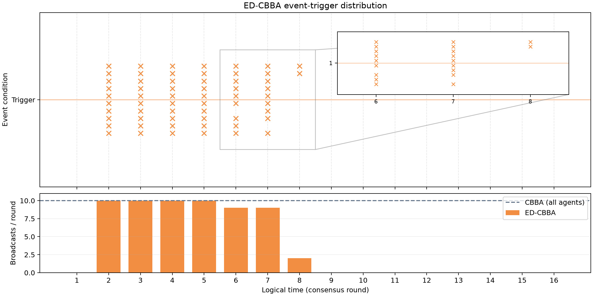
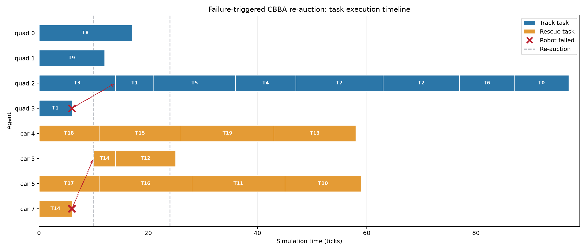
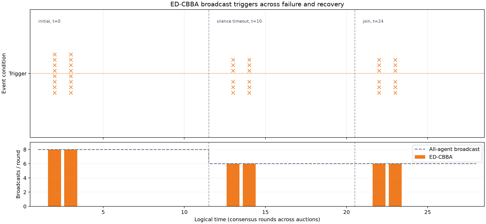

# CBBA-Python: event-driven communication and failure re-auction

This repository implements the Consensus-Based Bundle Algorithm (CBBA) for
multi-robot task allocation. It also includes an event-driven communication
mode based on [Sao et al., *Event Driven CBBA with Reduced Communication*
(2025)](https://arxiv.org/abs/2509.06481), plus a discrete-time experiment in
which robot failures and communication loss trigger re-auction.

The original capabilities remain unchanged: `quad` agents bid on `track`
tasks, and `car` agents bid on `rescue` tasks. Each agent has a position and
travel speed; each task has a location, value, and optional time window.

## Install

The experiments below were run with Python 3.14.9 on Linux. Create a virtual
environment from the repository root:

```bash
python3 -m venv .venv
.venv/bin/python -m pip install -r requirements.txt
```

`requirements.txt` pins NumPy, Matplotlib, and PyQt6 to the versions used for
the reported runs. PyQt6 provides interactive plot windows; the experiment
scripts save PNG files and also run without a display.

## Run the examples

| Command | What it runs |
| --- | --- |
| `.venv/bin/python test/run_cbba_example_01.py` | Original CBBA with task time windows |
| `.venv/bin/python test/run_cbba_example_02.py` | Original CBBA with zero task duration |
| `.venv/bin/python test/run_cbba_example_03.py` | Original CBBA without time windows |
| `.venv/bin/python test/run_ed_cbba_example.py` | Seeded CBBA versus ED-CBBA comparison |
| `.venv/bin/python test/run_failure_experiment.py` | Failure, silence, recovery, and re-auction simulation |
| `./run_gui.sh` | Open the first original example in Qt plot windows |

Run these commands from the repository root. For the original examples on a
headless machine, prefix the command with `MPLBACKEND=Agg`.

The main API is `CBBA.solve(agents, tasks, world, max_depth,
time_window_flag, ...)`. It returns `path_list` (task IDs in execution order
for each agent) and `times_list` (planned task start times). The solver uses a
fully connected communication graph by default; a symmetric adjacency matrix
can be supplied with `communication_graph=`.

## ED-CBBA communication trigger

Set `event_triggered=True` in `CBBA.solve()` to enable the event rule from
Equation (7) of Sao et al. At the start of each synchronous consensus round,
agent `i` broadcasts if its winner list or winning-bid list differs from the
last version it broadcast. An agent that does not broadcast still receives
its neighbours' messages. The original every-agent broadcast mode remains
the default.

`solver.broadcast_agents_history` records the sending agent IDs in each
round. `solver.broadcast_history` records the number of senders per round,
and `solver.total_broadcasts` is their sum. A broadcast counts once per
sending agent, regardless of the number of neighbours.

### Reproducible comparison

The seeded example uses 10 homogeneous agents, 20 tasks, a maximum bundle
size of 3, a 100 m × 100 m area, and a connected graph with 10 m radio range.
It runs both modes on the same generated positions and tasks (seed 7).

| Metric | Standard CBBA | ED-CBBA |
| --- | ---: | ---: |
| Consensus rounds | 16 | 16 |
| Total broadcasts | 160 | 60 |
| Task assignment | Same | Same |

ED-CBBA sent **62.5% fewer broadcasts** in this one seeded run. Its per-round
broadcast counts were `[0, 10, 10, 10, 10, 9, 9, 2, 0, 0, 0, 0, 0, 0, 0, 0]`.
Each orange cross below is one actual ED-CBBA broadcast; the lower panel
shows the trigger frequency per consensus round.



The horizontal axis is **logical consensus time**, not wall-clock seconds:
this solver performs offline auctions and has no physical communication clock.

## Failure-triggered re-auction experiment

`test/run_failure_experiment.py` runs a separate seeded simulation with 8
agents (4 `quad`, 4 `car`) and 20 tasks (10 `track`, 10 `rescue`). Every task's
unfinished work is retained if its agent fails, and all unfinished tasks are
auctioned again after failure is suspected. An online incumbent receives a
10% bid bonus to discourage needless handoffs. Completed tasks stay complete.

The event monitor uses the following rules:

| Event | Detection | Action |
| --- | --- | --- |
| E1: neighbour disappears | Its communication link vanishes | Mark as potentially unavailable |
| E2: prolonged silence | No direct or relayed heartbeat for 6 ticks | Exclude the agent and re-auction |
| E1: neighbour joins | A link returns | Re-auction the unfinished tasks |

Heartbeats are sent every 2 simulation ticks. At tick 6, each *working*
agent is sampled once for permanent failure with probability 10%. The
sampling preserves at least one live agent of each type. At tick 20, each
connected agent is sampled once for a 4-tick communication outage with
probability 5%. These are episode events, not probabilities applied on every
tick.

### Seeded result

With seed 7, `quad 3` and `car 7` fail at tick 6. Silence timeout at tick 10
causes re-auction. `quad 1` loses communication at tick 20 and rejoins at tick
24, causing another re-auction. All **20 of 20 tasks complete**; the two
interrupted tasks resume on surviving capable agents.

| Metric | Result |
| --- | ---: |
| Permanent failures | 2 |
| Re-auctions after the initial auction | 2 |
| ED-CBBA auction broadcasts (initial / timeout / join) | 16 / 12 / 12 |
| Heartbeats sent | 298 |
| Completed tasks | 20 / 20 |

The first figure shows task execution by agent. A red cross marks failure at
the end of a task segment; a dotted arrow points to the agent that resumes
the unfinished task. Dashed vertical lines mark re-auctions.



The next figure records actual ED-CBBA broadcast triggers across all three
auction episodes. Its horizontal axis concatenates their consensus rounds;
episode labels give the corresponding simulation tick.



An additional [E1/E2 detection timeline](doc/failure_trigger_timeline.png)
shows when neighbours disappear, time out, and rejoin. Its crosses are
**failure-detection events**, whereas the orange crosses above are
**ED-CBBA broadcast triggers**.

## Verification and scope

```bash
MPLBACKEND=Agg .venv/bin/python -m unittest test.test_ed_cbba test.test_failure_simulation -v
```

The tests compare standard and event-driven assignments on connected graphs,
check broadcast accounting, verify task progress after failures, and check
that the failure sampler leaves at least one agent of each type.

The communication and failure experiments are synchronous simulations. The
event monitor uses graph reachability for direct or relayed heartbeat news;
it does not simulate packet delays or a fully distributed failure detector.
The paper does not specify every task count and score parameter needed to
reproduce its published Monte Carlo figures exactly. Its convergence and
quality guarantees require a diminishing-marginal-gain score and a connected
static graph; the existing repository score function is retained here.

## References

- Choi, Brunet, and How, ["Consensus-Based Decentralized Auctions for Robust
  Task Allocation"](https://ieeexplore.ieee.org/document/5072249), *IEEE
  Transactions on Robotics*, 2009.
- Sao, Ho, Bhore, and Sujit, ["Event Driven CBBA with Reduced
  Communication"](https://arxiv.org/abs/2509.06481), arXiv:2509.06481v1,
  2025.
