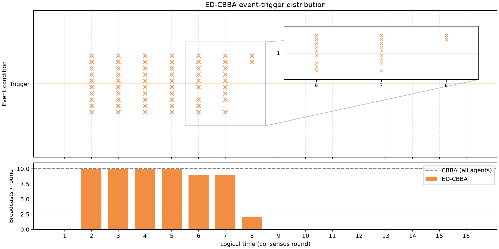
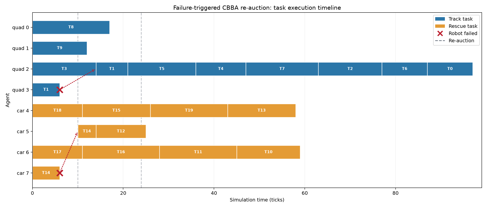
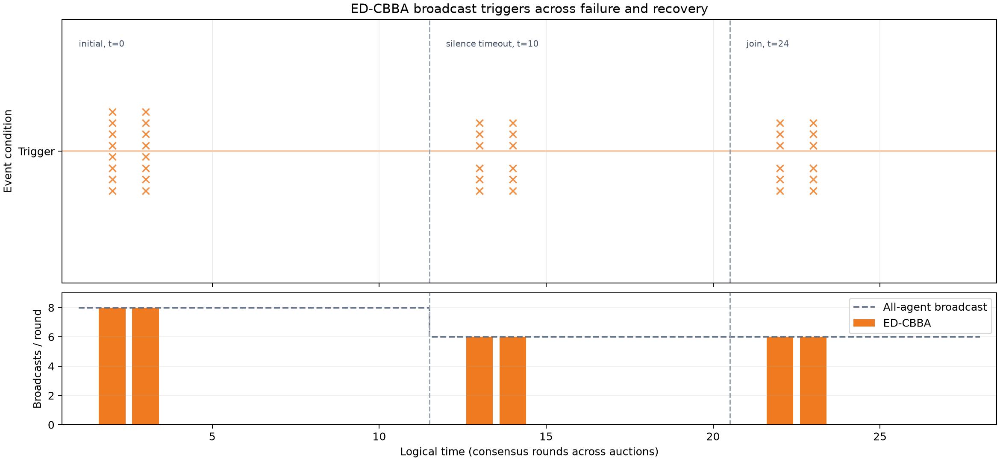

# CBBA-Python: event-driven communication and failure re-auction

This repository implements the Consensus-Based Bundle Algorithm (CBBA) for
multi-robot task allocation. It also includes an event-driven communication
mode based on [Sao et al., *Event Driven CBBA with Reduced Communication*
(2025)](https://arxiv.org/abs/2509.06481), plus a discrete-time experiment in
which robot failures and communication loss trigger re-auction.

The original capabilities remain unchanged: `quad` agents bid on `track`
tasks, and `car` agents bid on `rescue` tasks. Each agent has a position and
travel speed; each task has a location, value, and optional time window.

## Install

The experiments below were run with Python 3.14.9 on Linux. Create a virtual
environment from the repository root:

```bash
python3 -m venv .venv
.venv/bin/python -m pip install -r requirements.txt
```

`requirements.txt` pins NumPy, Matplotlib, and PyQt6 to the versions used for
the reported runs. PyQt6 provides interactive plot windows; the experiment
scripts save PNG files and also run without a display.

## Run the examples

| Command | What it runs |
| --- | --- |
| `.venv/bin/python test/run_cbba_example_01.py` | Original CBBA with task time windows |
| `.venv/bin/python test/run_cbba_example_02.py` | Original CBBA with zero task duration |
| `.venv/bin/python test/run_cbba_example_03.py` | Original CBBA without time windows |
| `.venv/bin/python test/run_ed_cbba_example.py` | Seeded CBBA versus ED-CBBA comparison |
| `.venv/bin/python test/run_failure_experiment.py` | Failure, silence, recovery, and re-auction simulation |
| `.venv/bin/python test/run_multitype_scenario.py` | Four robot types and six task types; writes a detailed schedule |
| `.venv/bin/python test/run_spatial_reauction_experiment.py` | Compare 20/40/60 m local re-auction with global ED-CBBA and traditional CBBA |
| `.venv/bin/python test/run_packet_loss_experiment.py` | Compare CBBA, ED-CBBA, and periodic-refresh ED-CBBA under packet loss |

| `.venv/bin/python test/run_exclusive_capabilities_experiment.py` | Experiment 2: post-failure re-auction with exclusive air/ground capabilities at 6, 12 and 24 robots |
| `.venv/bin/python test/run_homogeneous_experiment.py` | Homogeneous pre-execution failure comparison (27-row smoke test by default) |

| `./run_gui.sh` | Open the first original example in Qt plot windows |

Run these commands from the repository root. For the original examples on a
headless machine, prefix the command with `MPLBACKEND=Agg`.

The main API is `CBBA.solve(agents, tasks, world, max_depth,
time_window_flag, ...)`. It returns `path_list` (task IDs in execution order
for each agent) and `times_list` (planned task start times). The solver uses a
fully connected communication graph by default; a symmetric adjacency matrix
can be supplied with `communication_graph=`.

## Multi-type scheduling scenario

The optional [multi-type scenario](config_multitype_scenario.json) has 12 robots
(three each of `survey_quad`, `cargo_quad`, `rescue_car`, and `supply_truck`)
and 24 tasks across six types. The `COMPATIBILITY` map in its configuration
specifies which types may bid. Two aerial types compete for `relay` tasks,
and two ground types compete for `ground_inspect` tasks. Air and ground
robots cannot bid across those domains. All configured robot types use the
same existing travel-time, time-window, and discounted-value score formula.

The deterministic run allocates all 24 tasks in 17 ED-CBBA rounds with 60
broadcasts. The generated [schedule](doc/multitype_schedule.md) lists every
robot's starting position, every task's value and start window, and the
winning robot's execution order, planned start/end time, and bid. This is a
planned schedule from a static auction; it does not simulate task execution
or failures. The original two-type examples retain their original capability
rules when `COMPATIBILITY` is omitted.

### Spatial local/global re-auction experiment

The [spatial experiment](test/run_spatial_reauction_experiment.py) repeats 30
paired trials on the 100 m × 100 m multi-type mission. In each trial one
assigned robot fails before task execution. At radius 20, 40, or 60 m,
capable surviving robots may bid for its tasks only if their starting
position is within that distance of the task. A local auction includes the
participating robots' existing tasks and keeps the four-task capacity. It
falls back to a global auction if more than two tasks are affected, no
capable robot is nearby, or the local schedule cannot assign all scoped
tasks. A global ED-CBBA auction and a traditional all-broadcast CBBA auction
use the same failures and serve as paired controls.

The run writes a [summary](doc/spatial_reauction_summary.md), a
[figure](doc/spatial_reauction_radius.png), and per-trial
[CSV data](doc/spatial_reauction_trials.csv). An
[English experiment report](doc/spatial_reauction_report.md) documents the
method, results, and limitations. The radius is a task-bidding eligibility
rule, not a radio range. Robots participating in one auction
are assumed to communicate directly. The experiment measures static
replanning after failure; it does not model travel during execution or
failure-detection delay. Broadcast counts exclude the common initial
auction. The original two-type failure simulation remains a separate
execution-timeline example.


## Experiment 2: exclusive capabilities

The [Experiment 2 script](test/run_exclusive_capabilities_experiment.py)
compares standard CBBA, ED-CBBA and distance-scoped ED-CBBA (40 m local
attempt, then a global fallback) after one robot fails. The teams have 6, 12
and 24 robots, half air and half ground, and each task can be done by only one
of the two types. The script runs 30 paired trials per team size, with and
without an incumbency bonus. It writes a [report](doc/exclusive_capabilities/report.md)
that explains the method, the decisions behind it (including a capacity of 5
tasks per robot instead of 4) and the results. It also writes generated
[tables](doc/exclusive_capabilities/summary.md), figures and
[per-trial data](doc/exclusive_capabilities/trials.csv).

`CBBA.solve()` now also records `settled_round`, the consensus round in which
the last change to the allocation was shared, and `broadcasts_until_settled`.
These exclude the idle rounds that the stopping rule adds after the allocation
has stopped changing.

## Homogeneous failure re-auction experiment

The [homogeneous experiment](test/run_homogeneous_experiment.py) compares
Standard CBBA, global ED-CBBA and 40 m distance-scoped ED-CBBA using 30 paired
seeds at each of 6/18, 12/36 and 24/72 robots/tasks. Each mission shares one
initial assignment and one pre-execution robot failure across methods.
The [configuration](config_homogeneous_scenario.json) specifies one fully
compatible type, a 100 m × 100 m map, capacity 4, speed 5 m/s, task value 100,
duration 8 s and start window [0,240] s. Discount 0.02 and a 10% incumbent bid
bonus are explicit additional assumptions; reported scores exclude the bonus.

The [English report](doc/homogeneous/final_report.md),
[270-row trial CSV](doc/homogeneous/trials.csv),
[statistics](doc/homogeneous/summary_statistics.csv) and
[seven-metric figure](doc/homogeneous/figures/all_seven_metrics.png) document the
formal run. Global ED reduced mean broadcasts by 56.73%, 71.98% and 83.65%
relative to Standard. Distance scope's additional communication benefit was
scale-dependent, including a small mean increase at six robots. Every method
allocated all tasks. Failed local attempts and global fallback costs are retained.

Audit or regenerate the saved results without rerunning auctions:

```powershell
.\.venv\Scripts\python.exe test/audit_homogeneous_results.py --output-dir doc/homogeneous
.\.venv\Scripts\python.exe test/analyze_homogeneous_results.py --output-dir doc/homogeneous
```

The default experiment command runs only smoke seeds 0,1,2. A full reproduction
requires `--full --output-dir outputs/homogeneous_reproduction` and a new empty
directory. See the [reproduction and audit guide](doc/homogeneous/README.md)
for evidence contents, paired statistics, source hashes and limitations.
The core solver and other experiments are unchanged.


## ED-CBBA communication trigger

Set `event_triggered=True` in `CBBA.solve()` to enable the event rule from
Equation (7) of Sao et al. At the start of each synchronous consensus round,
agent `i` broadcasts if its winner list or winning-bid list differs from the
last version it broadcast. An agent that does not broadcast still receives
its neighbours' messages. The original every-agent broadcast mode remains
the default.

`solver.broadcast_agents_history` records the sending agent IDs in each
round. `solver.broadcast_history` records the number of senders per round,
and `solver.total_broadcasts` is their sum. A broadcast counts once per
sending agent, regardless of the number of neighbours.

### Reproducible comparison

The seeded example uses 10 homogeneous agents, 20 tasks, a maximum bundle
size of 3, a 100 m × 100 m area, and a connected graph with 10 m radio range.
It runs both modes on the same generated positions and tasks (seed 7).

| Metric | Standard CBBA | ED-CBBA |
| --- | ---: | ---: |
| Consensus rounds | 16 | 16 |
| Total broadcasts | 160 | 60 |
| Task assignment | Same | Same |

ED-CBBA sent **62.5% fewer broadcasts** in this one seeded run. Its per-round
broadcast counts were `[0, 10, 10, 10, 10, 9, 9, 2, 0, 0, 0, 0, 0, 0, 0, 0]`.
Each orange cross below is one actual ED-CBBA broadcast; the lower panel
shows the trigger frequency per consensus round.



The horizontal axis is **logical consensus time**, not wall-clock seconds:
this solver performs offline auctions and has no physical communication clock.

## Packet-loss robustness experiment

The [packet-loss experiment](test/run_packet_loss_experiment.py) uses the
same connected sparse-graph scenario generator as the seeded ED-CBBA example.
It compares standard CBBA, ED-CBBA, and ED-CBBA with a full-state refresh every
five rounds at independent per-link packet loss rates of 0%, 5%, 10%, 20%, and
30%. Thirty paired missions share robot/task positions and potential packet
erasures across methods. Each mission has 10 robots, 20 tasks, and bundle
capacity 3. A packet can reach some neighbours and be lost at others.

Run from the repository root on Windows:

```powershell
.\.venv\Scripts\python.exe test/run_packet_loss_experiment.py
```

The script writes a [report](doc/packet_loss_summary.md),
[trial CSV](doc/packet_loss_trials.csv), and
[comparison figure](doc/packet_loss_comparison.png). Options include
`--trials`, `--rounds`, `--refresh-interval`, `--loss-rates`, and `--output-dir`.
The default run executes 450 auctions, each with exactly 100 consensus rounds.
The common round budget replaces the solver's quiet stopping rule for this
experiment; silence under packet loss is not evidence of convergence.

Success requires all tasks to be assigned once, consistent winner/bid beliefs
across agents, and agreement between those beliefs and the returned paths.
The report includes success intervals, duplicate ownership, coverage, and
communication costs over the entire budget, including traffic after an
assignment stabilises. This tests static allocation under synchronous packet
erasures; it does not simulate task execution, delay, reordering, or robot
failures. Periodic refresh is a candidate robustness measure, not a guarantee
of convergence under arbitrary loss.

The new `CBBA.solve()` options are `packet_loss_probability`,
`communication_seed`, `refresh_interval`, and `round_budget`. Their defaults
retain loss-free delivery, no forced refresh, and the existing stopping rule.
`total_packet_attempts`, `total_packets_delivered`, and `total_packets_dropped`
count directed neighbour deliveries; `total_broadcasts` still counts senders.

## Failure-triggered re-auction experiment

`test/run_failure_experiment.py` runs a separate seeded simulation with 8
agents (4 `quad`, 4 `car`) and 20 tasks (10 `track`, 10 `rescue`). Every task's
unfinished work is retained if its agent fails, and all unfinished tasks are
auctioned again after failure is suspected. An online incumbent receives a
10% bid bonus to discourage needless handoffs. Completed tasks stay complete.

The event monitor uses the following rules:

| Event | Detection | Action |
| --- | --- | --- |
| E1: neighbour disappears | Its communication link vanishes | Mark as potentially unavailable |
| E2: prolonged silence | No direct or relayed heartbeat for 6 ticks | Exclude the agent and re-auction |
| E1: neighbour joins | A link returns | Re-auction the unfinished tasks |

Heartbeats are sent every 2 simulation ticks. At tick 6, each *working*
agent is sampled once for permanent failure with probability 10%. The
sampling preserves at least one live agent of each type. At tick 20, each
connected agent is sampled once for a 4-tick communication outage with
probability 5%. These are episode events, not probabilities applied on every
tick.

### Seeded result

With seed 7, `quad 3` and `car 7` fail at tick 6. Silence timeout at tick 10
causes re-auction. `quad 1` loses communication at tick 20 and rejoins at tick
24, causing another re-auction. All **20 of 20 tasks complete**; the two
interrupted tasks resume on surviving capable agents.

| Metric | Result |
| --- | ---: |
| Permanent failures | 2 |
| Re-auctions after the initial auction | 2 |
| ED-CBBA auction broadcasts (initial / timeout / join) | 16 / 12 / 12 |
| Heartbeats sent | 298 |
| Completed tasks | 20 / 20 |

The first figure shows task execution by agent. A red cross marks failure at
the end of a task segment; a dotted arrow points to the agent that resumes
the unfinished task. Dashed vertical lines mark re-auctions.



The next figure records actual ED-CBBA broadcast triggers across all three
auction episodes. Its horizontal axis concatenates their consensus rounds;
episode labels give the corresponding simulation tick.



An additional [E1/E2 detection timeline](doc/failure_trigger_timeline.png)
shows when neighbours disappear, time out, and rejoin. Its crosses are
**failure-detection events**, whereas the orange crosses above are
**ED-CBBA broadcast triggers**.

## Verification and scope

```bash
MPLCONFIGDIR=/tmp/cbba-mpl .venv/bin/python -m unittest discover -s test -p 'test_*.py' -v
```

The tests compare standard and event-driven assignments on connected graphs,
check broadcast accounting, verify task progress after failures, check spatial
eligibility and task capacity, and check that the failure sampler leaves at
least one agent of each type.

The communication and failure experiments are synchronous simulations. The
event monitor uses graph reachability for direct or relayed heartbeat news;
it does not simulate packet delays or a fully distributed failure detector.
The paper does not specify every task count and score parameter needed to
reproduce its published Monte Carlo figures exactly. Its convergence and
quality guarantees require a diminishing-marginal-gain score and a connected
static graph; the existing repository score function is retained here.

## References

- Choi, Brunet, and How, ["Consensus-Based Decentralized Auctions for Robust
  Task Allocation"](https://ieeexplore.ieee.org/document/5072249), *IEEE
  Transactions on Robotics*, 2009.
- Sao, Ho, Bhore, and Sujit, ["Event Driven CBBA with Reduced
  Communication"](https://arxiv.org/abs/2509.06481), arXiv:2509.06481v1,
  2025.
