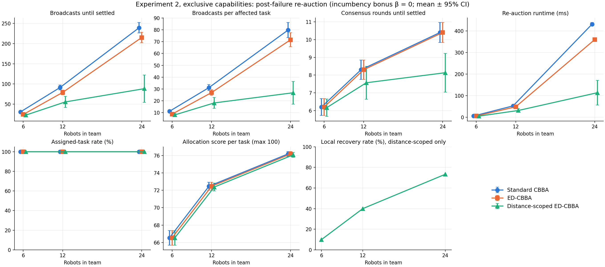

# Experiment 2: re-auction after a failure when capabilities are exclusive

This report describes Experiment 2 from the team's experiment requirements. It covers the question, the method, the decisions made where the requirements were silent or had to be changed, the results, and the limits of what the results show. The generated tables are in [summary.md](summary.md), and every trial is in [trials.csv](trials.csv).

## Definitions

- **Robot**: an air robot or a ground robot. Both move at 5 m/s.
- **Task**: a point on the map that one robot must visit and work at for 8 s. An **air-only task** can be done only by an air robot, and a **ground-only task** only by a ground robot. The robot type that may do a task is its **capability** requirement.
- **Allocation**: the agreed assignment of each task to at most one robot, with a planned start time for each task.
- **Owner**: the robot that the allocation gives a task to.
- **Capacity**: the largest number of tasks one robot may own. In this experiment the capacity is 5.
- **Failure**: one robot stops permanently before any task has started. The tasks it owned are its **affected tasks**.
- **Re-auction**: the auction that the surviving robots run after a failure to give the affected tasks new owners. Only the re-auction is measured. The auction that produced the allocation before the failure is not counted.
- **Consensus round**: one step of the auction in which each robot may send its current view of the winners and winning bids, receives the views of the others, and updates its own bids.
- **Broadcast**: one robot sending its view once in one consensus round. A broadcast counts once, however many robots receive it.
- **Settled round**: the consensus round in which the last change to any robot's winners or winning bids was shared with the other robots. After this round the allocation no longer changes.
- **Incumbency bonus β**: an optional change to the solver. During the re-auction, a robot's bid on a task it already owned is multiplied by 1 + β. This makes robots more likely to keep their existing tasks.

## Question

The experiment compares three ways of running the re-auction as the team grows from 6 to 12 to 24 robots:

1. **Standard CBBA.** Every surviving robot takes part, every task is re-auctioned, and every robot broadcasts in every consensus round.
2. **ED-CBBA (event-driven CBBA).** The participants are the same as in standard CBBA, but a robot broadcasts only when its view has changed since its last broadcast.
3. **Distance-scoped ED-CBBA.** First, an ED-CBBA auction is held only among surviving robots that can do an affected task and are within 40 m of it (a **local attempt**). If that does not work, a full ED-CBBA re-auction is held (a **global fallback**).

The question is how much communication each method needs to reallocate the affected tasks, and whether the scoped method's saving holds without a loss in allocation quality.

Experiment 2 has a specific role among the three experiments. Each task can be done by only half of the team, so fewer robots near an affected task are able to take it over. The experiment therefore tests whether the local attempt still finds a capable robot nearby often enough to be useful.

## Method

### Missions

Each trial generates one mission from a seed. For a team of N robots, the mission contains:

- N/2 air robots and N/2 ground robots;
- 1.5 N tasks, of which half are air-only and half are ground-only (9 + 9, 18 + 18 or 36 + 36);
- robot and task positions drawn uniformly at random on a 100 m × 100 m map.

Every task has value 100, takes 8 s, and may start at any time from 0 s to 240 s. A task's score falls the later it starts, as explained under Decision 4.

### Procedure for one trial

1. Generate the mission and compute one allocation of all tasks with ED-CBBA. All three methods start from this same allocation.
2. Choose one robot that owns at least one task, using a seeded random draw, and fail it.
3. Run the re-auction once with each method, starting from the same allocation and the same failure.
4. Check that every final schedule is feasible: no robot exceeds its capacity, no robot owns a task outside its capability, and every robot can travel to each task before its planned start. Then record the measures.

The local attempt of distance-scoped ED-CBBA works as follows:

- For each affected task, the candidates are the surviving robots that have the right capability and are within 40 m of the task. If any affected task has no candidate, the method goes straight to the global fallback.
- Otherwise, the local auction includes all candidates and all the tasks they already own, so that their existing work and remaining capacity are taken into account. Robots further than 40 m from an affected task may not bid on it.
- If the local auction assigns every task it includes, its result replaces those robots' schedules, and the rest of the allocation is left unchanged. Otherwise the global fallback runs. In that case the broadcasts, rounds and runtime of both auctions are added together.

There were 30 seeds for each team size. The whole set was run twice, once with β = 0 and once with β = 0.1.

### Measures

| Measure | Definition |
| --- | --- |
| Broadcasts until settled | Broadcasts sent up to and including the settled round, summed over every auction the method ran |
| Broadcasts per affected task | Broadcasts until settled divided by the number of affected tasks |
| Consensus rounds until settled | The settled round, summed over every auction the method ran |
| Runtime | Wall-clock time of the method's auctions in this single-process simulation |
| Assigned-task rate | Tasks with an owner after the re-auction, as a percentage of all tasks |
| Allocation score per task | The sum of each task's score, 100 × e^(−0.02 × start time), divided by the number of tasks. The bonus is not included. |
| Local recovery rate | Percentage of trials in which the local attempt reallocated the affected tasks without a global fallback |

## Decisions

The requirements left some settings unstated and set one value that would have obscured the results. These decisions were made before the results were seen.

### Decision 1: the main results use no incumbency bonus (β = 0); results with β = 0.1 are also provided

The incumbency bonus changes how the solver bids. It is not part of standard CBBA or ED-CBBA, and it does not describe anything about the environment. It comes from the team's research proposal, whose question was how the bonus affects re-auctioning (see `coursework/docs/adr/0002-full-reauction-with-incumbency-bonus.md`). The earlier spatial re-auction experiment used β = 0.1. With β = 0 the three methods are exactly the ones the requirements name, so those are the main results. The β = 0.1 results are provided in case the team wants to compare them.

### Decision 2: capacity is 5 tasks per robot, not 4

With the specified capacity of 4, a 6-robot team cannot reassign all affected tasks. Each type has 3 robots and 9 tasks. After one robot fails, the 2 survivors of that type have 2 × 4 = 8 slots for 9 tasks, and robots of the other type cannot take those tasks. Every method would then leave one task unassigned in every 6-robot trial. The local attempt could also never succeed, because it must place every affected task. The 6-robot results would then show a lack of slots, not the cost of communication. With capacity 5, the survivors have 10 slots for 9 tasks. At 12 and 24 robots, the survivors already had spare slots, so the change makes little difference there. The decision is recorded in `coursework/docs/adr/0004-experiment-2-capacity-five.md`.

The requirements allow a local attempt for up to four affected tasks. With capacity 4, this limit never stopped a local attempt. Its limit was raised to 5 to keep that intent. In practice, no trial was stopped by the limit.

### Decision 3: every task may start at any time from 0 s to 240 s

The requirements say "a 0–240 s start window". This was read as one window shared by all tasks. A robot with five tasks finishes its last start by about 5 × (28 + 8) = 180 s, where 28 s is the time to cross the map diagonally. So the window never stops a robot from taking a task. This is intentional, because timing pressure is not part of the question, and tighter windows would add a second reason for local attempts to fail.

### Decision 4: a task's score falls by a factor of e^(−0.02) for every second it starts after time 0

The requirements state only that tasks have value 100. Without a decay, every robot able to reach a task would bid exactly 100 on it. The solver would then break the ties by robot number and produce arbitrary schedules. The decay rate 0.02 is the one used in the earlier experiments.

### Decision 5: broadcasts and rounds are counted up to the settled round

To decide when to stop, the solver runs until no robot has changed its plan for N consecutive rounds. Those idle rounds do not change the allocation. In standard CBBA every robot still broadcasts in them, but in ED-CBBA nobody does. Counting them would make ED-CBBA's saving grow with team size purely because of the stopping rule. The main measures therefore stop at the settled round. The raw counts, which include the idle rounds, are also in the tables and the CSV file. As a check, the tests confirm that stopping the solver at the settled round gives the same allocation as letting it run to the end.

## Results (β = 0)

Values are means over 30 paired trials, with 95% confidence half-widths.

| Robots | Method | Broadcasts until settled | Rounds until settled | Runtime (ms) | Score per task |
| --- | --- | ---: | ---: | ---: | ---: |
| 6 | Standard CBBA | 31.0 ± 2.4 | 6.2 ± 0.5 | 6 | 66.5 |
| 6 | ED-CBBA | 24.5 ± 2.2 | 6.2 ± 0.5 | 6 | 66.5 |
| 6 | Distance-scoped ED-CBBA | 23.0 ± 2.9 | 6.2 ± 0.5 | 6 | 66.5 |
| 12 | Standard CBBA | 91.3 ± 6.0 | 8.3 ± 0.5 | 53 | 72.5 |
| 12 | ED-CBBA | 79.2 ± 5.8 | 8.3 ± 0.5 | 49 | 72.5 |
| 12 | Distance-scoped ED-CBBA | 55.6 ± 13.6 | 7.6 ± 0.9 | 32 | 72.4 |
| 24 | Standard CBBA | 239.2 ± 12.9 | 10.4 ± 0.6 | 431 | 76.2 |
| 24 | ED-CBBA | 215.1 ± 12.8 | 10.4 ± 0.6 | 360 | 76.2 |
| 24 | Distance-scoped ED-CBBA | 88.4 ± 34.1 | 8.1 ± 1.1 | 114 | 76.1 |

| Robots | Local recovery | Fallback: no capable robot within 40 m | Fallback: local schedule infeasible |
| --- | ---: | ---: | ---: |
| 6 | 3 of 30 (10%) | 27 | 0 |
| 12 | 12 of 30 (40%) | 16 | 2 |
| 24 | 22 of 30 (73%) | 7 | 1 |

Every method assigned every task in every trial.



### What the results show

**The scoped method's saving grows with team size because local recovery becomes more likely.** With 6 robots there are only 3 robots of each type on the map. In 27 of 30 trials, at least one affected task had no robot of the right type within 40 m, so the method fell back to a global auction. Its broadcasts were then close to ED-CBBA's: 23.0 against 24.5. With 24 robots there are 12 robots of each type, and the local attempt succeeded in 73% of trials. The scoped method then sent 59% fewer broadcasts than ED-CBBA (88.4 against 215.1) and 63% fewer than standard CBBA. The wide confidence interval at 24 robots comes from mixing two kinds of trial: those that succeed locally (a few tens of broadcasts) and those that fall back to a global auction (over 200).

**Exclusive capabilities make local recovery rarer at small team sizes.** The 40 m radius rarely contains a robot of the right type when only three of that type exist. This is the effect Experiment 2 was designed to expose. A comparison with Experiment 1, where every robot can do every task, would show how much of the shortfall at 6 and 12 robots is due to the capability split.

**Allocation quality is essentially unchanged.** The scoped method's score per task is at most 0.1 below the global methods' (76.1 against 76.2 out of 100 at 24 robots), which is well inside the confidence intervals. Standard CBBA and ED-CBBA produce identical allocations, because they exchange the same information and differ only in who sends it.

**ED-CBBA's saving over standard CBBA is modest once idle rounds are excluded.** Up to the settled round, ED-CBBA sends 10–21% fewer broadcasts than standard CBBA. Counting the idle rounds as well, the saving would appear to be 52–71% (see the raw columns in [summary.md](summary.md)). Most of that apparent saving comes from standard CBBA continuing to broadcast while nothing changes. Whether that counts as a real cost depends on how a deployed system decides to stop, so the report should state which count is used.

**Rounds and runtime follow broadcasts.** Standard CBBA and ED-CBBA need the same number of rounds. The scoped method needs fewer rounds when it succeeds locally, because the local auction involves fewer robots and tasks. Its runtime at 24 robots is about a third of ED-CBBA's.

### With the incumbency bonus (β = 0.1)

The bonus reduces every method's broadcasts by roughly 25–50% (for example, ED-CBBA at 24 robots sends 106.6 instead of 215.1), because surviving robots stop exchanging tasks they already owned. The ranking of the methods stays the same: at 24 robots the scoped method sends 53% fewer broadcasts than ED-CBBA. The score per task falls by at most 0.4. The local recovery rates are almost identical to those with β = 0, because the bonus does not change which robots are within 40 m. The full tables and figure are in [summary.md](summary.md).

## Limitations

- **The auction is simulated in a single process.** Every robot can communicate with every other robot taking part in the same auction. The 40 m radius limits which robots may bid. It does not limit radio range.
- **The re-auction starts immediately.** No robot has moved or started a task, and there is no delay in detecting the failure.
- **Runtime measures this Python simulation running all robots in one process.** It reflects how the amount of computation grows with team size, not the time a real team of robots would take.
- **The local attempt requires every affected task to have a candidate.** A scoped method that reallocated some tasks locally and only the rest globally might recover more often. That variant was not tested.

## Reproducing the results

From the `CBBA-Python` directory:

```bash
python3 test/run_exclusive_capabilities_experiment.py
```

The default run uses 30 trials per team size and β = 0 and 0.1, and takes about 90 seconds. Options are `--trials`, `--bonuses` and `--output-dir`. All results except runtime are deterministic for a given seed. The checks are in `test/test_exclusive_capabilities.py` and `test/test_settled_round.py`.
