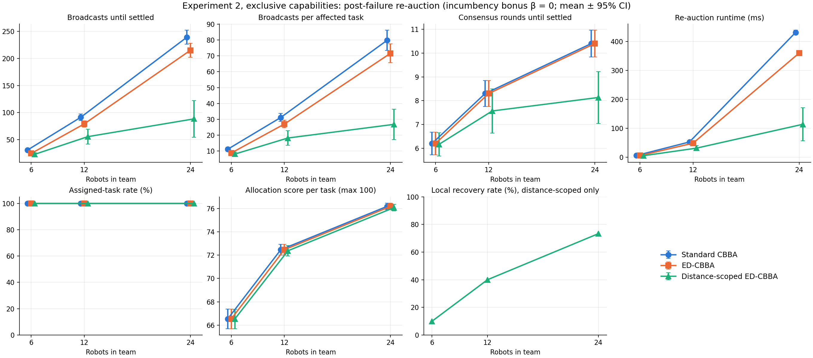
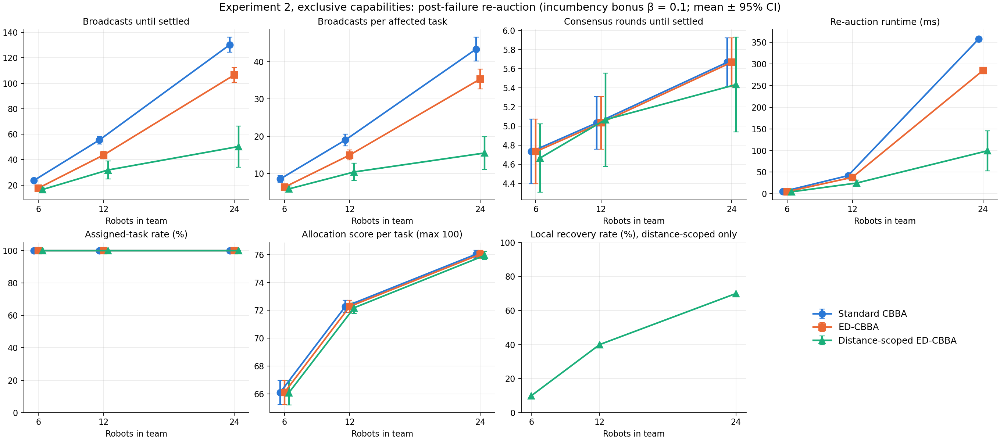

# Experiment 2 results: exclusive capabilities

Generated by `test/run_exclusive_capabilities_experiment.py` with 30 paired trials per team size. See `report.md` for the method and the decisions behind it, and `trials.csv` for every trial.

## Incumbency bonus β = 0

Values are means over paired trials with 95% confidence half-widths. Broadcasts and rounds are counted until the allocation settled; the raw columns include the solver's idle rounds before it stopped.

| Robots | Method | Broadcasts until settled | Broadcasts per affected task | Consensus rounds until settled | Re-auction runtime (ms) | Assigned-task rate (%) | Allocation score per task (max 100) | Raw broadcasts | Raw rounds |
| --- | --- | --- | --- | --- | --- | --- | --- | --- | --- |
| 6 | Standard CBBA | 31.0 ± 2.4 | 11.2 ± 1.2 | 6.2 ± 0.5 | 6.3 ± 0.4 | 100.0 ± 0.0 | 66.5 ± 0.8 | 51.0 | 10.2 |
| 6 | ED-CBBA | 24.5 ± 2.2 | 8.8 ± 1.0 | 6.2 ± 0.5 | 6.0 ± 0.3 | 100.0 ± 0.0 | 66.5 ± 0.8 | 24.5 | 10.2 |
| 6 | Distance-scoped ED-CBBA | 23.0 ± 2.9 | 8.1 ± 1.1 | 6.2 ± 0.5 | 5.6 ± 0.6 | 100.0 ± 0.0 | 66.5 ± 0.8 | 23.0 | 9.9 |
| 12 | Standard CBBA | 91.3 ± 6.0 | 31.2 ± 2.5 | 8.3 ± 0.5 | 53.0 ± 1.9 | 100.0 ± 0.0 | 72.5 ± 0.5 | 201.3 | 18.3 |
| 12 | ED-CBBA | 79.2 ± 5.8 | 27.0 ± 2.3 | 8.3 ± 0.5 | 48.7 ± 1.8 | 100.0 ± 0.0 | 72.5 ± 0.5 | 79.2 | 18.3 |
| 12 | Distance-scoped ED-CBBA | 55.6 ± 13.6 | 18.2 ± 4.6 | 7.6 ± 0.9 | 31.8 ± 8.3 | 100.0 ± 0.0 | 72.4 ± 0.4 | 55.6 | 14.5 |
| 24 | Standard CBBA | 239.2 ± 12.9 | 79.7 ± 6.4 | 10.4 ± 0.6 | 431.3 ± 7.5 | 100.0 ± 0.0 | 76.2 ± 0.3 | 745.2 | 32.4 |
| 24 | ED-CBBA | 215.1 ± 12.8 | 71.6 ± 5.9 | 10.4 ± 0.6 | 360.0 ± 8.2 | 100.0 ± 0.0 | 76.2 ± 0.3 | 215.1 | 32.4 |
| 24 | Distance-scoped ED-CBBA | 88.4 ± 34.1 | 26.9 ± 9.5 | 8.1 ± 1.1 | 114.0 ± 57.1 | 100.0 ± 0.0 | 76.1 ± 0.3 | 88.4 | 17.4 |

Local recovery by distance-scoped ED-CBBA:

| Robots | Trials | Local recovery | No capable robot within 40 m | Local schedule infeasible | Too many affected tasks | Mean participants when local |
| --- | ---: | ---: | ---: | ---: | ---: | ---: |
| 6 | 30 | 3 (10%) | 27 | 0 | 0 | 2.0 |
| 12 | 30 | 12 (40%) | 16 | 2 | 0 | 3.1 |
| 24 | 30 | 22 (73%) | 7 | 1 | 0 | 5.6 |

## Incumbency bonus β = 0.1

Values are means over paired trials with 95% confidence half-widths. Broadcasts and rounds are counted until the allocation settled; the raw columns include the solver's idle rounds before it stopped.

| Robots | Method | Broadcasts until settled | Broadcasts per affected task | Consensus rounds until settled | Re-auction runtime (ms) | Assigned-task rate (%) | Allocation score per task (max 100) | Raw broadcasts | Raw rounds |
| --- | --- | --- | --- | --- | --- | --- | --- | --- | --- |
| 6 | Standard CBBA | 23.7 ± 1.7 | 8.5 ± 0.9 | 4.7 ± 0.3 | 5.2 ± 0.2 | 100.0 ± 0.0 | 66.1 ± 0.9 | 43.7 | 8.7 |
| 6 | ED-CBBA | 17.6 ± 1.4 | 6.3 ± 0.7 | 4.7 ± 0.3 | 4.9 ± 0.2 | 100.0 ± 0.0 | 66.1 ± 0.9 | 17.6 | 8.7 |
| 6 | Distance-scoped ED-CBBA | 16.5 ± 2.0 | 5.9 ± 0.8 | 4.7 ± 0.4 | 4.6 ± 0.5 | 100.0 ± 0.0 | 66.1 ± 0.9 | 16.5 | 8.4 |
| 12 | Standard CBBA | 55.4 ± 3.0 | 19.0 ± 1.6 | 5.0 ± 0.3 | 41.9 ± 1.0 | 100.0 ± 0.0 | 72.3 ± 0.4 | 165.4 | 15.0 |
| 12 | ED-CBBA | 43.6 ± 2.8 | 15.0 ± 1.3 | 5.0 ± 0.3 | 38.1 ± 0.9 | 100.0 ± 0.0 | 72.3 ± 0.4 | 43.6 | 15.0 |
| 12 | Distance-scoped ED-CBBA | 31.8 ± 7.1 | 10.4 ± 2.3 | 5.1 ± 0.5 | 24.9 ± 6.4 | 100.0 ± 0.0 | 72.2 ± 0.4 | 31.8 | 12.0 |
| 24 | Standard CBBA | 130.3 ± 5.9 | 43.4 ± 3.2 | 5.7 ± 0.3 | 357.5 ± 4.2 | 100.0 ± 0.0 | 76.0 ± 0.3 | 636.3 | 27.7 |
| 24 | ED-CBBA | 106.6 ± 5.7 | 35.4 ± 2.7 | 5.7 ± 0.3 | 285.0 ± 4.4 | 100.0 ± 0.0 | 76.0 ± 0.3 | 106.6 | 27.7 |
| 24 | Distance-scoped ED-CBBA | 50.3 ± 16.1 | 15.5 ± 4.4 | 5.4 ± 0.5 | 99.3 ± 46.1 | 100.0 ± 0.0 | 75.9 ± 0.3 | 50.3 | 15.5 |

Local recovery by distance-scoped ED-CBBA:

| Robots | Trials | Local recovery | No capable robot within 40 m | Local schedule infeasible | Too many affected tasks | Mean participants when local |
| --- | ---: | ---: | ---: | ---: | ---: | ---: |
| 6 | 30 | 3 (10%) | 27 | 0 | 0 | 2.0 |
| 12 | 30 | 12 (40%) | 16 | 2 | 0 | 3.1 |
| 24 | 30 | 21 (70%) | 7 | 2 | 0 | 5.7 |

