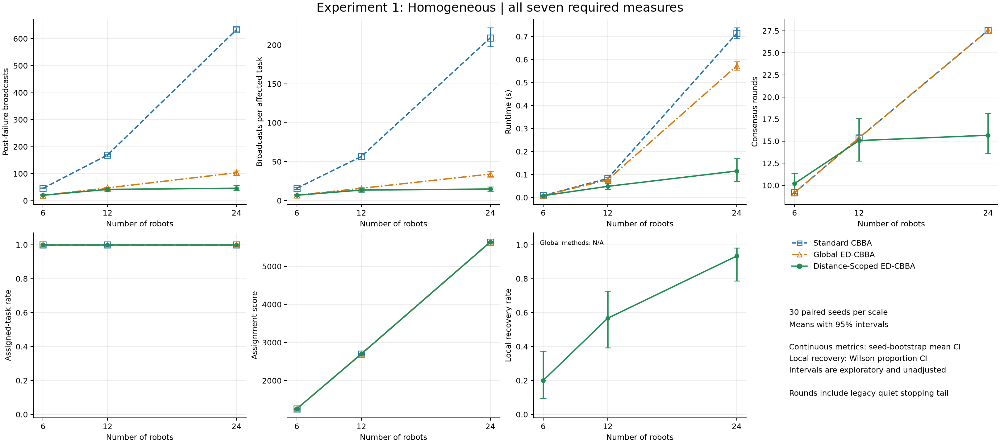
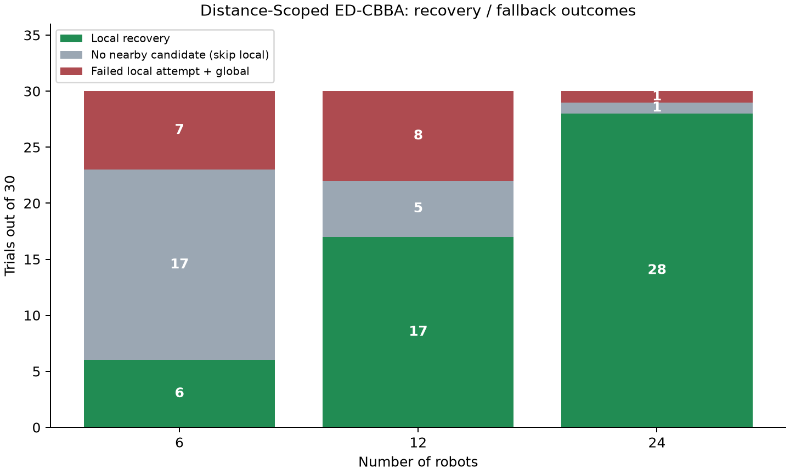
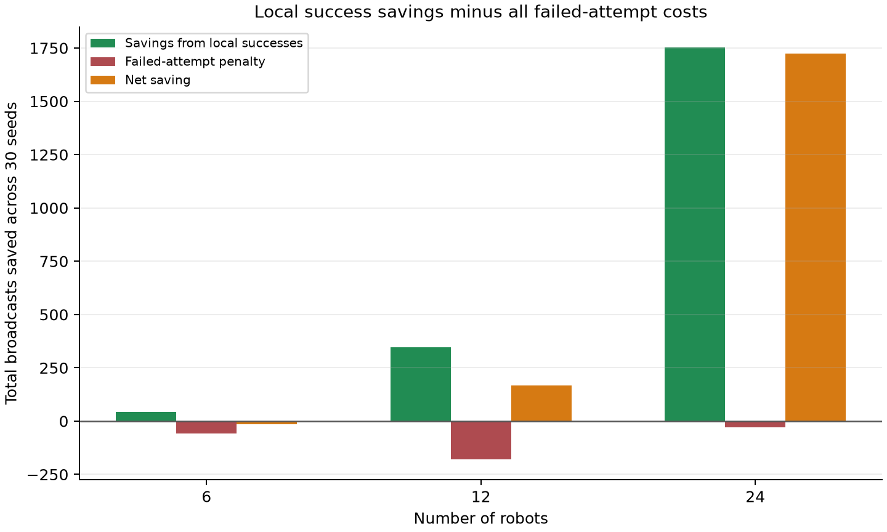
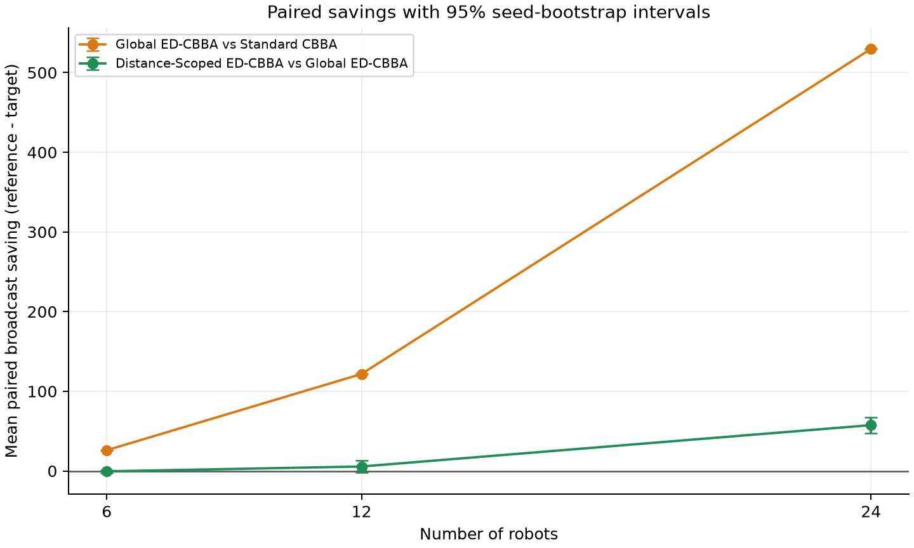
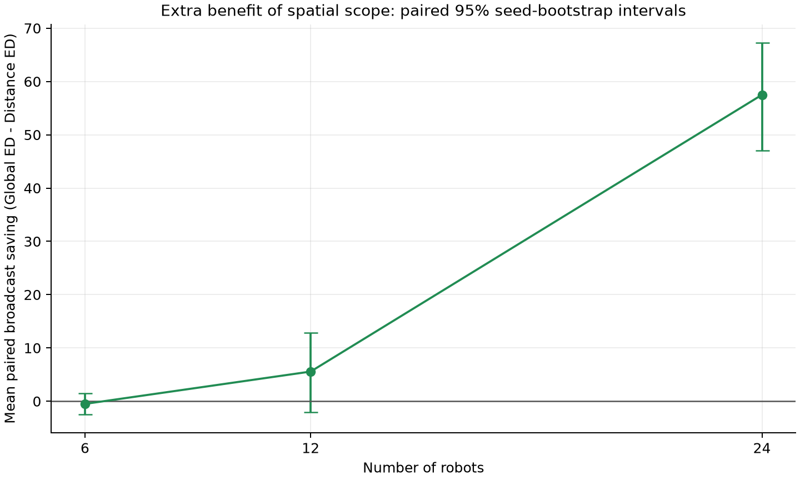
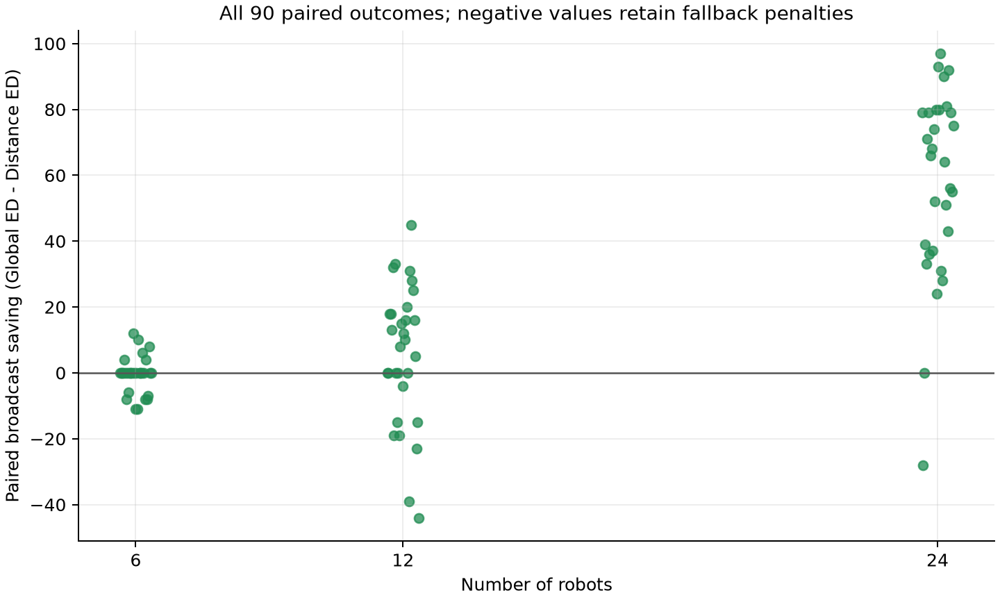
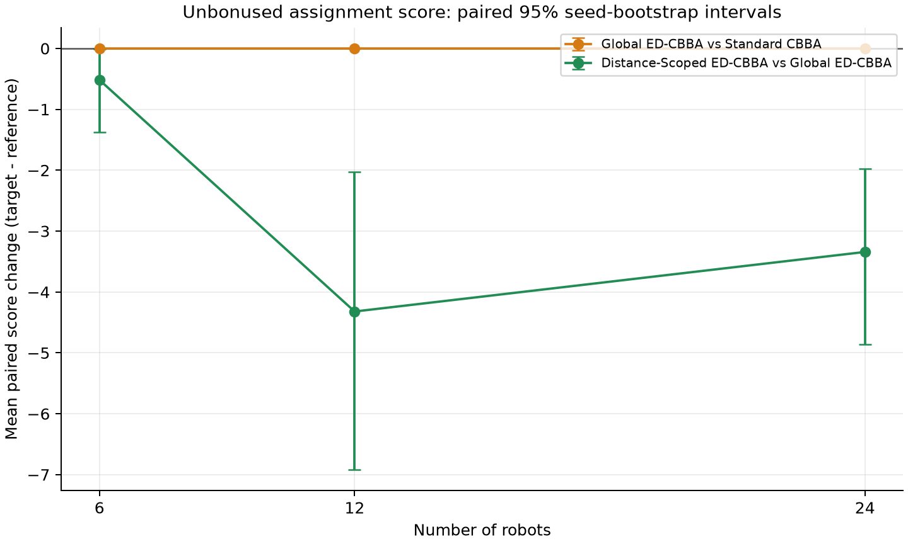

# Experiment 1: Homogeneous - Formal Paired Evaluation

## 1. Objective

Compare Standard CBBA, global event-driven CBBA (ED-CBBA), and Distance-Scoped ED-CBBA as the team grows, measuring only re-auction after one assigned robot fails before execution. The complete formal dataset contains **270 method results from 90 shared initial missions**.

## 2. Experimental Setup

| Parameter | Setting |
| --- | --- |
| Robots / tasks | 6/18, 12/36, 24/72 |
| Seeds | Exactly 0-29 at each scale; 30 paired trials, 90 method outcomes per scale |
| Types / compatibility | One robot type, one task type; fully compatible |
| Map / positions | 100 x 100 m, z=0; independent uniform coordinates |
| Robot speed / capacity | 5 m/s / four tasks |
| Task value / duration / start window | 100 / 8 s / [0,240] s |
| Local radius / affected-task limit | Inclusive 40 m / at most four affected tasks |
| Discount / incumbent bid bonus | 0.02 / 10%; explicit project assumptions, not mandated requirements |

Each mission uses Random(seed), generating robot positions then task positions in ID order. One initial ED-CBBA assignment is computed and reused. Random(100000+seed) chooses one robot from sorted assigned IDs to fail. Deep copies and SHA-256 input fingerprints enforce pairing. Coordinates, original ownership, paths, planned times, failure ID and initial auction records are saved once per mission. No input is resampled or changed to improve outcomes. The complete parameter settings are defined in config_homogeneous_scenario.json.

## 3. Compared Methods

**Standard CBBA** re-auctions every task globally among all survivors and broadcasts every round. **Global ED-CBBA** uses identical bidding, incumbency and scope, but broadcasts only when winner or winning-bid lists differ from the last sent state. **Distance-Scoped ED-CBBA** first uses ED-CBBA among the union of surviving, compatible robots within 40 m of affected tasks. Affected-task eligibility is enforced separately for each task. Existing tasks of participants enter the local scope; outsiders retain owners, paths and times. Local bidding is skipped for an uncovered affected task or more than four affected tasks. Incomplete/invalid local results cause a fresh global ED auction. Costs from an actual failed local attempt are retained. No extra optimization was added.

Bidding and consensus use the existing repository CBBA solver without changing its algorithm. Independent audit and offline analysis read saved results without executing the solver.

## 4. Metrics and Statistical Methods

Broadcasts count sending robots, once per round, irrespective of recipients. Post-failure broadcasts and consensus rounds sum every actual local and global auction; initial allocation is excluded. Broadcasts per affected task divide each trial's total by its failed robot's original task count, before averaging. Assigned-task rate is unique final assigned tasks / all original tasks. Unbonused score is J=sum(value * exp(-discount * (planned_start-release))). Local recovery rate is successful local recoveries / all 30 distance-method trials; global methods are N/A.

Runtime uses perf_counter over post-failure scope selection, auction preparation/solve and validation, excluding common initial allocation, method-input copying/fingerprinting and export. Each auction's setup/solve time is separately retained; controller/validation overhead completes the total. Execution was serial after tests, in fixed Standard, Global ED, Distance ED order.

summary_statistics.csv records n, mean, sample SD (ddof=1), median, minimum and maximum for all seven metrics, with N/A rows for nonapplicable local rates. Continuous-mean intervals and paired-difference intervals use a paired-seed percentile bootstrap: 20,000 resamples of 30 seed indices, NumPy PCG64 default_rng(20261120+robot_count), linear 2.5/97.5% quantiles. The same resampling indices are used for every method and metric at a given scale. Local-rate intervals are 95% Wilson intervals. Zero empirical variance gives a degenerate bootstrap interval; it does not prove universal certainty.

Paired differences are target minus reference; a negative cost difference is beneficial. Mean per-seed relative change is mean(100*(target-reference)/reference). Headline reduction percentages instead use 100*(mean(reference)-mean(target))/mean(reference); both are exported and must not be confused. Intervals are exploratory, unadjusted for multiple comparisons, and conditional on these seeded missions and assumptions. Scale-wise analyses do not treat the same seed across scales as independent pooled observations.

## 5. Results

### Seven required metrics

All values below are arithmetic means; n=30 per method/scale. Full dispersion and extrema are in summary_statistics.csv.

| Robots | Method | Broadcasts | Broadcasts/affected | Runtime s | Rounds | Assigned rate | Score | Local recovery |
| ---: | --- | ---: | ---: | ---: | ---: | ---: | ---: | ---: |
| 6 | Standard CBBA | 45.833 | 15.778 | 0.008441 | 9.167 | 1.000 | 1258.566 | N/A |
| 6 | Global ED-CBBA | 19.833 | 6.750 | 0.008098 | 9.167 | 1.000 | 1258.566 | N/A |
| 6 | Distance-Scoped ED-CBBA | 20.333 | 6.847 | 0.007849 | 10.200 | 1.000 | 1258.048 | 0.200 |
| 12 | Standard CBBA | 169.033 | 56.589 | 0.082471 | 15.367 | 1.000 | 2701.081 | N/A |
| 12 | Global ED-CBBA | 47.367 | 15.694 | 0.076919 | 15.367 | 1.000 | 2701.081 | N/A |
| 12 | Distance-Scoped ED-CBBA | 41.800 | 13.422 | 0.048513 | 15.067 | 1.000 | 2696.760 | 0.567 |
| 24 | Standard CBBA | 633.267 | 209.108 | 0.713695 | 27.533 | 1.000 | 5638.935 | N/A |
| 24 | Global ED-CBBA | 103.567 | 34.011 | 0.572151 | 27.533 | 1.000 | 5638.935 | N/A |
| 24 | Distance-Scoped ED-CBBA | 46.067 | 14.764 | 0.115273 | 15.667 | 1.000 | 5635.592 | 0.933 |



### Recovery, fallback and retained penalties

| Robots | Local recovery | 95% Wilson CI | No candidate: skip | Failed local + global | Extra broadcasts from failed attempts | Local cost > Global ED |
| ---: | ---: | --- | ---: | ---: | ---: | ---: |
| 6 | 6/30 (20.0%) | [9.5%, 37.3%] | 17 | 7 | 59 | 7/30 |
| 12 | 17/30 (56.7%) | [39.2%, 72.6%] | 5 | 8 | 178 | 8/30 |
| 24 | 28/30 (93.3%) | [78.7%, 98.2%] | 1 | 1 | 28 | 1/30 |

There were no task-count-limit or solver-error fallback cases. The affected-task limit cannot be exceeded in a valid capacity-four initial mission; its defensive branch was tested by unit tests. Failed local auctions are not removed; every fallback record is in fallback_attempts.csv. All fallback global paths, bids, broadcasts and rounds match the corresponding standalone Global ED control (runtime is allowed to differ). A failed greedy local auction does not prove mathematical infeasibility.



Savings from successful local recoveries total 44, 345, and 1,753 broadcasts for 6, 12, and 24 robots, respectively. Failed local attempts add 59, 178, and 28 broadcasts, respectively, leaving net savings of -15, 167, and 1,725 across each scale's 30 paired missions. Negative net savings represent extra cost.



## 6. Paired Comparisons

### Broadcasts

Positive savings mean fewer broadcasts for the target. Intervals describe the mean paired absolute saving. Reduction percentages are ratios of sample means.

| Robots | Target vs reference | Mean saving | Paired 95% CI | Reduction of means |
| ---: | --- | ---: | --- | ---: |
| 6 | Global ED-CBBA vs Standard CBBA | 26.000 | [25.767, 26.233] | 56.73% |
| 6 | Distance-Scoped ED-CBBA vs Global ED-CBBA | -0.500 | [-2.433, 1.467] | -2.52% |
| 6 | Distance-Scoped ED-CBBA vs Standard CBBA | 25.500 | [23.533, 27.467] | 55.64% |
| 12 | Global ED-CBBA vs Standard CBBA | 121.667 | [121.433, 121.933] | 71.98% |
| 12 | Distance-Scoped ED-CBBA vs Global ED-CBBA | 5.567 | [-2.067, 12.800] | 11.75% |
| 12 | Distance-Scoped ED-CBBA vs Standard CBBA | 127.233 | [119.533, 134.533] | 75.27% |
| 24 | Global ED-CBBA vs Standard CBBA | 529.700 | [529.500, 529.867] | 83.65% |
| 24 | Distance-Scoped ED-CBBA vs Global ED-CBBA | 57.500 | [47.033, 67.267] | 55.52% |
| 24 | Distance-Scoped ED-CBBA vs Standard CBBA | 587.200 | [576.633, 597.100] | 92.73% |







### Assignment score, rounds and runtime

| Robots | Target vs reference | Score change (paired 95% CI) | Score reduction | Rounds change | Runtime change s |
| ---: | --- | --- | ---: | ---: | ---: |
| 6 | Global ED-CBBA vs Standard CBBA | 0.000 [0.000, 0.000] | 0.0000% | 0.000 | -0.000343 |
| 6 | Distance-Scoped ED-CBBA vs Global ED-CBBA | -0.517 [-1.375, -0.009] | 0.0411% | 1.033 | -0.000249 |
| 12 | Global ED-CBBA vs Standard CBBA | 0.000 [0.000, 0.000] | 0.0000% | 0.000 | -0.005552 |
| 12 | Distance-Scoped ED-CBBA vs Global ED-CBBA | -4.321 [-6.915, -2.031] | 0.1600% | -0.300 | -0.028406 |
| 24 | Global ED-CBBA vs Standard CBBA | 0.000 [0.000, 0.000] | 0.0000% | 0.000 | -0.141544 |
| 24 | Distance-Scoped ED-CBBA vs Global ED-CBBA | -3.343 [-4.864, -1.973] | 0.0593% | -11.867 | -0.456878 |

All six comparable metrics and all three method pairs, including runtime/round confidence intervals and both relative-change definitions, are in paired_comparisons.csv. Seed-level differences are in paired_seed_differences.csv. Assigned-task-rate differences are exactly zero for every pair.



## 7. Discussion

### Observations

Global ED reduces mean broadcasts relative to Standard by 56.73%, 71.98%, 83.65% at 6, 12, and 24 robots, respectively. The paired absolute-saving intervals exclude zero at every scale, and the observed percentage reduction grows with team size. Standard and Global ED have identical final paths, start times, scores and total rounds in every one of the 90 shared missions.

Distance ED's mean broadcast reductions relative to Global ED are -2.52%, 11.75%, 55.52% at 6, 12, and 24 robots, respectively; a negative percentage is an increase. Local recovery rises from 20.0% to 56.7% to 93.3%. At six robots, failed-attempt penalties outweigh average local communication savings. At 12 robots the mean favors local scope, but its paired saving interval includes zero; these samples do not establish a reliable extra broadcast benefit there. At 24 robots the local broadcast saving is large and its paired interval excludes zero. Local scope is therefore not uniformly beneficial.

All methods assign 100% of tasks in all 270 outcomes. The distance policy changes scores slightly relative to Global ED; the table above quantifies those paired changes instead of treating reduced communication as free. No task was dropped to obtain these results. Raw scores increase across scales partly because there are more tasks; scores should also be read against their corresponding maximum values 1,800, 3,600, and 7,200, rather than compared as identical workloads.

Broadcast savings do not translate one-for-one to runtime or rounds. ED suppresses messages while retaining the same rounds. At 6 robots distance scope has slightly more broadcasts and more rounds on average, despite a small runtime decrease. At 12 robots the round decrease is small; at 24 both rounds and runtime decrease substantially. Runtime comparisons remain descriptive because the method order was fixed and no independent timing replication was performed.

### Interpretation (inference, not a separately tested cause)

More robots in the same map plausibly provide more nearby eligible bidders and spare local capacity. This is consistent with higher observed local recovery, but the experiment does not independently isolate density from other scale effects. The unchanged Standard/ED paths are consistent with changing transmission policy rather than bidding. Legacy quiet tails and the number of participant/task loops plausibly explain part of the mismatch between rounds, runtime and broadcasts; the data do not quantify each causal contribution.

## 8. Limitations

- Consensus rounds include the original participant-count-dependent quiet stopping tail; they are not certified convergence times.
- Runtime includes audit/controller overhead and depends on system load, fixed method order, and hardware. A single timed run per seed does not establish a universal speedup.
- 40 m is spatial bidding eligibility, not a radio range; each actual auction assumes a complete communication graph.
- There is no physical robot execution or realistic communication network simulation, packet delay, bandwidth contention, or mobility during execution.
- Broadcast counts are sending events, not bytes, packet payload size, or measured network traffic.
- Failure detection, heartbeat and scope-coordination/dissemination communication are excluded.
- Every actual auction's participants agree on winners/bids and paths. Local results compose that consensus with frozen outsider schedules; mission-wide belief synchronization to nonparticipants is not simulated or verified.
- Discount 0.02, 10% incumbent bonus, uniform positions and the failure-selection rule are explicit project assumptions.
- Local greedy CBBA is not a global optimum solver; an unsuccessful local attempt does not establish true local infeasibility.
- Thirty paired seeds per scale and exploratory unadjusted intervals do not establish generality beyond the tested configuration. No equivalence margin was prespecified for score differences.

## 9. Reproducibility and Independent Audit

The independent auditor executed **655,893 checks** with zero errors. It reads saved CSV/snapshots/raw solver records without importing the experiment or solver, reconstructs positions and the failure rule, recomputes physical feasibility and unbonused scores, checks every participant's winner/bid records, validates all cost sums and verifies source and raw-data hashes. Five deliberately corrupted in-memory negative controls were detected. All 90 snapshots and 270 diagnostics are retained in audit_evidence.jsonl.gz. All 28 tests available at experiment execution passed before the serial run. The compact evidence expands only into a temporary directory during audit; CSV alone would not establish schedule or consensus validity.

The baseline repository commit was `41d1ceb8a8c27b5759b69d66ba5a6b3b0c23c93e`. Experiment files were uncommitted at execution time. The exact executed source witnesses and their SHA-256 values are retained in the compressed audit evidence, alongside preflight metadata, configuration, interpreter and dependency versions. run_provenance.json distinguishes execution-time source hashes from the delivered audit/analysis scripts. Subsequent report-wording and artifact-loading changes do not alter bidding, experiment parameters, or numerical observations.

```powershell
.\.venv\Scripts\python.exe -m unittest discover -s test -p 'test_*.py' -v
.\.venv\Scripts\python.exe test/run_homogeneous_experiment.py --full --output-dir outputs/homogeneous_reproduction
.\.venv\Scripts\python.exe test/audit_homogeneous_results.py --output-dir doc/homogeneous
.\.venv\Scripts\python.exe test/analyze_homogeneous_results.py --output-dir doc/homogeneous
```

The experiment command requires a new empty output directory and must not overwrite this run. The last two commands audit and regenerate the committed results without rerunning auctions. Full local raw outputs remain separate from this compact results directory. trials.csv and all evidence bytes remain unchanged.

Key files: final_report.md; summary_statistics.csv; paired_comparisons.csv; paired_seed_differences.csv; fallback_summary.csv; fallback_attempts.csv; independent_audit.json; audit_evidence.jsonl.gz; run_provenance.json; environment-freeze.txt; analysis_statistics.json; README.md.
