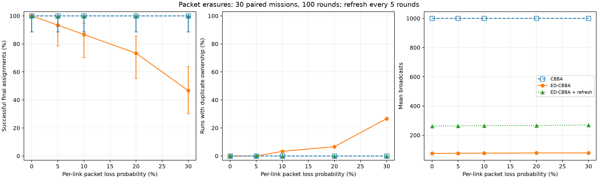

# Packet loss: fixed-budget CBBA robustness experiment

## Method

Each loss rate uses 30 paired missions (seeds 0 onward), 10 homogeneous robots, 20 tasks, bundle capacity 3, and a 100 m × 100 m map. The connected, undirected 10 m-range graph and task generator are reused from `run_ed_cbba_example.py`. Tasks have no time windows.

Each attempted sender-to-neighbour delivery is independently erased with probability p. This is receiver-specific packet loss: a broadcast can reach some neighbours and miss others. There is no delay, reordering, ACK, or retry queue. The ED sender records its state as sent even when delivery fails. A separate seeded random generator draws every ordered pair every round, including silent senders; methods therefore share potential erasures at the same round/sender/receiver. Their realised dropped-packet counts can differ because they send different messages.

All methods run exactly **100 consensus rounds**; the existing quiet stopping rule is disabled. Refresh forces every ED agent to broadcast every **5 rounds**, in addition to change-triggered broadcasts. These are proposed robustness modifications to evaluate, not an implementation of asynchronous CBBA.

Success means all 20 tasks occur in exactly one robot path, capacity is respected, all robots agree on every winner and bid (absolute bid tolerance 1e-5), and winner beliefs match path ownership. It is a final-state check, not a convergence-time measurement or a guarantee that no transient conflicts occurred.

One broadcast counts one sending robot; packet attempts count its outgoing graph edges. Dropped packets still count as attempts. All traffic across the common round budget is included, even after assignments stabilise. Thus the communication comparison describes a fixed monitoring horizon, not traffic to a certified stopping time.

## Results

Success intervals are marginal 95% Wilson intervals across missions.

| Loss | Method | Success | 95% interval | Runs with duplicate ownership | Mean covered / 20 | Mean broadcasts | Mean packet attempts |
| --- | --- | ---: | ---: | ---: | ---: | ---: | ---: |
| 0% | CBBA | 30/30 | 88.6%–100.0% | 0 | 20.00 | 1000.0 | 4220.0 |
| 0% | ED-CBBA | 30/30 | 88.6%–100.0% | 0 | 20.00 | 74.5 | 297.8 |
| 0% | ED-CBBA + refresh | 30/30 | 88.6%–100.0% | 0 | 20.00 | 262.2 | 1092.8 |
| 5% | CBBA | 30/30 | 88.6%–100.0% | 0 | 20.00 | 1000.0 | 4220.0 |
| 5% | ED-CBBA | 28/30 | 78.7%–98.2% | 0 | 20.00 | 75.8 | 306.1 |
| 5% | ED-CBBA + refresh | 30/30 | 88.6%–100.0% | 0 | 20.00 | 263.6 | 1101.3 |
| 10% | CBBA | 30/30 | 88.6%–100.0% | 0 | 20.00 | 1000.0 | 4220.0 |
| 10% | ED-CBBA | 26/30 | 70.3%–94.7% | 1 | 20.00 | 76.9 | 311.7 |
| 10% | ED-CBBA + refresh | 30/30 | 88.6%–100.0% | 0 | 20.00 | 265.0 | 1107.3 |
| 20% | CBBA | 30/30 | 88.6%–100.0% | 0 | 20.00 | 1000.0 | 4220.0 |
| 20% | ED-CBBA | 22/30 | 55.6%–85.8% | 2 | 20.00 | 77.7 | 321.4 |
| 20% | ED-CBBA + refresh | 30/30 | 88.6%–100.0% | 0 | 20.00 | 266.5 | 1117.4 |
| 30% | CBBA | 30/30 | 88.6%–100.0% | 0 | 20.00 | 1000.0 | 4220.0 |
| 30% | ED-CBBA | 14/30 | 30.2%–63.9% | 8 | 20.00 | 78.2 | 330.9 |
| 30% | ED-CBBA + refresh | 30/30 | 88.6%–100.0% | 0 | 20.00 | 269.4 | 1131.6 |



## Paired refresh effect

Positive differences mean refresh improved final success over unmodified ED-CBBA. These paired differences are descriptive; the Wilson intervals above quantify uncertainty in each method's marginal success rate, not in their paired difference.

| Loss | Refresh rescued / regressed trials | Success difference (percentage points) |
| --- | ---: | ---: |
| 0% | 0 / 0 | 0.0 |
| 5% | 2 / 0 | 6.7 |
| 10% | 4 / 0 | 13.3 |
| 20% | 8 / 0 | 26.7 |
| 30% | 16 / 0 | 53.3 |

At the highest tested loss rate (30%), standard CBBA succeeded in 30/30 missions, plain ED-CBBA in 14/30, and refreshed ED-CBBA in 30/30. Refreshed ED-CBBA used 269.4 mean broadcasts versus 1000.0 for standard CBBA (73.1% fewer), but more than plain ED-CBBA (78.2). All counts cover the same fixed horizon.

## Interpretation and limits

A dropped state update can leave a neighbour with stale winner information. Change-triggered transmission alone need not resend an unchanged state. Periodic refresh creates additional delivery opportunities, at the cost of ongoing traffic. The tables measure whether that mechanism helps in these trials; they do not establish eventual convergence for arbitrary packet loss.

This is a synchronous, static allocation stress test. It excludes execution, robot failures, deadlines, bandwidth contention, burst loss, and partitions. Covered tasks can include conflicting assignments and must be read with success and duplicate ownership. No optimality or execution-completion claim is made. The refresh period and round budget are fixed design choices, not tuned optima. Larger paired samples, multiple horizons, and burst-loss models are follow-up studies.

## Reproduction

Run from the repository root:

```powershell
.\.venv\Scripts\python.exe test/run_packet_loss_experiment.py --trials 30 --rounds 100 --refresh-interval 5 --loss-rates 0.0 0.05 0.1 0.2 0.3
```

Outputs: `packet_loss_trials.csv`, `packet_loss_summary.md`, and `packet_loss_comparison.png`. The CSV includes the mission and communication seeds and attempted, delivered, and dropped packet counts.

Environment: Python 3.13.9, NumPy 2.5.4, Matplotlib 3.11.2; Windows.
