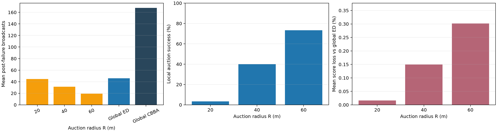

# Spatially Scoped Re-auction after Robot Failure: A Radius Sensitivity Study

## Abstract

Event-driven CBBA (ED-CBBA) reduces communication during consensus by allowing a robot to broadcast only when its recorded task winners or winning bids change. This report evaluates a separate extension: limiting a failure-triggered re-auction to nearby capable robots and escalating to a global auction when local recovery is infeasible. In a 100 m × 100 m heterogeneous task-allocation scenario, we compare local bidding radii of 20, 40, and 60 m against global ED-CBBA and global traditional CBBA. Thirty paired trials use the same initial allocation and robot failure across all five methods. At 60 m, the local policy resolves 22 of 30 failures without a global auction and reduces mean post-failure broadcasts from 46.0 to 19.1 relative to global ED-CBBA. All 24 tasks remain allocated in every trial, while the mean unbonused assignment score is 0.30% lower than with global ED-CBBA. These results support a communication–assignment-quality trade-off within the tested static replanning model.

## 1. Research question and method

The research question is: **How does the local bidding radius affect communication cost and assignment quality when a robot fails?** Traditional CBBA broadcasts every agent's state in every consensus round. The ED-CBBA broadcast rule follows Sao *et al.* [2]: a robot broadcasts when its winner or winning-bid list changes. We retain that rule and add a spatial choice of *who participates in a post-failure auction*. The spatial rule is the extension tested here; the ED-CBBA broadcast condition itself is not new.

For each affected task $j$, a surviving robot $i$ may bid locally only if it is capable of performing the task and its Euclidean distance from the task is at most $R$. The local auction also includes the existing tasks of all participating robots. Therefore, those robots compete with their current commitments accounted for, and no robot may hold more than $K=4$ tasks. Tasks held by robots outside the local auction keep their previous owners and planned times.

The policy escalates to a global auction if more than two tasks were owned by the failed robot, any affected task has no nearby capable bidder, or the local auction cannot allocate every task in its scope. In a global auction, all surviving robots bid on all 24 tasks. Local and global auctions give a surviving incumbent a 10% bid bonus; this bonus is used only during bidding and is removed from the reported assignment score. All variants use the same four-task capacity and incumbent bonus.

## 2. Experimental design

The experiment uses a 100 m × 100 m map with 12 robots: three survey drones, three cargo drones, three rescue cars, and three supply trucks. The 24 tasks comprise four instances each of aerial survey, communication relay, air drop, rescue, ground inspection, and heavy supply. Each robot type can bid only on its configured task types. Survey and cargo drones may both bid on relay tasks; rescue cars and supply trucks may both bid on ground inspection tasks. Air and ground robots cannot bid across these domains.

Thirty paired trials use seeds 0–29. For each trial, every robot and task position is independently perturbed by up to 4 m in each horizontal direction. An initial ED-CBBA auction allocates all tasks. One robot with at least one allocated task is then selected to fail **before task execution**. The same perturbed mission, failed robot, and pre-failure allocation are reused for every method in that trial. We compare three adaptive radii, $R \in \{20,40,60\}$ m, with two global controls: ED-CBBA and traditional CBBA. The global controls differ only in their consensus broadcast rule.

The primary metric is the number of robot broadcasts in the post-failure auction. One sender counts as one broadcast regardless of its number of recipients; the common initial auction is excluded. If a local attempt is followed by a global fallback, broadcasts from both attempts are counted. We also record local-auction success, the number of allocated tasks, the number of tasks whose owner changes, and the unbonused assignment score

\[
J=\sum_{j\text{ allocated}} v_j\exp[-\lambda_j(s_j-r_j)],
\]

where $v_j$ is task value, $s_j$ is its planned start time, $r_j$ is its release time, and $\lambda_j=0.02$ is its time-discount factor. This score allows a comparison of assignment quality without treating the 10% incumbency bonus as mission value.

## 3. Results

| Post-failure method | Local auctions successful | Mean broadcasts | Reduction vs global ED-CBBA | Trials allocating all 24 tasks | Mean unbonused score | Mean tasks changing owner |
| --- | ---: | ---: | ---: | ---: | ---: | ---: |
| Local, $R=20$ m | 1/30 | 44.8 | 2.8% | 30/30 | 2472.2 | 2.9 |
| Local, $R=40$ m | 12/30 | 31.3 | 31.9% | 30/30 | 2468.9 | 2.7 |
| Local, $R=60$ m | 22/30 | 19.1 | 58.4% | 30/30 | 2465.2 | 2.5 |
| Global ED-CBBA | — | 46.0 | — | 30/30 | 2472.6 | 2.9 |
| Global traditional CBBA | — | 167.6 | — | 30/30 | 2472.6 | 2.9 |



At 20 m, 21 trials had no capable robot within range of at least one affected task, and eight exceeded the two-task local limit. Only one trial was resolved locally. At 40 m, 12 trials succeeded locally; ten required global recovery because no suitable robot was nearby, and eight exceeded the task-count limit. At 60 m, all affected tasks had nearby capable bidders when the task-count limit allowed a local auction; the eight global escalations were caused by the task-count limit. No trial needed a global fallback after a completed local auction failed its capacity or schedule check.

The 60 m policy saved an average of 26.9 broadcasts per trial relative to global ED-CBBA. An approximate paired 95% confidence interval for this absolute saving is 20.6–33.2 broadcasts. Its mean unbonused score was 7.46 points, or 0.30%, below global ED-CBBA. Global ED-CBBA itself used 72.5% fewer broadcasts than global traditional CBBA under the same fault and task inputs. The 60 m policy used 88.6% fewer broadcasts than traditional global CBBA, but this comparison combines the ED broadcast rule with the smaller auction scope.

## 4. Interpretation and limitations

Among the three tested radii, 60 m provides the lowest communication cost and the highest rate of local recovery. It is a suitable choice **if a mean score reduction of about 0.30% is acceptable**. A 40 m radius retains more of the global assignment score, with a smaller 31.9% communication reduction. The data do not establish that either radius is universally optimal; the result depends on robot density, capability distribution, task locations, and the two-task escalation threshold.

This experiment measures static replanning after a pre-execution failure. It does not simulate robot motion while tasks are being performed, partial work, failure-detection delay, packet loss, or disconnected communication. The radius limits task-bidding eligibility, **not radio coverage**; robots admitted to one auction are assumed able to exchange consensus messages directly. Broadcasts count senders rather than individual link transmissions or heartbeat messages. The scope decision is made by the experiment controller, so these results do not establish a fully distributed failure detector or spatial-auction protocol. A follow-up experiment should integrate the same scope rule into the execution-time failure simulator and account for communication and detection costs.

## 5. Reproducibility

From the repository root, install `requirements.txt` and run:

```bash
MPLCONFIGDIR=/tmp/cbba-mpl .venv/bin/python test/run_spatial_reauction_experiment.py
```

The script regenerates the figure, [per-trial CSV](spatial_reauction_trials.csv), and [numerical summary](spatial_reauction_summary.md). The scenario configuration is in [`config_multitype_scenario.json`](../config_multitype_scenario.json). The implementation and capacity checks are in [`run_spatial_reauction_experiment.py`](../test/run_spatial_reauction_experiment.py) and [`test_spatial_reauction.py`](../test/test_spatial_reauction.py).

## References

[1] H.-L. Choi, L. Brunet, and J. P. How, “Consensus-Based Decentralized Auctions for Robust Task Allocation,” *IEEE Transactions on Robotics*, vol. 25, no. 4, pp. 912–926, 2009.

[2] V. Sao, T. D. Ho, S. Bhore, and P. B. Sujit, “Event Driven CBBA with Reduced Communication,” arXiv:2509.06481, 2025.
