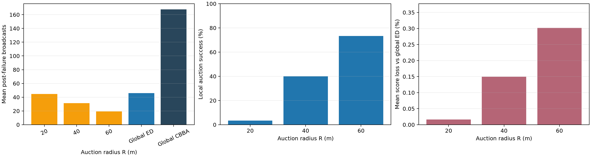

# 距离分级重新竞价实验

故障发生在任务执行前，使用同一批 30 个随机种子做配对比较。
地图 100 m × 100 m，4 类机器人共 12 台，6 类任务共 24 个；
每台最多 4 个任务，机器人坐标和任务坐标在基础场景上独立扰动 ±4 m。
每个种子先运行一次初始 ED-CBBA，再随机选一台获得任务的机器人故障。

局部候选人必须在线、能力匹配且与受影响任务的欧氏距离不超过 R。
局部拍卖包含候选机器人原有任务，以计入已有安排与容量；受影响任务
对超出 R 的机器人禁投。受影响任务超过 2 个、附近没有合格机器人，
或局部拍卖无法安排全部相关任务时，升级为全局拍卖。
全局拍卖由所有存活机器人对所有任务竞价。所有模式均使用 10% 原持有者奖励。

本实验是静态故障后的重新规划，不模拟移动、任务执行时间或故障检测延迟。
R 限制受影响任务的竞标资格，不代表无线电覆盖半径；
参与同一拍卖的机器人在本实验中假定能直接通信。
广播次数只统计故障后的拍卖，不含初始拍卖；一次机器人广播记为 1 次。
若先尝试局部拍卖再升级全局，两次拍卖的广播都会计入。
真实分数按任务原价值和计划开始时间重算，不含原持有者奖励。

| R / 方法 | 试验数 | 局部成功 | 升级全局 | 平均广播 | 相比全局ED节省 | 全部24任务分配 | 平均真实分数 | 平均换手任务 |
| --- | ---: | ---: | ---: | ---: | ---: | ---: | ---: | ---: |
| 20 | 30 | 1 | 29 | 44.8 | 2.8% | 30/30 | 2472.2 | 2.9 |
| 40 | 30 | 12 | 18 | 31.3 | 31.9% | 30/30 | 2468.9 | 2.7 |
| 60 | 30 | 22 | 8 | 19.1 | 58.4% | 30/30 | 2465.2 | 2.5 |
| global_ed | 30 | 0 | — | 46.0 | — | 30/30 | 2472.6 | 2.9 |
| global_cbba | 30 | 0 | — | 167.6 | — | 30/30 | 2472.6 | 2.9 |

全局 ED-CBBA 相比传统 CBBA 的平均广播减少 72.5%。
R=60 相比全局 ED-CBBA 的平均真实分数变化为 -0.30%。

R=20 升级原因：任务过多 8 次，附近无合格机器人 21 次，局部排程不可行 0 次。
R=40 升级原因：任务过多 8 次，附近无合格机器人 10 次，局部排程不可行 0 次。
R=60 升级原因：任务过多 8 次，附近无合格机器人 0 次，局部排程不可行 0 次。

逐次结果见 `spatial_reauction_trials.csv`。
