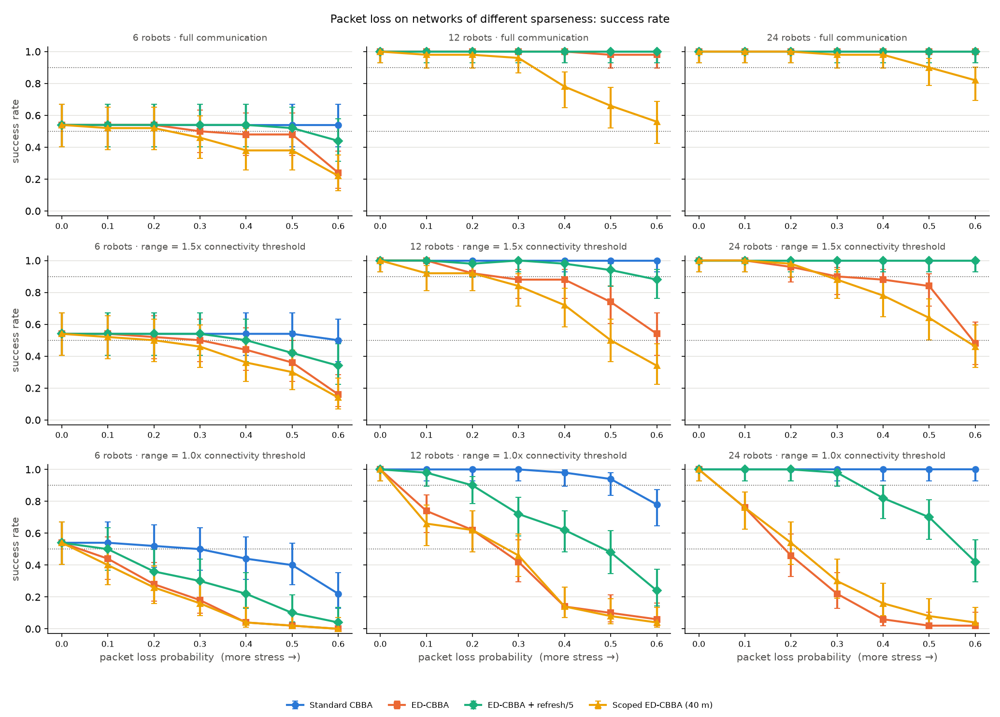
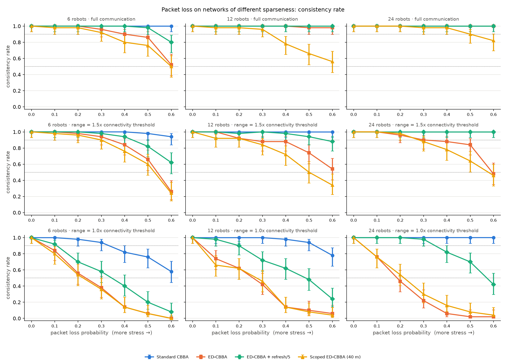
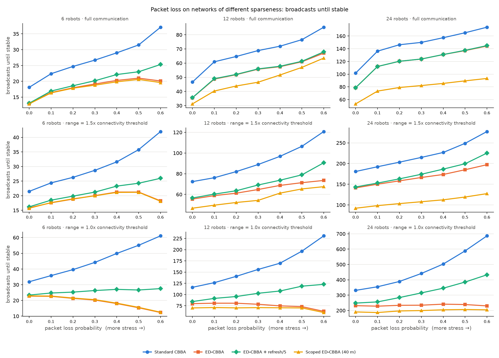
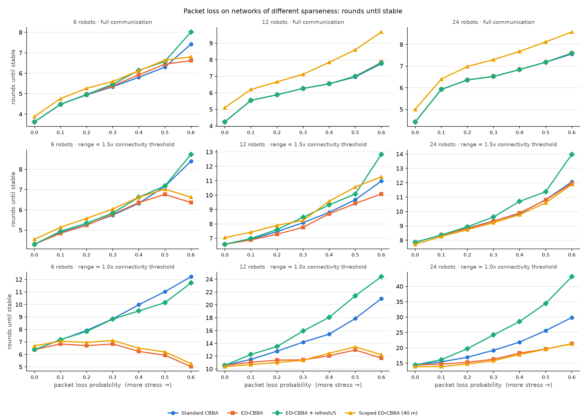

# Packet loss on networks of different sparseness

50 seeds per cell. Rates: value [Wilson 95%].

## full communication

| robots | level | method | success | consistent | avoidable loss | groups | broadcasts | rounds | local rate |
| ---: | --- | --- | --- | --- | ---: | ---: | ---: | ---: | ---: |
| 6 | 0.0 | Standard CBBA | 0.54 [0.40, 0.67] | 1.00 [0.93, 1.00] | 0.62 | 1.0 | 18 | 3.6 | - |
| 6 | 0.0 | ED-CBBA | 0.54 [0.40, 0.67] | 1.00 [0.93, 1.00] | 0.62 | 1.0 | 13 | 3.6 | - |
| 6 | 0.0 | ED-CBBA + refresh/5 | 0.54 [0.40, 0.67] | 1.00 [0.93, 1.00] | 0.62 | 1.0 | 13 | 3.6 | - |
| 6 | 0.0 | Scoped ED-CBBA (40 m) | 0.54 [0.40, 0.67] | 1.00 [0.93, 1.00] | 0.62 | 1.0 | 13 | 3.9 | 0.08 |
| 6 | 0.1 | Standard CBBA | 0.54 [0.40, 0.67] | 1.00 [0.93, 1.00] | 0.62 | 1.0 | 22 | 4.5 | - |
| 6 | 0.1 | ED-CBBA | 0.54 [0.40, 0.67] | 1.00 [0.93, 1.00] | 0.62 | 1.0 | 16 | 4.5 | - |
| 6 | 0.1 | ED-CBBA + refresh/5 | 0.54 [0.40, 0.67] | 1.00 [0.93, 1.00] | 0.62 | 1.0 | 17 | 4.5 | - |
| 6 | 0.1 | Scoped ED-CBBA (40 m) | 0.52 [0.39, 0.65] | 0.98 [0.90, 1.00] | 0.62 | 1.0 | 16 | 4.8 | 0.06 |
| 6 | 0.2 | Standard CBBA | 0.54 [0.40, 0.67] | 1.00 [0.93, 1.00] | 0.62 | 1.0 | 25 | 4.9 | - |
| 6 | 0.2 | ED-CBBA | 0.54 [0.40, 0.67] | 1.00 [0.93, 1.00] | 0.62 | 1.0 | 18 | 5.0 | - |
| 6 | 0.2 | ED-CBBA + refresh/5 | 0.54 [0.40, 0.67] | 1.00 [0.93, 1.00] | 0.62 | 1.0 | 19 | 5.0 | - |
| 6 | 0.2 | Scoped ED-CBBA (40 m) | 0.52 [0.39, 0.65] | 0.98 [0.90, 1.00] | 0.62 | 1.0 | 18 | 5.3 | 0.06 |
| 6 | 0.3 | Standard CBBA | 0.54 [0.40, 0.67] | 1.00 [0.93, 1.00] | 0.62 | 1.0 | 27 | 5.3 | - |
| 6 | 0.3 | ED-CBBA | 0.50 [0.37, 0.63] | 0.96 [0.87, 0.99] | 0.62 | 1.0 | 19 | 5.4 | - |
| 6 | 0.3 | ED-CBBA + refresh/5 | 0.54 [0.40, 0.67] | 1.00 [0.93, 1.00] | 0.62 | 1.0 | 20 | 5.5 | - |
| 6 | 0.3 | Scoped ED-CBBA (40 m) | 0.46 [0.33, 0.60] | 0.92 [0.81, 0.97] | 0.62 | 1.0 | 19 | 5.6 | 0.06 |
| 6 | 0.4 | Standard CBBA | 0.54 [0.40, 0.67] | 1.00 [0.93, 1.00] | 0.62 | 1.0 | 29 | 5.8 | - |
| 6 | 0.4 | ED-CBBA | 0.48 [0.35, 0.61] | 0.90 [0.79, 0.96] | 0.62 | 1.0 | 20 | 5.9 | - |
| 6 | 0.4 | ED-CBBA + refresh/5 | 0.54 [0.40, 0.67] | 1.00 [0.93, 1.00] | 0.62 | 1.0 | 22 | 6.1 | - |
| 6 | 0.4 | Scoped ED-CBBA (40 m) | 0.38 [0.26, 0.52] | 0.80 [0.67, 0.89] | 0.62 | 1.0 | 20 | 6.1 | 0.06 |
| 6 | 0.5 | Standard CBBA | 0.54 [0.40, 0.67] | 1.00 [0.93, 1.00] | 0.62 | 1.0 | 32 | 6.3 | - |
| 6 | 0.5 | ED-CBBA | 0.48 [0.35, 0.61] | 0.86 [0.74, 0.93] | 0.62 | 1.0 | 21 | 6.4 | - |
| 6 | 0.5 | ED-CBBA + refresh/5 | 0.52 [0.39, 0.65] | 0.98 [0.90, 1.00] | 0.62 | 1.0 | 23 | 6.6 | - |
| 6 | 0.5 | Scoped ED-CBBA (40 m) | 0.38 [0.26, 0.52] | 0.76 [0.63, 0.86] | 0.62 | 1.0 | 21 | 6.6 | 0.06 |
| 6 | 0.6 | Standard CBBA | 0.54 [0.40, 0.67] | 1.00 [0.93, 1.00] | 0.62 | 1.0 | 37 | 7.4 | - |
| 6 | 0.6 | ED-CBBA | 0.24 [0.14, 0.37] | 0.52 [0.39, 0.65] | 0.74 | 1.0 | 20 | 6.6 | - |
| 6 | 0.6 | ED-CBBA + refresh/5 | 0.44 [0.31, 0.58] | 0.80 [0.67, 0.89] | 0.62 | 1.0 | 25 | 8.0 | - |
| 6 | 0.6 | Scoped ED-CBBA (40 m) | 0.22 [0.13, 0.35] | 0.50 [0.37, 0.63] | 0.74 | 1.0 | 20 | 6.8 | 0.06 |
| 12 | 0.0 | Standard CBBA | 1.00 [0.93, 1.00] | 1.00 [0.93, 1.00] | 0.00 | 1.0 | 47 | 4.2 | - |
| 12 | 0.0 | ED-CBBA | 1.00 [0.93, 1.00] | 1.00 [0.93, 1.00] | 0.00 | 1.0 | 36 | 4.2 | - |
| 12 | 0.0 | ED-CBBA + refresh/5 | 1.00 [0.93, 1.00] | 1.00 [0.93, 1.00] | 0.00 | 1.0 | 36 | 4.2 | - |
| 12 | 0.0 | Scoped ED-CBBA (40 m) | 1.00 [0.93, 1.00] | 1.00 [0.93, 1.00] | 0.00 | 1.0 | 31 | 5.1 | 0.36 |
| 12 | 0.1 | Standard CBBA | 1.00 [0.93, 1.00] | 1.00 [0.93, 1.00] | 0.00 | 1.0 | 61 | 5.5 | - |
| 12 | 0.1 | ED-CBBA | 1.00 [0.93, 1.00] | 1.00 [0.93, 1.00] | 0.00 | 1.0 | 49 | 5.5 | - |
| 12 | 0.1 | ED-CBBA + refresh/5 | 1.00 [0.93, 1.00] | 1.00 [0.93, 1.00] | 0.00 | 1.0 | 49 | 5.5 | - |
| 12 | 0.1 | Scoped ED-CBBA (40 m) | 0.98 [0.90, 1.00] | 0.98 [0.90, 1.00] | 0.00 | 1.0 | 40 | 6.2 | 0.36 |
| 12 | 0.2 | Standard CBBA | 1.00 [0.93, 1.00] | 1.00 [0.93, 1.00] | 0.00 | 1.0 | 65 | 5.9 | - |
| 12 | 0.2 | ED-CBBA | 1.00 [0.93, 1.00] | 1.00 [0.93, 1.00] | 0.00 | 1.0 | 52 | 5.9 | - |
| 12 | 0.2 | ED-CBBA + refresh/5 | 1.00 [0.93, 1.00] | 1.00 [0.93, 1.00] | 0.00 | 1.0 | 52 | 5.9 | - |
| 12 | 0.2 | Scoped ED-CBBA (40 m) | 0.98 [0.90, 1.00] | 0.98 [0.90, 1.00] | 0.00 | 1.0 | 44 | 6.7 | 0.36 |
| 12 | 0.3 | Standard CBBA | 1.00 [0.93, 1.00] | 1.00 [0.93, 1.00] | 0.00 | 1.0 | 69 | 6.3 | - |
| 12 | 0.3 | ED-CBBA | 1.00 [0.93, 1.00] | 1.00 [0.93, 1.00] | 0.00 | 1.0 | 56 | 6.3 | - |
| 12 | 0.3 | ED-CBBA + refresh/5 | 1.00 [0.93, 1.00] | 1.00 [0.93, 1.00] | 0.00 | 1.0 | 56 | 6.3 | - |
| 12 | 0.3 | Scoped ED-CBBA (40 m) | 0.96 [0.87, 0.99] | 0.96 [0.87, 0.99] | 0.00 | 1.0 | 47 | 7.1 | 0.36 |
| 12 | 0.4 | Standard CBBA | 1.00 [0.93, 1.00] | 1.00 [0.93, 1.00] | 0.00 | 1.0 | 72 | 6.5 | - |
| 12 | 0.4 | ED-CBBA | 1.00 [0.93, 1.00] | 1.00 [0.93, 1.00] | 0.00 | 1.0 | 57 | 6.5 | - |
| 12 | 0.4 | ED-CBBA + refresh/5 | 1.00 [0.93, 1.00] | 1.00 [0.93, 1.00] | 0.00 | 1.0 | 58 | 6.5 | - |
| 12 | 0.4 | Scoped ED-CBBA (40 m) | 0.78 [0.65, 0.87] | 0.78 [0.65, 0.87] | 0.00 | 1.0 | 52 | 7.8 | 0.30 |
| 12 | 0.5 | Standard CBBA | 1.00 [0.93, 1.00] | 1.00 [0.93, 1.00] | 0.00 | 1.0 | 77 | 7.0 | - |
| 12 | 0.5 | ED-CBBA | 0.98 [0.90, 1.00] | 0.98 [0.90, 1.00] | 0.00 | 1.0 | 61 | 7.0 | - |
| 12 | 0.5 | ED-CBBA + refresh/5 | 1.00 [0.93, 1.00] | 1.00 [0.93, 1.00] | 0.00 | 1.0 | 61 | 7.0 | - |
| 12 | 0.5 | Scoped ED-CBBA (40 m) | 0.66 [0.52, 0.78] | 0.66 [0.52, 0.78] | 0.00 | 1.0 | 57 | 8.6 | 0.24 |
| 12 | 0.6 | Standard CBBA | 1.00 [0.93, 1.00] | 1.00 [0.93, 1.00] | 0.00 | 1.0 | 85 | 7.8 | - |
| 12 | 0.6 | ED-CBBA | 0.98 [0.90, 1.00] | 0.98 [0.90, 1.00] | 0.00 | 1.0 | 67 | 7.8 | - |
| 12 | 0.6 | ED-CBBA + refresh/5 | 1.00 [0.93, 1.00] | 1.00 [0.93, 1.00] | 0.00 | 1.0 | 68 | 7.8 | - |
| 12 | 0.6 | Scoped ED-CBBA (40 m) | 0.56 [0.42, 0.69] | 0.56 [0.42, 0.69] | 0.00 | 1.0 | 64 | 9.7 | 0.22 |
| 24 | 0.0 | Standard CBBA | 1.00 [0.93, 1.00] | 1.00 [0.93, 1.00] | 0.00 | 1.0 | 102 | 4.4 | - |
| 24 | 0.0 | ED-CBBA | 1.00 [0.93, 1.00] | 1.00 [0.93, 1.00] | 0.00 | 1.0 | 79 | 4.4 | - |
| 24 | 0.0 | ED-CBBA + refresh/5 | 1.00 [0.93, 1.00] | 1.00 [0.93, 1.00] | 0.00 | 1.0 | 79 | 4.4 | - |
| 24 | 0.0 | Scoped ED-CBBA (40 m) | 1.00 [0.93, 1.00] | 1.00 [0.93, 1.00] | 0.00 | 1.0 | 53 | 5.0 | 0.68 |
| 24 | 0.1 | Standard CBBA | 1.00 [0.93, 1.00] | 1.00 [0.93, 1.00] | 0.00 | 1.0 | 136 | 5.9 | - |
| 24 | 0.1 | ED-CBBA | 1.00 [0.93, 1.00] | 1.00 [0.93, 1.00] | 0.00 | 1.0 | 112 | 5.9 | - |
| 24 | 0.1 | ED-CBBA + refresh/5 | 1.00 [0.93, 1.00] | 1.00 [0.93, 1.00] | 0.00 | 1.0 | 112 | 5.9 | - |
| 24 | 0.1 | Scoped ED-CBBA (40 m) | 1.00 [0.93, 1.00] | 1.00 [0.93, 1.00] | 0.00 | 1.0 | 73 | 6.4 | 0.68 |
| 24 | 0.2 | Standard CBBA | 1.00 [0.93, 1.00] | 1.00 [0.93, 1.00] | 0.00 | 1.0 | 146 | 6.4 | - |
| 24 | 0.2 | ED-CBBA | 1.00 [0.93, 1.00] | 1.00 [0.93, 1.00] | 0.00 | 1.0 | 120 | 6.4 | - |
| 24 | 0.2 | ED-CBBA + refresh/5 | 1.00 [0.93, 1.00] | 1.00 [0.93, 1.00] | 0.00 | 1.0 | 120 | 6.4 | - |
| 24 | 0.2 | Scoped ED-CBBA (40 m) | 1.00 [0.93, 1.00] | 1.00 [0.93, 1.00] | 0.00 | 1.0 | 79 | 7.0 | 0.68 |
| 24 | 0.3 | Standard CBBA | 1.00 [0.93, 1.00] | 1.00 [0.93, 1.00] | 0.00 | 1.0 | 150 | 6.5 | - |
| 24 | 0.3 | ED-CBBA | 1.00 [0.93, 1.00] | 1.00 [0.93, 1.00] | 0.00 | 1.0 | 124 | 6.5 | - |
| 24 | 0.3 | ED-CBBA + refresh/5 | 1.00 [0.93, 1.00] | 1.00 [0.93, 1.00] | 0.00 | 1.0 | 124 | 6.5 | - |
| 24 | 0.3 | Scoped ED-CBBA (40 m) | 0.98 [0.90, 1.00] | 0.98 [0.90, 1.00] | 0.00 | 1.0 | 82 | 7.3 | 0.68 |
| 24 | 0.4 | Standard CBBA | 1.00 [0.93, 1.00] | 1.00 [0.93, 1.00] | 0.00 | 1.0 | 157 | 6.8 | - |
| 24 | 0.4 | ED-CBBA | 1.00 [0.93, 1.00] | 1.00 [0.93, 1.00] | 0.00 | 1.0 | 131 | 6.8 | - |
| 24 | 0.4 | ED-CBBA + refresh/5 | 1.00 [0.93, 1.00] | 1.00 [0.93, 1.00] | 0.00 | 1.0 | 131 | 6.8 | - |
| 24 | 0.4 | Scoped ED-CBBA (40 m) | 0.98 [0.90, 1.00] | 0.98 [0.90, 1.00] | 0.00 | 1.0 | 85 | 7.7 | 0.68 |
| 24 | 0.5 | Standard CBBA | 1.00 [0.93, 1.00] | 1.00 [0.93, 1.00] | 0.00 | 1.0 | 165 | 7.2 | - |
| 24 | 0.5 | ED-CBBA | 1.00 [0.93, 1.00] | 1.00 [0.93, 1.00] | 0.00 | 1.0 | 137 | 7.2 | - |
| 24 | 0.5 | ED-CBBA + refresh/5 | 1.00 [0.93, 1.00] | 1.00 [0.93, 1.00] | 0.00 | 1.0 | 137 | 7.2 | - |
| 24 | 0.5 | Scoped ED-CBBA (40 m) | 0.90 [0.79, 0.96] | 0.90 [0.79, 0.96] | 0.00 | 1.0 | 89 | 8.1 | 0.68 |
| 24 | 0.6 | Standard CBBA | 1.00 [0.93, 1.00] | 1.00 [0.93, 1.00] | 0.00 | 1.0 | 174 | 7.6 | - |
| 24 | 0.6 | ED-CBBA | 1.00 [0.93, 1.00] | 1.00 [0.93, 1.00] | 0.00 | 1.0 | 144 | 7.6 | - |
| 24 | 0.6 | ED-CBBA + refresh/5 | 1.00 [0.93, 1.00] | 1.00 [0.93, 1.00] | 0.00 | 1.0 | 145 | 7.6 | - |
| 24 | 0.6 | Scoped ED-CBBA (40 m) | 0.82 [0.69, 0.90] | 0.82 [0.69, 0.90] | 0.00 | 1.0 | 93 | 8.6 | 0.68 |

## range = 1.5x connectivity threshold

| robots | level | method | success | consistent | avoidable loss | groups | broadcasts | rounds | local rate |
| ---: | --- | --- | --- | --- | ---: | ---: | ---: | ---: | ---: |
| 6 | 0.0 | Standard CBBA | 0.54 [0.40, 0.67] | 1.00 [0.93, 1.00] | 0.62 | 1.0 | 22 | 4.3 | - |
| 6 | 0.0 | ED-CBBA | 0.54 [0.40, 0.67] | 1.00 [0.93, 1.00] | 0.62 | 1.0 | 16 | 4.3 | - |
| 6 | 0.0 | ED-CBBA + refresh/5 | 0.54 [0.40, 0.67] | 1.00 [0.93, 1.00] | 0.62 | 1.0 | 16 | 4.3 | - |
| 6 | 0.0 | Scoped ED-CBBA (40 m) | 0.54 [0.40, 0.67] | 1.00 [0.93, 1.00] | 0.62 | 1.0 | 16 | 4.5 | 0.06 |
| 6 | 0.1 | Standard CBBA | 0.54 [0.40, 0.67] | 1.00 [0.93, 1.00] | 0.62 | 1.0 | 24 | 4.9 | - |
| 6 | 0.1 | ED-CBBA | 0.54 [0.40, 0.67] | 1.00 [0.93, 1.00] | 0.62 | 1.0 | 18 | 4.8 | - |
| 6 | 0.1 | ED-CBBA + refresh/5 | 0.54 [0.40, 0.67] | 1.00 [0.93, 1.00] | 0.62 | 1.0 | 18 | 4.9 | - |
| 6 | 0.1 | Scoped ED-CBBA (40 m) | 0.52 [0.39, 0.65] | 0.98 [0.90, 1.00] | 0.62 | 1.0 | 18 | 5.1 | 0.04 |
| 6 | 0.2 | Standard CBBA | 0.54 [0.40, 0.67] | 1.00 [0.93, 1.00] | 0.62 | 1.0 | 26 | 5.3 | - |
| 6 | 0.2 | ED-CBBA | 0.52 [0.39, 0.65] | 0.98 [0.90, 1.00] | 0.62 | 1.0 | 19 | 5.2 | - |
| 6 | 0.2 | ED-CBBA + refresh/5 | 0.54 [0.40, 0.67] | 1.00 [0.93, 1.00] | 0.62 | 1.0 | 20 | 5.3 | - |
| 6 | 0.2 | Scoped ED-CBBA (40 m) | 0.50 [0.37, 0.63] | 0.96 [0.87, 0.99] | 0.62 | 1.0 | 19 | 5.6 | 0.04 |
| 6 | 0.3 | Standard CBBA | 0.54 [0.40, 0.67] | 1.00 [0.93, 1.00] | 0.62 | 1.0 | 29 | 5.7 | - |
| 6 | 0.3 | ED-CBBA | 0.50 [0.37, 0.63] | 0.94 [0.84, 0.98] | 0.62 | 1.0 | 20 | 5.8 | - |
| 6 | 0.3 | ED-CBBA + refresh/5 | 0.54 [0.40, 0.67] | 0.98 [0.90, 1.00] | 0.62 | 1.0 | 21 | 5.8 | - |
| 6 | 0.3 | Scoped ED-CBBA (40 m) | 0.46 [0.33, 0.60] | 0.90 [0.79, 0.96] | 0.62 | 1.0 | 20 | 6.0 | 0.04 |
| 6 | 0.4 | Standard CBBA | 0.54 [0.40, 0.67] | 1.00 [0.93, 1.00] | 0.62 | 1.0 | 32 | 6.3 | - |
| 6 | 0.4 | ED-CBBA | 0.44 [0.31, 0.58] | 0.84 [0.71, 0.92] | 0.62 | 1.0 | 21 | 6.4 | - |
| 6 | 0.4 | ED-CBBA + refresh/5 | 0.50 [0.37, 0.63] | 0.94 [0.84, 0.98] | 0.62 | 1.0 | 23 | 6.6 | - |
| 6 | 0.4 | Scoped ED-CBBA (40 m) | 0.36 [0.24, 0.50] | 0.76 [0.63, 0.86] | 0.62 | 1.0 | 21 | 6.6 | 0.04 |
| 6 | 0.5 | Standard CBBA | 0.54 [0.40, 0.67] | 0.98 [0.90, 1.00] | 0.62 | 1.0 | 36 | 7.2 | - |
| 6 | 0.5 | ED-CBBA | 0.36 [0.24, 0.50] | 0.66 [0.52, 0.78] | 0.66 | 1.0 | 21 | 6.8 | - |
| 6 | 0.5 | ED-CBBA + refresh/5 | 0.42 [0.29, 0.56] | 0.82 [0.69, 0.90] | 0.66 | 1.0 | 24 | 7.2 | - |
| 6 | 0.5 | Scoped ED-CBBA (40 m) | 0.30 [0.19, 0.44] | 0.60 [0.46, 0.72] | 0.66 | 1.0 | 21 | 7.0 | 0.04 |
| 6 | 0.6 | Standard CBBA | 0.50 [0.37, 0.63] | 0.94 [0.84, 0.98] | 0.64 | 1.0 | 42 | 8.4 | - |
| 6 | 0.6 | ED-CBBA | 0.16 [0.08, 0.29] | 0.26 [0.16, 0.40] | 0.92 | 1.0 | 18 | 6.4 | - |
| 6 | 0.6 | ED-CBBA + refresh/5 | 0.34 [0.22, 0.48] | 0.62 [0.48, 0.74] | 0.68 | 1.0 | 26 | 8.7 | - |
| 6 | 0.6 | Scoped ED-CBBA (40 m) | 0.14 [0.07, 0.26] | 0.24 [0.14, 0.37] | 0.92 | 1.0 | 18 | 6.6 | 0.04 |
| 12 | 0.0 | Standard CBBA | 1.00 [0.93, 1.00] | 1.00 [0.93, 1.00] | 0.00 | 1.0 | 72 | 6.6 | - |
| 12 | 0.0 | ED-CBBA | 1.00 [0.93, 1.00] | 1.00 [0.93, 1.00] | 0.00 | 1.0 | 56 | 6.6 | - |
| 12 | 0.0 | ED-CBBA + refresh/5 | 1.00 [0.93, 1.00] | 1.00 [0.93, 1.00] | 0.00 | 1.0 | 57 | 6.6 | - |
| 12 | 0.0 | Scoped ED-CBBA (40 m) | 1.00 [0.93, 1.00] | 1.00 [0.93, 1.00] | 0.00 | 1.0 | 47 | 7.0 | 0.32 |
| 12 | 0.1 | Standard CBBA | 1.00 [0.93, 1.00] | 1.00 [0.93, 1.00] | 0.00 | 1.0 | 76 | 6.9 | - |
| 12 | 0.1 | ED-CBBA | 1.00 [0.93, 1.00] | 1.00 [0.93, 1.00] | 0.00 | 1.0 | 59 | 6.9 | - |
| 12 | 0.1 | ED-CBBA + refresh/5 | 1.00 [0.93, 1.00] | 1.00 [0.93, 1.00] | 0.00 | 1.0 | 60 | 7.0 | - |
| 12 | 0.1 | Scoped ED-CBBA (40 m) | 0.92 [0.81, 0.97] | 0.92 [0.81, 0.97] | 0.00 | 1.0 | 50 | 7.4 | 0.32 |
| 12 | 0.2 | Standard CBBA | 1.00 [0.93, 1.00] | 1.00 [0.93, 1.00] | 0.00 | 1.0 | 82 | 7.5 | - |
| 12 | 0.2 | ED-CBBA | 0.92 [0.81, 0.97] | 0.92 [0.81, 0.97] | 0.00 | 1.0 | 61 | 7.3 | - |
| 12 | 0.2 | ED-CBBA + refresh/5 | 0.98 [0.90, 1.00] | 0.98 [0.90, 1.00] | 0.00 | 1.0 | 64 | 7.6 | - |
| 12 | 0.2 | Scoped ED-CBBA (40 m) | 0.92 [0.81, 0.97] | 0.92 [0.81, 0.97] | 0.00 | 1.0 | 52 | 7.9 | 0.32 |
| 12 | 0.3 | Standard CBBA | 1.00 [0.93, 1.00] | 1.00 [0.93, 1.00] | 0.00 | 1.0 | 89 | 8.1 | - |
| 12 | 0.3 | ED-CBBA | 0.88 [0.76, 0.94] | 0.88 [0.76, 0.94] | 0.00 | 1.0 | 65 | 7.8 | - |
| 12 | 0.3 | ED-CBBA + refresh/5 | 1.00 [0.93, 1.00] | 1.00 [0.93, 1.00] | 0.00 | 1.0 | 69 | 8.5 | - |
| 12 | 0.3 | Scoped ED-CBBA (40 m) | 0.84 [0.71, 0.92] | 0.84 [0.71, 0.92] | 0.00 | 1.0 | 54 | 8.2 | 0.32 |
| 12 | 0.4 | Standard CBBA | 1.00 [0.93, 1.00] | 1.00 [0.93, 1.00] | 0.00 | 1.0 | 97 | 8.8 | - |
| 12 | 0.4 | ED-CBBA | 0.88 [0.76, 0.94] | 0.88 [0.76, 0.94] | 0.00 | 1.0 | 69 | 8.7 | - |
| 12 | 0.4 | ED-CBBA + refresh/5 | 0.98 [0.90, 1.00] | 0.98 [0.90, 1.00] | 0.00 | 1.0 | 74 | 9.3 | - |
| 12 | 0.4 | Scoped ED-CBBA (40 m) | 0.72 [0.58, 0.83] | 0.72 [0.58, 0.83] | 0.00 | 1.0 | 61 | 9.6 | 0.26 |
| 12 | 0.5 | Standard CBBA | 1.00 [0.93, 1.00] | 1.00 [0.93, 1.00] | 0.00 | 1.0 | 106 | 9.7 | - |
| 12 | 0.5 | ED-CBBA | 0.74 [0.60, 0.84] | 0.74 [0.60, 0.84] | 0.00 | 1.0 | 71 | 9.4 | - |
| 12 | 0.5 | ED-CBBA + refresh/5 | 0.94 [0.84, 0.98] | 0.94 [0.84, 0.98] | 0.00 | 1.0 | 79 | 10.1 | - |
| 12 | 0.5 | Scoped ED-CBBA (40 m) | 0.50 [0.37, 0.63] | 0.50 [0.37, 0.63] | 0.00 | 1.0 | 65 | 10.6 | 0.22 |
| 12 | 0.6 | Standard CBBA | 1.00 [0.93, 1.00] | 1.00 [0.93, 1.00] | 0.00 | 1.0 | 121 | 11.0 | - |
| 12 | 0.6 | ED-CBBA | 0.54 [0.40, 0.67] | 0.54 [0.40, 0.67] | 0.06 | 1.0 | 74 | 10.1 | - |
| 12 | 0.6 | ED-CBBA + refresh/5 | 0.88 [0.76, 0.94] | 0.88 [0.76, 0.94] | 0.00 | 1.0 | 91 | 12.8 | - |
| 12 | 0.6 | Scoped ED-CBBA (40 m) | 0.34 [0.22, 0.48] | 0.34 [0.22, 0.48] | 0.02 | 1.0 | 68 | 11.3 | 0.20 |
| 24 | 0.0 | Standard CBBA | 1.00 [0.93, 1.00] | 1.00 [0.93, 1.00] | 0.00 | 1.0 | 181 | 7.9 | - |
| 24 | 0.0 | ED-CBBA | 1.00 [0.93, 1.00] | 1.00 [0.93, 1.00] | 0.00 | 1.0 | 141 | 7.9 | - |
| 24 | 0.0 | ED-CBBA + refresh/5 | 1.00 [0.93, 1.00] | 1.00 [0.93, 1.00] | 0.00 | 1.0 | 143 | 7.9 | - |
| 24 | 0.0 | Scoped ED-CBBA (40 m) | 1.00 [0.93, 1.00] | 1.00 [0.93, 1.00] | 0.00 | 1.0 | 92 | 7.7 | 0.60 |
| 24 | 0.1 | Standard CBBA | 1.00 [0.93, 1.00] | 1.00 [0.93, 1.00] | 0.00 | 1.0 | 192 | 8.4 | - |
| 24 | 0.1 | ED-CBBA | 1.00 [0.93, 1.00] | 1.00 [0.93, 1.00] | 0.00 | 1.0 | 150 | 8.4 | - |
| 24 | 0.1 | ED-CBBA + refresh/5 | 1.00 [0.93, 1.00] | 1.00 [0.93, 1.00] | 0.00 | 1.0 | 153 | 8.4 | - |
| 24 | 0.1 | Scoped ED-CBBA (40 m) | 1.00 [0.93, 1.00] | 1.00 [0.93, 1.00] | 0.00 | 1.0 | 98 | 8.3 | 0.60 |
| 24 | 0.2 | Standard CBBA | 1.00 [0.93, 1.00] | 1.00 [0.93, 1.00] | 0.00 | 1.0 | 203 | 8.8 | - |
| 24 | 0.2 | ED-CBBA | 0.96 [0.87, 0.99] | 0.96 [0.87, 0.99] | 0.00 | 1.0 | 158 | 8.8 | - |
| 24 | 0.2 | ED-CBBA + refresh/5 | 1.00 [0.93, 1.00] | 1.00 [0.93, 1.00] | 0.00 | 1.0 | 163 | 8.9 | - |
| 24 | 0.2 | Scoped ED-CBBA (40 m) | 0.98 [0.90, 1.00] | 0.98 [0.90, 1.00] | 0.00 | 1.0 | 103 | 8.7 | 0.60 |
| 24 | 0.3 | Standard CBBA | 1.00 [0.93, 1.00] | 1.00 [0.93, 1.00] | 0.00 | 1.0 | 215 | 9.3 | - |
| 24 | 0.3 | ED-CBBA | 0.90 [0.79, 0.96] | 0.90 [0.79, 0.96] | 0.00 | 1.0 | 166 | 9.3 | - |
| 24 | 0.3 | ED-CBBA + refresh/5 | 1.00 [0.93, 1.00] | 1.00 [0.93, 1.00] | 0.00 | 1.0 | 174 | 9.6 | - |
| 24 | 0.3 | Scoped ED-CBBA (40 m) | 0.88 [0.76, 0.94] | 0.88 [0.76, 0.94] | 0.00 | 1.0 | 108 | 9.2 | 0.60 |
| 24 | 0.4 | Standard CBBA | 1.00 [0.93, 1.00] | 1.00 [0.93, 1.00] | 0.00 | 1.0 | 227 | 9.9 | - |
| 24 | 0.4 | ED-CBBA | 0.88 [0.76, 0.94] | 0.88 [0.76, 0.94] | 0.00 | 1.0 | 174 | 9.9 | - |
| 24 | 0.4 | ED-CBBA + refresh/5 | 1.00 [0.93, 1.00] | 1.00 [0.93, 1.00] | 0.00 | 1.0 | 187 | 10.7 | - |
| 24 | 0.4 | Scoped ED-CBBA (40 m) | 0.78 [0.65, 0.87] | 0.78 [0.65, 0.87] | 0.00 | 1.0 | 112 | 9.8 | 0.60 |
| 24 | 0.5 | Standard CBBA | 1.00 [0.93, 1.00] | 1.00 [0.93, 1.00] | 0.00 | 1.0 | 249 | 10.8 | - |
| 24 | 0.5 | ED-CBBA | 0.84 [0.71, 0.92] | 0.84 [0.71, 0.92] | 0.00 | 1.0 | 185 | 10.8 | - |
| 24 | 0.5 | ED-CBBA + refresh/5 | 1.00 [0.93, 1.00] | 1.00 [0.93, 1.00] | 0.00 | 1.0 | 200 | 11.4 | - |
| 24 | 0.5 | Scoped ED-CBBA (40 m) | 0.64 [0.50, 0.76] | 0.64 [0.50, 0.76] | 0.00 | 1.0 | 119 | 10.6 | 0.58 |
| 24 | 0.6 | Standard CBBA | 1.00 [0.93, 1.00] | 1.00 [0.93, 1.00] | 0.00 | 1.0 | 277 | 12.1 | - |
| 24 | 0.6 | ED-CBBA | 0.48 [0.35, 0.61] | 0.48 [0.35, 0.61] | 0.00 | 1.0 | 197 | 12.0 | - |
| 24 | 0.6 | ED-CBBA + refresh/5 | 1.00 [0.93, 1.00] | 1.00 [0.93, 1.00] | 0.00 | 1.0 | 225 | 14.0 | - |
| 24 | 0.6 | Scoped ED-CBBA (40 m) | 0.46 [0.33, 0.60] | 0.46 [0.33, 0.60] | 0.00 | 1.0 | 127 | 11.9 | 0.58 |

## range = 1.0x connectivity threshold

| robots | level | method | success | consistent | avoidable loss | groups | broadcasts | rounds | local rate |
| ---: | --- | --- | --- | --- | ---: | ---: | ---: | ---: | ---: |
| 6 | 0.0 | Standard CBBA | 0.54 [0.40, 0.67] | 1.00 [0.93, 1.00] | 0.62 | 1.0 | 32 | 6.4 | - |
| 6 | 0.0 | ED-CBBA | 0.54 [0.40, 0.67] | 1.00 [0.93, 1.00] | 0.62 | 1.0 | 23 | 6.4 | - |
| 6 | 0.0 | ED-CBBA + refresh/5 | 0.54 [0.40, 0.67] | 1.00 [0.93, 1.00] | 0.62 | 1.0 | 23 | 6.4 | - |
| 6 | 0.0 | Scoped ED-CBBA (40 m) | 0.54 [0.40, 0.67] | 1.00 [0.93, 1.00] | 0.62 | 1.0 | 23 | 6.7 | 0.02 |
| 6 | 0.1 | Standard CBBA | 0.54 [0.40, 0.67] | 1.00 [0.93, 1.00] | 0.62 | 1.0 | 36 | 7.2 | - |
| 6 | 0.1 | ED-CBBA | 0.44 [0.31, 0.58] | 0.84 [0.71, 0.92] | 0.66 | 1.0 | 23 | 6.8 | - |
| 6 | 0.1 | ED-CBBA + refresh/5 | 0.50 [0.37, 0.63] | 0.92 [0.81, 0.97] | 0.64 | 1.0 | 25 | 7.2 | - |
| 6 | 0.1 | Scoped ED-CBBA (40 m) | 0.40 [0.28, 0.54] | 0.80 [0.67, 0.89] | 0.66 | 1.0 | 23 | 7.1 | 0.02 |
| 6 | 0.2 | Standard CBBA | 0.52 [0.39, 0.65] | 0.98 [0.90, 1.00] | 0.62 | 1.0 | 40 | 7.9 | - |
| 6 | 0.2 | ED-CBBA | 0.28 [0.17, 0.42] | 0.56 [0.42, 0.69] | 0.74 | 1.0 | 21 | 6.7 | - |
| 6 | 0.2 | ED-CBBA + refresh/5 | 0.36 [0.24, 0.50] | 0.70 [0.56, 0.81] | 0.68 | 1.0 | 25 | 7.8 | - |
| 6 | 0.2 | Scoped ED-CBBA (40 m) | 0.26 [0.16, 0.40] | 0.54 [0.40, 0.67] | 0.74 | 1.0 | 22 | 7.0 | 0.02 |
| 6 | 0.3 | Standard CBBA | 0.50 [0.37, 0.63] | 0.94 [0.84, 0.98] | 0.62 | 1.0 | 44 | 8.8 | - |
| 6 | 0.3 | ED-CBBA | 0.18 [0.10, 0.31] | 0.38 [0.26, 0.52] | 0.86 | 1.0 | 20 | 6.8 | - |
| 6 | 0.3 | ED-CBBA + refresh/5 | 0.30 [0.19, 0.44] | 0.58 [0.44, 0.71] | 0.70 | 1.0 | 26 | 8.8 | - |
| 6 | 0.3 | Scoped ED-CBBA (40 m) | 0.16 [0.08, 0.29] | 0.36 [0.24, 0.50] | 0.82 | 1.0 | 20 | 7.1 | 0.02 |
| 6 | 0.4 | Standard CBBA | 0.44 [0.31, 0.58] | 0.82 [0.69, 0.90] | 0.62 | 1.0 | 50 | 10.0 | - |
| 6 | 0.4 | ED-CBBA | 0.04 [0.01, 0.13] | 0.14 [0.07, 0.26] | 1.20 | 1.0 | 18 | 6.2 | - |
| 6 | 0.4 | ED-CBBA + refresh/5 | 0.22 [0.13, 0.35] | 0.40 [0.28, 0.54] | 0.86 | 1.0 | 27 | 9.5 | - |
| 6 | 0.4 | Scoped ED-CBBA (40 m) | 0.04 [0.01, 0.13] | 0.14 [0.07, 0.26] | 1.16 | 1.0 | 18 | 6.5 | 0.02 |
| 6 | 0.5 | Standard CBBA | 0.40 [0.28, 0.54] | 0.76 [0.63, 0.86] | 0.66 | 1.0 | 55 | 11.0 | - |
| 6 | 0.5 | ED-CBBA | 0.02 [0.00, 0.10] | 0.06 [0.02, 0.16] | 1.52 | 1.0 | 15 | 5.9 | - |
| 6 | 0.5 | ED-CBBA + refresh/5 | 0.10 [0.04, 0.21] | 0.20 [0.11, 0.33] | 0.96 | 1.0 | 27 | 10.1 | - |
| 6 | 0.5 | Scoped ED-CBBA (40 m) | 0.02 [0.00, 0.10] | 0.06 [0.02, 0.16] | 1.48 | 1.0 | 16 | 6.2 | 0.02 |
| 6 | 0.6 | Standard CBBA | 0.22 [0.13, 0.35] | 0.58 [0.44, 0.71] | 0.74 | 1.0 | 61 | 12.2 | - |
| 6 | 0.6 | ED-CBBA | 0.00 [0.00, 0.07] | 0.00 [0.00, 0.07] | 1.90 | 1.0 | 12 | 5.0 | - |
| 6 | 0.6 | ED-CBBA + refresh/5 | 0.04 [0.01, 0.13] | 0.08 [0.03, 0.19] | 1.08 | 1.0 | 28 | 11.7 | - |
| 6 | 0.6 | Scoped ED-CBBA (40 m) | 0.00 [0.00, 0.07] | 0.00 [0.00, 0.07] | 1.86 | 1.0 | 12 | 5.3 | 0.02 |
| 12 | 0.0 | Standard CBBA | 1.00 [0.93, 1.00] | 1.00 [0.93, 1.00] | 0.00 | 1.0 | 116 | 10.6 | - |
| 12 | 0.0 | ED-CBBA | 1.00 [0.93, 1.00] | 1.00 [0.93, 1.00] | 0.00 | 1.0 | 80 | 10.6 | - |
| 12 | 0.0 | ED-CBBA + refresh/5 | 1.00 [0.93, 1.00] | 1.00 [0.93, 1.00] | 0.00 | 1.0 | 84 | 10.6 | - |
| 12 | 0.0 | Scoped ED-CBBA (40 m) | 1.00 [0.93, 1.00] | 1.00 [0.93, 1.00] | 0.00 | 1.0 | 70 | 10.4 | 0.22 |
| 12 | 0.1 | Standard CBBA | 1.00 [0.93, 1.00] | 1.00 [0.93, 1.00] | 0.00 | 1.0 | 126 | 11.5 | - |
| 12 | 0.1 | ED-CBBA | 0.74 [0.60, 0.84] | 0.74 [0.60, 0.84] | 0.00 | 1.0 | 81 | 11.0 | - |
| 12 | 0.1 | ED-CBBA + refresh/5 | 0.98 [0.90, 1.00] | 0.98 [0.90, 1.00] | 0.00 | 1.0 | 91 | 12.3 | - |
| 12 | 0.1 | Scoped ED-CBBA (40 m) | 0.66 [0.52, 0.78] | 0.66 [0.52, 0.78] | 0.00 | 1.0 | 71 | 10.7 | 0.22 |
| 12 | 0.2 | Standard CBBA | 1.00 [0.93, 1.00] | 1.00 [0.93, 1.00] | 0.00 | 1.0 | 141 | 12.8 | - |
| 12 | 0.2 | ED-CBBA | 0.62 [0.48, 0.74] | 0.62 [0.48, 0.74] | 0.00 | 1.0 | 81 | 11.4 | - |
| 12 | 0.2 | ED-CBBA + refresh/5 | 0.90 [0.79, 0.96] | 0.90 [0.79, 0.96] | 0.00 | 1.0 | 96 | 13.5 | - |
| 12 | 0.2 | Scoped ED-CBBA (40 m) | 0.62 [0.48, 0.74] | 0.62 [0.48, 0.74] | 0.00 | 1.0 | 70 | 11.0 | 0.22 |
| 12 | 0.3 | Standard CBBA | 1.00 [0.93, 1.00] | 1.00 [0.93, 1.00] | 0.00 | 1.0 | 156 | 14.2 | - |
| 12 | 0.3 | ED-CBBA | 0.42 [0.29, 0.56] | 0.42 [0.29, 0.56] | 0.02 | 1.0 | 78 | 11.4 | - |
| 12 | 0.3 | ED-CBBA + refresh/5 | 0.72 [0.58, 0.83] | 0.72 [0.58, 0.83] | 0.00 | 1.0 | 103 | 15.9 | - |
| 12 | 0.3 | Scoped ED-CBBA (40 m) | 0.46 [0.33, 0.60] | 0.46 [0.33, 0.60] | 0.02 | 1.0 | 71 | 11.4 | 0.18 |
| 12 | 0.4 | Standard CBBA | 0.98 [0.90, 1.00] | 0.98 [0.90, 1.00] | 0.00 | 1.0 | 170 | 15.4 | - |
| 12 | 0.4 | ED-CBBA | 0.14 [0.07, 0.26] | 0.14 [0.07, 0.26] | 0.12 | 1.0 | 75 | 12.1 | - |
| 12 | 0.4 | ED-CBBA + refresh/5 | 0.62 [0.48, 0.74] | 0.62 [0.48, 0.74] | 0.00 | 1.0 | 108 | 18.1 | - |
| 12 | 0.4 | Scoped ED-CBBA (40 m) | 0.14 [0.07, 0.26] | 0.14 [0.07, 0.26] | 0.12 | 1.0 | 71 | 12.5 | 0.14 |
| 12 | 0.5 | Standard CBBA | 0.94 [0.84, 0.98] | 0.94 [0.84, 0.98] | 0.00 | 1.0 | 197 | 17.9 | - |
| 12 | 0.5 | ED-CBBA | 0.10 [0.04, 0.21] | 0.10 [0.04, 0.21] | 0.24 | 1.0 | 73 | 13.0 | - |
| 12 | 0.5 | ED-CBBA + refresh/5 | 0.48 [0.35, 0.61] | 0.48 [0.35, 0.61] | 0.00 | 1.0 | 119 | 21.4 | - |
| 12 | 0.5 | Scoped ED-CBBA (40 m) | 0.08 [0.03, 0.19] | 0.08 [0.03, 0.19] | 0.22 | 1.0 | 70 | 13.4 | 0.10 |
| 12 | 0.6 | Standard CBBA | 0.78 [0.65, 0.87] | 0.78 [0.65, 0.87] | 0.00 | 1.0 | 231 | 21.0 | - |
| 12 | 0.6 | ED-CBBA | 0.06 [0.02, 0.16] | 0.06 [0.02, 0.16] | 0.72 | 1.0 | 63 | 11.7 | - |
| 12 | 0.6 | ED-CBBA + refresh/5 | 0.24 [0.14, 0.37] | 0.24 [0.14, 0.37] | 0.10 | 1.0 | 123 | 24.4 | - |
| 12 | 0.6 | Scoped ED-CBBA (40 m) | 0.04 [0.01, 0.13] | 0.04 [0.01, 0.13] | 0.72 | 1.0 | 60 | 12.2 | 0.08 |
| 24 | 0.0 | Standard CBBA | 1.00 [0.93, 1.00] | 1.00 [0.93, 1.00] | 0.00 | 1.0 | 331 | 14.4 | - |
| 24 | 0.0 | ED-CBBA | 1.00 [0.93, 1.00] | 1.00 [0.93, 1.00] | 0.00 | 1.0 | 231 | 14.4 | - |
| 24 | 0.0 | ED-CBBA + refresh/5 | 1.00 [0.93, 1.00] | 1.00 [0.93, 1.00] | 0.00 | 1.0 | 248 | 14.4 | - |
| 24 | 0.0 | Scoped ED-CBBA (40 m) | 1.00 [0.93, 1.00] | 1.00 [0.93, 1.00] | 0.00 | 1.0 | 191 | 13.9 | 0.32 |
| 24 | 0.1 | Standard CBBA | 1.00 [0.93, 1.00] | 1.00 [0.93, 1.00] | 0.00 | 1.0 | 355 | 15.4 | - |
| 24 | 0.1 | ED-CBBA | 0.76 [0.63, 0.86] | 0.76 [0.63, 0.86] | 0.00 | 1.0 | 228 | 14.7 | - |
| 24 | 0.1 | ED-CBBA + refresh/5 | 1.00 [0.93, 1.00] | 1.00 [0.93, 1.00] | 0.00 | 1.0 | 256 | 16.1 | - |
| 24 | 0.1 | Scoped ED-CBBA (40 m) | 0.76 [0.63, 0.86] | 0.76 [0.63, 0.86] | 0.00 | 1.0 | 187 | 13.9 | 0.32 |
| 24 | 0.2 | Standard CBBA | 1.00 [0.93, 1.00] | 1.00 [0.93, 1.00] | 0.00 | 1.0 | 389 | 16.9 | - |
| 24 | 0.2 | ED-CBBA | 0.46 [0.33, 0.60] | 0.46 [0.33, 0.60] | 0.00 | 1.0 | 234 | 15.3 | - |
| 24 | 0.2 | ED-CBBA + refresh/5 | 1.00 [0.93, 1.00] | 1.00 [0.93, 1.00] | 0.00 | 1.0 | 284 | 19.7 | - |
| 24 | 0.2 | Scoped ED-CBBA (40 m) | 0.54 [0.40, 0.67] | 0.54 [0.40, 0.67] | 0.00 | 1.0 | 197 | 14.7 | 0.30 |
| 24 | 0.3 | Standard CBBA | 1.00 [0.93, 1.00] | 1.00 [0.93, 1.00] | 0.00 | 1.0 | 441 | 19.2 | - |
| 24 | 0.3 | ED-CBBA | 0.22 [0.13, 0.35] | 0.22 [0.13, 0.35] | 0.04 | 1.0 | 234 | 16.3 | - |
| 24 | 0.3 | ED-CBBA + refresh/5 | 0.98 [0.90, 1.00] | 0.98 [0.90, 1.00] | 0.00 | 1.0 | 315 | 24.2 | - |
| 24 | 0.3 | Scoped ED-CBBA (40 m) | 0.30 [0.19, 0.44] | 0.30 [0.19, 0.44] | 0.04 | 1.0 | 199 | 15.8 | 0.30 |
| 24 | 0.4 | Standard CBBA | 1.00 [0.93, 1.00] | 1.00 [0.93, 1.00] | 0.00 | 1.0 | 503 | 21.9 | - |
| 24 | 0.4 | ED-CBBA | 0.06 [0.02, 0.16] | 0.06 [0.02, 0.16] | 0.00 | 1.0 | 241 | 18.3 | - |
| 24 | 0.4 | ED-CBBA + refresh/5 | 0.82 [0.69, 0.90] | 0.82 [0.69, 0.90] | 0.00 | 1.0 | 345 | 28.6 | - |
| 24 | 0.4 | Scoped ED-CBBA (40 m) | 0.16 [0.08, 0.29] | 0.16 [0.08, 0.29] | 0.00 | 1.0 | 204 | 17.8 | 0.30 |
| 24 | 0.5 | Standard CBBA | 1.00 [0.93, 1.00] | 1.00 [0.93, 1.00] | 0.00 | 1.0 | 589 | 25.6 | - |
| 24 | 0.5 | ED-CBBA | 0.02 [0.00, 0.10] | 0.02 [0.00, 0.10] | 0.06 | 1.0 | 239 | 19.6 | - |
| 24 | 0.5 | ED-CBBA + refresh/5 | 0.70 [0.56, 0.81] | 0.70 [0.56, 0.81] | 0.00 | 1.0 | 385 | 34.5 | - |
| 24 | 0.5 | Scoped ED-CBBA (40 m) | 0.08 [0.03, 0.19] | 0.08 [0.03, 0.19] | 0.06 | 1.0 | 206 | 19.6 | 0.28 |
| 24 | 0.6 | Standard CBBA | 1.00 [0.93, 1.00] | 1.00 [0.93, 1.00] | 0.00 | 1.0 | 687 | 29.9 | - |
| 24 | 0.6 | ED-CBBA | 0.02 [0.00, 0.10] | 0.02 [0.00, 0.10] | 0.44 | 1.0 | 230 | 21.3 | - |
| 24 | 0.6 | ED-CBBA + refresh/5 | 0.42 [0.29, 0.56] | 0.42 [0.29, 0.56] | 0.00 | 1.0 | 433 | 43.2 | - |
| 24 | 0.6 | Scoped ED-CBBA (40 m) | 0.04 [0.01, 0.13] | 0.04 [0.01, 0.13] | 0.42 | 1.0 | 204 | 21.3 | 0.24 |

