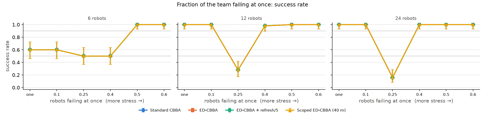
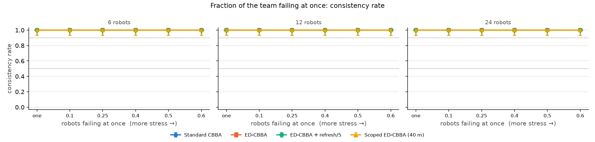
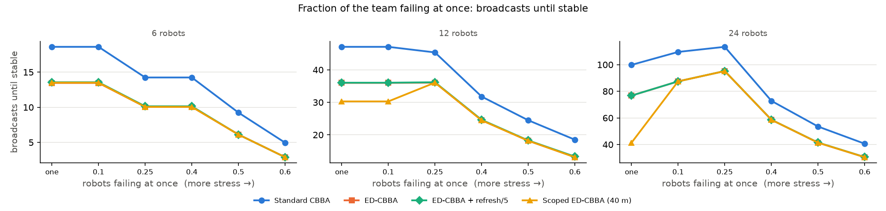
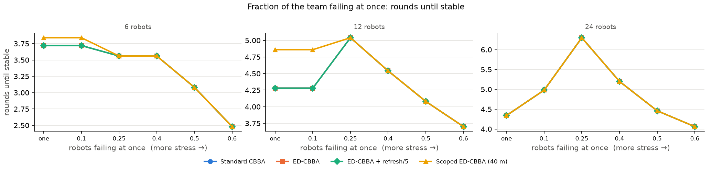

# Fraction of the team failing at once

50 seeds per cell. Rates: value [Wilson 95%].

## All levels

| robots | level | method | success | consistent | avoidable loss | groups | broadcasts | rounds | local rate |
| ---: | --- | --- | --- | --- | ---: | ---: | ---: | ---: | ---: |
| 6 | one | Standard CBBA | 0.60 [0.46, 0.72] | 1.00 [0.93, 1.00] | 0.48 | 1.0 | 19 | 3.7 | - |
| 6 | one | ED-CBBA | 0.60 [0.46, 0.72] | 1.00 [0.93, 1.00] | 0.48 | 1.0 | 13 | 3.7 | - |
| 6 | one | ED-CBBA + refresh/5 | 0.60 [0.46, 0.72] | 1.00 [0.93, 1.00] | 0.48 | 1.0 | 14 | 3.7 | - |
| 6 | one | Scoped ED-CBBA (40 m) | 0.60 [0.46, 0.72] | 1.00 [0.93, 1.00] | 0.48 | 1.0 | 14 | 3.8 | 0.02 |
| 6 | 0.1 | Standard CBBA | 0.60 [0.46, 0.72] | 1.00 [0.93, 1.00] | 0.48 | 1.0 | 19 | 3.7 | - |
| 6 | 0.1 | ED-CBBA | 0.60 [0.46, 0.72] | 1.00 [0.93, 1.00] | 0.48 | 1.0 | 13 | 3.7 | - |
| 6 | 0.1 | ED-CBBA + refresh/5 | 0.60 [0.46, 0.72] | 1.00 [0.93, 1.00] | 0.48 | 1.0 | 14 | 3.7 | - |
| 6 | 0.1 | Scoped ED-CBBA (40 m) | 0.60 [0.46, 0.72] | 1.00 [0.93, 1.00] | 0.48 | 1.0 | 14 | 3.8 | 0.02 |
| 6 | 0.25 | Standard CBBA | 0.50 [0.37, 0.63] | 1.00 [0.93, 1.00] | 0.78 | 1.0 | 14 | 3.6 | - |
| 6 | 0.25 | ED-CBBA | 0.50 [0.37, 0.63] | 1.00 [0.93, 1.00] | 0.78 | 1.0 | 10 | 3.6 | - |
| 6 | 0.25 | ED-CBBA + refresh/5 | 0.50 [0.37, 0.63] | 1.00 [0.93, 1.00] | 0.78 | 1.0 | 10 | 3.6 | - |
| 6 | 0.25 | Scoped ED-CBBA (40 m) | 0.50 [0.37, 0.63] | 1.00 [0.93, 1.00] | 0.78 | 1.0 | 10 | 3.6 | 0.00 |
| 6 | 0.4 | Standard CBBA | 0.50 [0.37, 0.63] | 1.00 [0.93, 1.00] | 0.78 | 1.0 | 14 | 3.6 | - |
| 6 | 0.4 | ED-CBBA | 0.50 [0.37, 0.63] | 1.00 [0.93, 1.00] | 0.78 | 1.0 | 10 | 3.6 | - |
| 6 | 0.4 | ED-CBBA + refresh/5 | 0.50 [0.37, 0.63] | 1.00 [0.93, 1.00] | 0.78 | 1.0 | 10 | 3.6 | - |
| 6 | 0.4 | Scoped ED-CBBA (40 m) | 0.50 [0.37, 0.63] | 1.00 [0.93, 1.00] | 0.78 | 1.0 | 10 | 3.6 | 0.00 |
| 6 | 0.5 | Standard CBBA | 1.00 [0.93, 1.00] | 1.00 [0.93, 1.00] | 0.00 | 1.0 | 9 | 3.1 | - |
| 6 | 0.5 | ED-CBBA | 1.00 [0.93, 1.00] | 1.00 [0.93, 1.00] | 0.00 | 1.0 | 6 | 3.1 | - |
| 6 | 0.5 | ED-CBBA + refresh/5 | 1.00 [0.93, 1.00] | 1.00 [0.93, 1.00] | 0.00 | 1.0 | 6 | 3.1 | - |
| 6 | 0.5 | Scoped ED-CBBA (40 m) | 1.00 [0.93, 1.00] | 1.00 [0.93, 1.00] | 0.00 | 1.0 | 6 | 3.1 | 0.00 |
| 6 | 0.6 | Standard CBBA | 1.00 [0.93, 1.00] | 1.00 [0.93, 1.00] | 0.00 | 1.0 | 5 | 2.5 | - |
| 6 | 0.6 | ED-CBBA | 1.00 [0.93, 1.00] | 1.00 [0.93, 1.00] | 0.00 | 1.0 | 3 | 2.5 | - |
| 6 | 0.6 | ED-CBBA + refresh/5 | 1.00 [0.93, 1.00] | 1.00 [0.93, 1.00] | 0.00 | 1.0 | 3 | 2.5 | - |
| 6 | 0.6 | Scoped ED-CBBA (40 m) | 1.00 [0.93, 1.00] | 1.00 [0.93, 1.00] | 0.00 | 1.0 | 3 | 2.5 | 0.00 |
| 12 | one | Standard CBBA | 1.00 [0.93, 1.00] | 1.00 [0.93, 1.00] | 0.00 | 1.0 | 47 | 4.3 | - |
| 12 | one | ED-CBBA | 1.00 [0.93, 1.00] | 1.00 [0.93, 1.00] | 0.00 | 1.0 | 36 | 4.3 | - |
| 12 | one | ED-CBBA + refresh/5 | 1.00 [0.93, 1.00] | 1.00 [0.93, 1.00] | 0.00 | 1.0 | 36 | 4.3 | - |
| 12 | one | Scoped ED-CBBA (40 m) | 1.00 [0.93, 1.00] | 1.00 [0.93, 1.00] | 0.00 | 1.0 | 30 | 4.9 | 0.38 |
| 12 | 0.1 | Standard CBBA | 1.00 [0.93, 1.00] | 1.00 [0.93, 1.00] | 0.00 | 1.0 | 47 | 4.3 | - |
| 12 | 0.1 | ED-CBBA | 1.00 [0.93, 1.00] | 1.00 [0.93, 1.00] | 0.00 | 1.0 | 36 | 4.3 | - |
| 12 | 0.1 | ED-CBBA + refresh/5 | 1.00 [0.93, 1.00] | 1.00 [0.93, 1.00] | 0.00 | 1.0 | 36 | 4.3 | - |
| 12 | 0.1 | Scoped ED-CBBA (40 m) | 1.00 [0.93, 1.00] | 1.00 [0.93, 1.00] | 0.00 | 1.0 | 30 | 4.9 | 0.38 |
| 12 | 0.25 | Standard CBBA | 0.28 [0.17, 0.42] | 1.00 [0.93, 1.00] | 1.40 | 1.0 | 45 | 5.0 | - |
| 12 | 0.25 | ED-CBBA | 0.28 [0.17, 0.42] | 1.00 [0.93, 1.00] | 1.40 | 1.0 | 36 | 5.0 | - |
| 12 | 0.25 | ED-CBBA + refresh/5 | 0.28 [0.17, 0.42] | 1.00 [0.93, 1.00] | 1.40 | 1.0 | 36 | 5.0 | - |
| 12 | 0.25 | Scoped ED-CBBA (40 m) | 0.28 [0.17, 0.42] | 1.00 [0.93, 1.00] | 1.40 | 1.0 | 36 | 5.0 | 0.00 |
| 12 | 0.4 | Standard CBBA | 0.98 [0.90, 1.00] | 1.00 [0.93, 1.00] | 0.04 | 1.0 | 32 | 4.5 | - |
| 12 | 0.4 | ED-CBBA | 0.98 [0.90, 1.00] | 1.00 [0.93, 1.00] | 0.04 | 1.0 | 24 | 4.5 | - |
| 12 | 0.4 | ED-CBBA + refresh/5 | 0.98 [0.90, 1.00] | 1.00 [0.93, 1.00] | 0.04 | 1.0 | 25 | 4.5 | - |
| 12 | 0.4 | Scoped ED-CBBA (40 m) | 0.98 [0.90, 1.00] | 1.00 [0.93, 1.00] | 0.04 | 1.0 | 24 | 4.5 | 0.00 |
| 12 | 0.5 | Standard CBBA | 1.00 [0.93, 1.00] | 1.00 [0.93, 1.00] | 0.00 | 1.0 | 24 | 4.1 | - |
| 12 | 0.5 | ED-CBBA | 1.00 [0.93, 1.00] | 1.00 [0.93, 1.00] | 0.00 | 1.0 | 18 | 4.1 | - |
| 12 | 0.5 | ED-CBBA + refresh/5 | 1.00 [0.93, 1.00] | 1.00 [0.93, 1.00] | 0.00 | 1.0 | 18 | 4.1 | - |
| 12 | 0.5 | Scoped ED-CBBA (40 m) | 1.00 [0.93, 1.00] | 1.00 [0.93, 1.00] | 0.00 | 1.0 | 18 | 4.1 | 0.00 |
| 12 | 0.6 | Standard CBBA | 1.00 [0.93, 1.00] | 1.00 [0.93, 1.00] | 0.00 | 1.0 | 18 | 3.7 | - |
| 12 | 0.6 | ED-CBBA | 1.00 [0.93, 1.00] | 1.00 [0.93, 1.00] | 0.00 | 1.0 | 13 | 3.7 | - |
| 12 | 0.6 | ED-CBBA + refresh/5 | 1.00 [0.93, 1.00] | 1.00 [0.93, 1.00] | 0.00 | 1.0 | 13 | 3.7 | - |
| 12 | 0.6 | Scoped ED-CBBA (40 m) | 1.00 [0.93, 1.00] | 1.00 [0.93, 1.00] | 0.00 | 1.0 | 13 | 3.7 | 0.00 |
| 24 | one | Standard CBBA | 1.00 [0.93, 1.00] | 1.00 [0.93, 1.00] | 0.00 | 1.0 | 100 | 4.3 | - |
| 24 | one | ED-CBBA | 1.00 [0.93, 1.00] | 1.00 [0.93, 1.00] | 0.00 | 1.0 | 77 | 4.3 | - |
| 24 | one | ED-CBBA + refresh/5 | 1.00 [0.93, 1.00] | 1.00 [0.93, 1.00] | 0.00 | 1.0 | 77 | 4.3 | - |
| 24 | one | Scoped ED-CBBA (40 m) | 1.00 [0.93, 1.00] | 1.00 [0.93, 1.00] | 0.00 | 1.0 | 41 | 4.3 | 0.74 |
| 24 | 0.1 | Standard CBBA | 1.00 [0.93, 1.00] | 1.00 [0.93, 1.00] | 0.00 | 1.0 | 110 | 5.0 | - |
| 24 | 0.1 | ED-CBBA | 1.00 [0.93, 1.00] | 1.00 [0.93, 1.00] | 0.00 | 1.0 | 87 | 5.0 | - |
| 24 | 0.1 | ED-CBBA + refresh/5 | 1.00 [0.93, 1.00] | 1.00 [0.93, 1.00] | 0.00 | 1.0 | 87 | 5.0 | - |
| 24 | 0.1 | Scoped ED-CBBA (40 m) | 1.00 [0.93, 1.00] | 1.00 [0.93, 1.00] | 0.00 | 1.0 | 87 | 5.0 | 0.00 |
| 24 | 0.25 | Standard CBBA | 0.16 [0.08, 0.29] | 1.00 [0.93, 1.00] | 2.36 | 1.0 | 113 | 6.3 | - |
| 24 | 0.25 | ED-CBBA | 0.16 [0.08, 0.29] | 1.00 [0.93, 1.00] | 2.36 | 1.0 | 95 | 6.3 | - |
| 24 | 0.25 | ED-CBBA + refresh/5 | 0.16 [0.08, 0.29] | 1.00 [0.93, 1.00] | 2.36 | 1.0 | 95 | 6.3 | - |
| 24 | 0.25 | Scoped ED-CBBA (40 m) | 0.16 [0.08, 0.29] | 1.00 [0.93, 1.00] | 2.36 | 1.0 | 95 | 6.3 | 0.00 |
| 24 | 0.4 | Standard CBBA | 1.00 [0.93, 1.00] | 1.00 [0.93, 1.00] | 0.00 | 1.0 | 73 | 5.2 | - |
| 24 | 0.4 | ED-CBBA | 1.00 [0.93, 1.00] | 1.00 [0.93, 1.00] | 0.00 | 1.0 | 59 | 5.2 | - |
| 24 | 0.4 | ED-CBBA + refresh/5 | 1.00 [0.93, 1.00] | 1.00 [0.93, 1.00] | 0.00 | 1.0 | 59 | 5.2 | - |
| 24 | 0.4 | Scoped ED-CBBA (40 m) | 1.00 [0.93, 1.00] | 1.00 [0.93, 1.00] | 0.00 | 1.0 | 59 | 5.2 | 0.00 |
| 24 | 0.5 | Standard CBBA | 1.00 [0.93, 1.00] | 1.00 [0.93, 1.00] | 0.00 | 1.0 | 54 | 4.5 | - |
| 24 | 0.5 | ED-CBBA | 1.00 [0.93, 1.00] | 1.00 [0.93, 1.00] | 0.00 | 1.0 | 41 | 4.5 | - |
| 24 | 0.5 | ED-CBBA + refresh/5 | 1.00 [0.93, 1.00] | 1.00 [0.93, 1.00] | 0.00 | 1.0 | 41 | 4.5 | - |
| 24 | 0.5 | Scoped ED-CBBA (40 m) | 1.00 [0.93, 1.00] | 1.00 [0.93, 1.00] | 0.00 | 1.0 | 41 | 4.5 | 0.00 |
| 24 | 0.6 | Standard CBBA | 1.00 [0.93, 1.00] | 1.00 [0.93, 1.00] | 0.00 | 1.0 | 41 | 4.1 | - |
| 24 | 0.6 | ED-CBBA | 1.00 [0.93, 1.00] | 1.00 [0.93, 1.00] | 0.00 | 1.0 | 30 | 4.1 | - |
| 24 | 0.6 | ED-CBBA + refresh/5 | 1.00 [0.93, 1.00] | 1.00 [0.93, 1.00] | 0.00 | 1.0 | 31 | 4.1 | - |
| 24 | 0.6 | Scoped ED-CBBA (40 m) | 1.00 [0.93, 1.00] | 1.00 [0.93, 1.00] | 0.00 | 1.0 | 30 | 4.1 | 0.00 |

