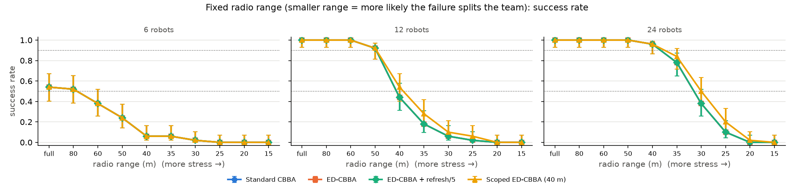
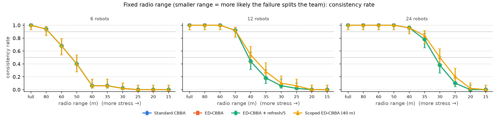
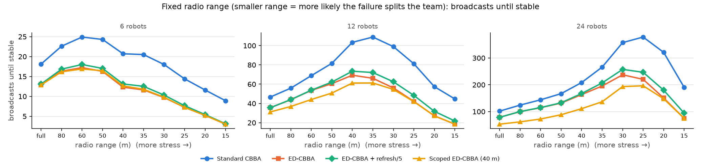
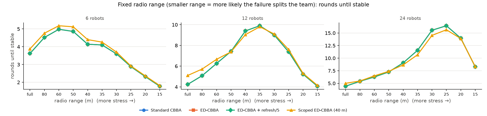

# Fixed radio range (smaller range = more likely the failure splits the team)

50 seeds per cell. Rates: value [Wilson 95%].

## All levels

| robots | level | method | success | consistent | avoidable loss | groups | broadcasts | rounds | local rate |
| ---: | --- | --- | --- | --- | ---: | ---: | ---: | ---: | ---: |
| 6 | full | Standard CBBA | 0.54 [0.40, 0.67] | 1.00 [0.93, 1.00] | 0.62 | 1.0 | 18 | 3.6 | - |
| 6 | full | ED-CBBA | 0.54 [0.40, 0.67] | 1.00 [0.93, 1.00] | 0.62 | 1.0 | 13 | 3.6 | - |
| 6 | full | ED-CBBA + refresh/5 | 0.54 [0.40, 0.67] | 1.00 [0.93, 1.00] | 0.62 | 1.0 | 13 | 3.6 | - |
| 6 | full | Scoped ED-CBBA (40 m) | 0.54 [0.40, 0.67] | 1.00 [0.93, 1.00] | 0.62 | 1.0 | 13 | 3.9 | 0.08 |
| 6 | 80 | Standard CBBA | 0.52 [0.39, 0.65] | 0.94 [0.84, 0.98] | 0.70 | 1.1 | 23 | 4.5 | - |
| 6 | 80 | ED-CBBA | 0.52 [0.39, 0.65] | 0.94 [0.84, 0.98] | 0.70 | 1.1 | 16 | 4.5 | - |
| 6 | 80 | ED-CBBA + refresh/5 | 0.52 [0.39, 0.65] | 0.94 [0.84, 0.98] | 0.70 | 1.1 | 17 | 4.5 | - |
| 6 | 80 | Scoped ED-CBBA (40 m) | 0.52 [0.39, 0.65] | 0.94 [0.84, 0.98] | 0.70 | 1.1 | 16 | 4.8 | 0.06 |
| 6 | 60 | Standard CBBA | 0.38 [0.26, 0.52] | 0.68 [0.54, 0.79] | 1.06 | 1.3 | 25 | 5.0 | - |
| 6 | 60 | ED-CBBA | 0.38 [0.26, 0.52] | 0.68 [0.54, 0.79] | 1.06 | 1.3 | 17 | 5.0 | - |
| 6 | 60 | ED-CBBA + refresh/5 | 0.38 [0.26, 0.52] | 0.68 [0.54, 0.79] | 1.06 | 1.3 | 18 | 5.0 | - |
| 6 | 60 | Scoped ED-CBBA (40 m) | 0.38 [0.26, 0.52] | 0.68 [0.54, 0.79] | 1.06 | 1.3 | 17 | 5.2 | 0.06 |
| 6 | 50 | Standard CBBA | 0.24 [0.14, 0.37] | 0.40 [0.28, 0.54] | 1.38 | 1.7 | 24 | 4.9 | - |
| 6 | 50 | ED-CBBA | 0.24 [0.14, 0.37] | 0.40 [0.28, 0.54] | 1.38 | 1.7 | 16 | 4.9 | - |
| 6 | 50 | ED-CBBA + refresh/5 | 0.24 [0.14, 0.37] | 0.40 [0.28, 0.54] | 1.38 | 1.7 | 17 | 4.9 | - |
| 6 | 50 | Scoped ED-CBBA (40 m) | 0.24 [0.14, 0.37] | 0.40 [0.28, 0.54] | 1.38 | 1.7 | 16 | 5.1 | 0.02 |
| 6 | 40 | Standard CBBA | 0.06 [0.02, 0.16] | 0.06 [0.02, 0.16] | 2.12 | 2.5 | 21 | 4.1 | - |
| 6 | 40 | ED-CBBA | 0.06 [0.02, 0.16] | 0.06 [0.02, 0.16] | 2.12 | 2.5 | 12 | 4.1 | - |
| 6 | 40 | ED-CBBA + refresh/5 | 0.06 [0.02, 0.16] | 0.06 [0.02, 0.16] | 2.12 | 2.5 | 13 | 4.1 | - |
| 6 | 40 | Scoped ED-CBBA (40 m) | 0.06 [0.02, 0.16] | 0.06 [0.02, 0.16] | 2.12 | 2.5 | 13 | 4.4 | 0.00 |
| 6 | 35 | Standard CBBA | 0.06 [0.02, 0.16] | 0.06 [0.02, 0.16] | 2.20 | 2.7 | 20 | 4.1 | - |
| 6 | 35 | ED-CBBA | 0.06 [0.02, 0.16] | 0.06 [0.02, 0.16] | 2.20 | 2.7 | 12 | 4.1 | - |
| 6 | 35 | ED-CBBA + refresh/5 | 0.06 [0.02, 0.16] | 0.06 [0.02, 0.16] | 2.20 | 2.7 | 13 | 4.1 | - |
| 6 | 35 | Scoped ED-CBBA (40 m) | 0.06 [0.02, 0.16] | 0.06 [0.02, 0.16] | 2.20 | 2.7 | 12 | 4.3 | 0.00 |
| 6 | 30 | Standard CBBA | 0.02 [0.00, 0.10] | 0.02 [0.00, 0.10] | 2.56 | 3.1 | 18 | 3.6 | - |
| 6 | 30 | ED-CBBA | 0.02 [0.00, 0.10] | 0.02 [0.00, 0.10] | 2.56 | 3.1 | 10 | 3.6 | - |
| 6 | 30 | ED-CBBA + refresh/5 | 0.02 [0.00, 0.10] | 0.02 [0.00, 0.10] | 2.56 | 3.1 | 10 | 3.6 | - |
| 6 | 30 | Scoped ED-CBBA (40 m) | 0.02 [0.00, 0.10] | 0.02 [0.00, 0.10] | 2.56 | 3.1 | 10 | 3.7 | 0.00 |
| 6 | 25 | Standard CBBA | 0.00 [0.00, 0.07] | 0.00 [0.00, 0.07] | 2.82 | 3.6 | 14 | 2.9 | - |
| 6 | 25 | ED-CBBA | 0.00 [0.00, 0.07] | 0.00 [0.00, 0.07] | 2.82 | 3.6 | 7 | 2.9 | - |
| 6 | 25 | ED-CBBA + refresh/5 | 0.00 [0.00, 0.07] | 0.00 [0.00, 0.07] | 2.82 | 3.6 | 8 | 2.9 | - |
| 6 | 25 | Scoped ED-CBBA (40 m) | 0.00 [0.00, 0.07] | 0.00 [0.00, 0.07] | 2.82 | 3.6 | 7 | 2.9 | 0.00 |
| 6 | 20 | Standard CBBA | 0.00 [0.00, 0.07] | 0.00 [0.00, 0.07] | 2.92 | 4.0 | 12 | 2.3 | - |
| 6 | 20 | ED-CBBA | 0.00 [0.00, 0.07] | 0.00 [0.00, 0.07] | 2.92 | 4.0 | 5 | 2.3 | - |
| 6 | 20 | ED-CBBA + refresh/5 | 0.00 [0.00, 0.07] | 0.00 [0.00, 0.07] | 2.92 | 4.0 | 5 | 2.3 | - |
| 6 | 20 | Scoped ED-CBBA (40 m) | 0.00 [0.00, 0.07] | 0.00 [0.00, 0.07] | 2.92 | 4.0 | 5 | 2.4 | 0.00 |
| 6 | 15 | Standard CBBA | 0.00 [0.00, 0.07] | 0.00 [0.00, 0.07] | 3.22 | 4.5 | 9 | 1.8 | - |
| 6 | 15 | ED-CBBA | 0.00 [0.00, 0.07] | 0.00 [0.00, 0.07] | 3.22 | 4.5 | 3 | 1.8 | - |
| 6 | 15 | ED-CBBA + refresh/5 | 0.00 [0.00, 0.07] | 0.00 [0.00, 0.07] | 3.22 | 4.5 | 3 | 1.8 | - |
| 6 | 15 | Scoped ED-CBBA (40 m) | 0.00 [0.00, 0.07] | 0.00 [0.00, 0.07] | 3.22 | 4.5 | 3 | 1.8 | 0.00 |
| 12 | full | Standard CBBA | 1.00 [0.93, 1.00] | 1.00 [0.93, 1.00] | 0.00 | 1.0 | 47 | 4.2 | - |
| 12 | full | ED-CBBA | 1.00 [0.93, 1.00] | 1.00 [0.93, 1.00] | 0.00 | 1.0 | 36 | 4.2 | - |
| 12 | full | ED-CBBA + refresh/5 | 1.00 [0.93, 1.00] | 1.00 [0.93, 1.00] | 0.00 | 1.0 | 36 | 4.2 | - |
| 12 | full | Scoped ED-CBBA (40 m) | 1.00 [0.93, 1.00] | 1.00 [0.93, 1.00] | 0.00 | 1.0 | 31 | 5.1 | 0.36 |
| 12 | 80 | Standard CBBA | 1.00 [0.93, 1.00] | 1.00 [0.93, 1.00] | 0.00 | 1.0 | 56 | 5.1 | - |
| 12 | 80 | ED-CBBA | 1.00 [0.93, 1.00] | 1.00 [0.93, 1.00] | 0.00 | 1.0 | 44 | 5.1 | - |
| 12 | 80 | ED-CBBA + refresh/5 | 1.00 [0.93, 1.00] | 1.00 [0.93, 1.00] | 0.00 | 1.0 | 44 | 5.1 | - |
| 12 | 80 | Scoped ED-CBBA (40 m) | 1.00 [0.93, 1.00] | 1.00 [0.93, 1.00] | 0.00 | 1.0 | 37 | 5.7 | 0.36 |
| 12 | 60 | Standard CBBA | 1.00 [0.93, 1.00] | 1.00 [0.93, 1.00] | 0.00 | 1.0 | 69 | 6.3 | - |
| 12 | 60 | ED-CBBA | 1.00 [0.93, 1.00] | 1.00 [0.93, 1.00] | 0.00 | 1.0 | 54 | 6.3 | - |
| 12 | 60 | ED-CBBA + refresh/5 | 1.00 [0.93, 1.00] | 1.00 [0.93, 1.00] | 0.00 | 1.0 | 54 | 6.3 | - |
| 12 | 60 | Scoped ED-CBBA (40 m) | 1.00 [0.93, 1.00] | 1.00 [0.93, 1.00] | 0.00 | 1.0 | 44 | 6.7 | 0.34 |
| 12 | 50 | Standard CBBA | 0.92 [0.81, 0.97] | 0.92 [0.81, 0.97] | 0.04 | 1.1 | 82 | 7.4 | - |
| 12 | 50 | ED-CBBA | 0.92 [0.81, 0.97] | 0.92 [0.81, 0.97] | 0.04 | 1.1 | 61 | 7.4 | - |
| 12 | 50 | ED-CBBA + refresh/5 | 0.92 [0.81, 0.97] | 0.92 [0.81, 0.97] | 0.04 | 1.1 | 62 | 7.4 | - |
| 12 | 50 | Scoped ED-CBBA (40 m) | 0.92 [0.81, 0.97] | 0.92 [0.81, 0.97] | 0.04 | 1.1 | 51 | 7.4 | 0.28 |
| 12 | 40 | Standard CBBA | 0.44 [0.31, 0.58] | 0.44 [0.31, 0.58] | 0.50 | 1.7 | 103 | 9.4 | - |
| 12 | 40 | ED-CBBA | 0.44 [0.31, 0.58] | 0.44 [0.31, 0.58] | 0.50 | 1.7 | 69 | 9.4 | - |
| 12 | 40 | ED-CBBA + refresh/5 | 0.44 [0.31, 0.58] | 0.44 [0.31, 0.58] | 0.50 | 1.7 | 73 | 9.4 | - |
| 12 | 40 | Scoped ED-CBBA (40 m) | 0.54 [0.40, 0.67] | 0.54 [0.40, 0.67] | 0.48 | 1.7 | 61 | 9.0 | 0.18 |
| 12 | 35 | Standard CBBA | 0.18 [0.10, 0.31] | 0.18 [0.10, 0.31] | 1.02 | 2.4 | 109 | 9.9 | - |
| 12 | 35 | ED-CBBA | 0.18 [0.10, 0.31] | 0.18 [0.10, 0.31] | 1.02 | 2.4 | 66 | 9.9 | - |
| 12 | 35 | ED-CBBA + refresh/5 | 0.18 [0.10, 0.31] | 0.18 [0.10, 0.31] | 1.02 | 2.4 | 72 | 9.9 | - |
| 12 | 35 | Scoped ED-CBBA (40 m) | 0.28 [0.17, 0.42] | 0.28 [0.17, 0.42] | 0.90 | 2.4 | 61 | 9.8 | 0.12 |
| 12 | 30 | Standard CBBA | 0.06 [0.02, 0.16] | 0.06 [0.02, 0.16] | 1.78 | 3.3 | 99 | 9.0 | - |
| 12 | 30 | ED-CBBA | 0.06 [0.02, 0.16] | 0.06 [0.02, 0.16] | 1.78 | 3.3 | 56 | 9.0 | - |
| 12 | 30 | ED-CBBA + refresh/5 | 0.06 [0.02, 0.16] | 0.06 [0.02, 0.16] | 1.78 | 3.3 | 63 | 9.0 | - |
| 12 | 30 | Scoped ED-CBBA (40 m) | 0.10 [0.04, 0.21] | 0.10 [0.04, 0.21] | 1.68 | 3.3 | 55 | 9.1 | 0.06 |
| 12 | 25 | Standard CBBA | 0.02 [0.00, 0.10] | 0.02 [0.00, 0.10] | 2.56 | 4.6 | 81 | 7.4 | - |
| 12 | 25 | ED-CBBA | 0.02 [0.00, 0.10] | 0.02 [0.00, 0.10] | 2.56 | 4.6 | 42 | 7.4 | - |
| 12 | 25 | ED-CBBA + refresh/5 | 0.02 [0.00, 0.10] | 0.02 [0.00, 0.10] | 2.56 | 4.6 | 48 | 7.4 | - |
| 12 | 25 | Scoped ED-CBBA (40 m) | 0.06 [0.02, 0.16] | 0.06 [0.02, 0.16] | 2.52 | 4.6 | 42 | 7.6 | 0.04 |
| 12 | 20 | Standard CBBA | 0.00 [0.00, 0.07] | 0.00 [0.00, 0.07] | 3.58 | 6.4 | 57 | 5.2 | - |
| 12 | 20 | ED-CBBA | 0.00 [0.00, 0.07] | 0.00 [0.00, 0.07] | 3.58 | 6.4 | 27 | 5.2 | - |
| 12 | 20 | ED-CBBA + refresh/5 | 0.00 [0.00, 0.07] | 0.00 [0.00, 0.07] | 3.58 | 6.4 | 32 | 5.2 | - |
| 12 | 20 | Scoped ED-CBBA (40 m) | 0.00 [0.00, 0.07] | 0.00 [0.00, 0.07] | 3.58 | 6.4 | 27 | 5.3 | 0.00 |
| 12 | 15 | Standard CBBA | 0.00 [0.00, 0.07] | 0.00 [0.00, 0.07] | 4.14 | 8.1 | 45 | 4.1 | - |
| 12 | 15 | ED-CBBA | 0.00 [0.00, 0.07] | 0.00 [0.00, 0.07] | 4.14 | 8.1 | 19 | 4.1 | - |
| 12 | 15 | ED-CBBA + refresh/5 | 0.00 [0.00, 0.07] | 0.00 [0.00, 0.07] | 4.14 | 8.1 | 22 | 4.1 | - |
| 12 | 15 | Scoped ED-CBBA (40 m) | 0.00 [0.00, 0.07] | 0.00 [0.00, 0.07] | 4.14 | 8.1 | 19 | 4.1 | 0.00 |
| 24 | full | Standard CBBA | 1.00 [0.93, 1.00] | 1.00 [0.93, 1.00] | 0.00 | 1.0 | 102 | 4.4 | - |
| 24 | full | ED-CBBA | 1.00 [0.93, 1.00] | 1.00 [0.93, 1.00] | 0.00 | 1.0 | 79 | 4.4 | - |
| 24 | full | ED-CBBA + refresh/5 | 1.00 [0.93, 1.00] | 1.00 [0.93, 1.00] | 0.00 | 1.0 | 79 | 4.4 | - |
| 24 | full | Scoped ED-CBBA (40 m) | 1.00 [0.93, 1.00] | 1.00 [0.93, 1.00] | 0.00 | 1.0 | 53 | 5.0 | 0.68 |
| 24 | 80 | Standard CBBA | 1.00 [0.93, 1.00] | 1.00 [0.93, 1.00] | 0.00 | 1.0 | 124 | 5.4 | - |
| 24 | 80 | ED-CBBA | 1.00 [0.93, 1.00] | 1.00 [0.93, 1.00] | 0.00 | 1.0 | 100 | 5.4 | - |
| 24 | 80 | ED-CBBA + refresh/5 | 1.00 [0.93, 1.00] | 1.00 [0.93, 1.00] | 0.00 | 1.0 | 100 | 5.4 | - |
| 24 | 80 | Scoped ED-CBBA (40 m) | 1.00 [0.93, 1.00] | 1.00 [0.93, 1.00] | 0.00 | 1.0 | 62 | 5.5 | 0.68 |
| 24 | 60 | Standard CBBA | 1.00 [0.93, 1.00] | 1.00 [0.93, 1.00] | 0.00 | 1.0 | 144 | 6.3 | - |
| 24 | 60 | ED-CBBA | 1.00 [0.93, 1.00] | 1.00 [0.93, 1.00] | 0.00 | 1.0 | 115 | 6.3 | - |
| 24 | 60 | ED-CBBA + refresh/5 | 1.00 [0.93, 1.00] | 1.00 [0.93, 1.00] | 0.00 | 1.0 | 115 | 6.3 | - |
| 24 | 60 | Scoped ED-CBBA (40 m) | 1.00 [0.93, 1.00] | 1.00 [0.93, 1.00] | 0.00 | 1.0 | 72 | 6.5 | 0.66 |
| 24 | 50 | Standard CBBA | 1.00 [0.93, 1.00] | 1.00 [0.93, 1.00] | 0.00 | 1.0 | 167 | 7.3 | - |
| 24 | 50 | ED-CBBA | 1.00 [0.93, 1.00] | 1.00 [0.93, 1.00] | 0.00 | 1.0 | 132 | 7.3 | - |
| 24 | 50 | ED-CBBA + refresh/5 | 1.00 [0.93, 1.00] | 1.00 [0.93, 1.00] | 0.00 | 1.0 | 133 | 7.3 | - |
| 24 | 50 | Scoped ED-CBBA (40 m) | 1.00 [0.93, 1.00] | 1.00 [0.93, 1.00] | 0.00 | 1.0 | 88 | 7.4 | 0.60 |
| 24 | 40 | Standard CBBA | 0.96 [0.87, 0.99] | 0.96 [0.87, 0.99] | 0.00 | 1.0 | 208 | 9.1 | - |
| 24 | 40 | ED-CBBA | 0.96 [0.87, 0.99] | 0.96 [0.87, 0.99] | 0.00 | 1.0 | 163 | 9.1 | - |
| 24 | 40 | ED-CBBA + refresh/5 | 0.96 [0.87, 0.99] | 0.96 [0.87, 0.99] | 0.00 | 1.0 | 167 | 9.1 | - |
| 24 | 40 | Scoped ED-CBBA (40 m) | 0.96 [0.87, 0.99] | 0.96 [0.87, 0.99] | 0.00 | 1.0 | 111 | 8.7 | 0.56 |
| 24 | 35 | Standard CBBA | 0.78 [0.65, 0.87] | 0.78 [0.65, 0.87] | 0.06 | 1.3 | 266 | 11.6 | - |
| 24 | 35 | ED-CBBA | 0.78 [0.65, 0.87] | 0.78 [0.65, 0.87] | 0.06 | 1.3 | 195 | 11.6 | - |
| 24 | 35 | ED-CBBA + refresh/5 | 0.78 [0.65, 0.87] | 0.78 [0.65, 0.87] | 0.06 | 1.3 | 207 | 11.6 | - |
| 24 | 35 | Scoped ED-CBBA (40 m) | 0.84 [0.71, 0.92] | 0.84 [0.71, 0.92] | 0.06 | 1.3 | 137 | 10.7 | 0.50 |
| 24 | 30 | Standard CBBA | 0.38 [0.26, 0.52] | 0.38 [0.26, 0.52] | 0.42 | 1.9 | 357 | 15.5 | - |
| 24 | 30 | ED-CBBA | 0.38 [0.26, 0.52] | 0.38 [0.26, 0.52] | 0.42 | 1.9 | 237 | 15.5 | - |
| 24 | 30 | ED-CBBA + refresh/5 | 0.38 [0.26, 0.52] | 0.38 [0.26, 0.52] | 0.42 | 1.9 | 257 | 15.5 | - |
| 24 | 30 | Scoped ED-CBBA (40 m) | 0.50 [0.37, 0.63] | 0.50 [0.37, 0.63] | 0.42 | 1.9 | 193 | 14.5 | 0.34 |
| 24 | 25 | Standard CBBA | 0.10 [0.04, 0.21] | 0.10 [0.04, 0.21] | 1.44 | 3.3 | 378 | 16.4 | - |
| 24 | 25 | ED-CBBA | 0.10 [0.04, 0.21] | 0.10 [0.04, 0.21] | 1.44 | 3.3 | 220 | 16.4 | - |
| 24 | 25 | ED-CBBA + refresh/5 | 0.10 [0.04, 0.21] | 0.10 [0.04, 0.21] | 1.44 | 3.3 | 247 | 16.4 | - |
| 24 | 25 | Scoped ED-CBBA (40 m) | 0.20 [0.11, 0.33] | 0.20 [0.11, 0.33] | 1.42 | 3.3 | 196 | 15.6 | 0.16 |
| 24 | 20 | Standard CBBA | 0.00 [0.00, 0.07] | 0.00 [0.00, 0.07] | 3.28 | 6.0 | 321 | 14.0 | - |
| 24 | 20 | ED-CBBA | 0.00 [0.00, 0.07] | 0.00 [0.00, 0.07] | 3.28 | 6.0 | 151 | 14.0 | - |
| 24 | 20 | ED-CBBA + refresh/5 | 0.00 [0.00, 0.07] | 0.00 [0.00, 0.07] | 3.28 | 6.0 | 180 | 14.0 | - |
| 24 | 20 | Scoped ED-CBBA (40 m) | 0.02 [0.00, 0.10] | 0.02 [0.00, 0.10] | 3.28 | 6.0 | 148 | 13.9 | 0.02 |
| 24 | 15 | Standard CBBA | 0.00 [0.00, 0.07] | 0.00 [0.00, 0.07] | 5.18 | 11.1 | 190 | 8.3 | - |
| 24 | 15 | ED-CBBA | 0.00 [0.00, 0.07] | 0.00 [0.00, 0.07] | 5.18 | 11.1 | 75 | 8.3 | - |
| 24 | 15 | ED-CBBA + refresh/5 | 0.00 [0.00, 0.07] | 0.00 [0.00, 0.07] | 5.18 | 11.1 | 94 | 8.3 | - |
| 24 | 15 | Scoped ED-CBBA (40 m) | 0.00 [0.00, 0.07] | 0.00 [0.00, 0.07] | 5.18 | 11.1 | 75 | 8.3 | 0.00 |

