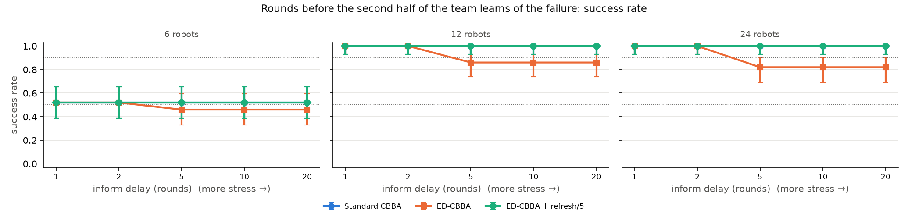
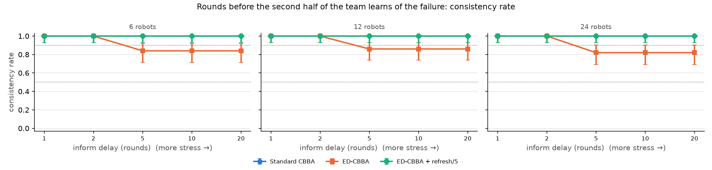
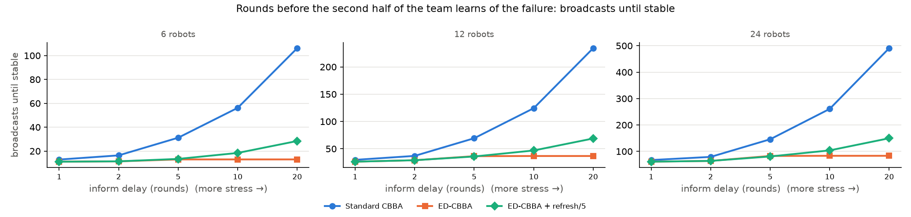
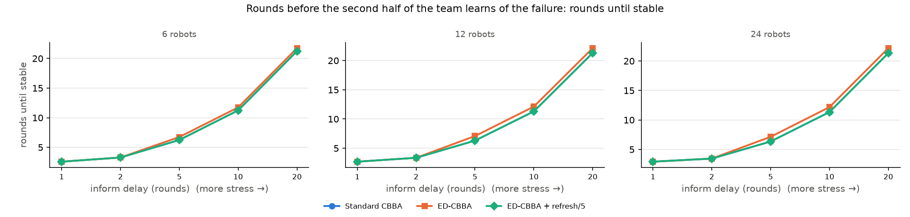

# Rounds before the second half of the team learns of the failure

50 seeds per cell. Rates: value [Wilson 95%].

## All levels

| robots | level | method | success | consistent | avoidable loss | groups | broadcasts | rounds | local rate |
| ---: | --- | --- | --- | --- | ---: | ---: | ---: | ---: | ---: |
| 6 | 1 | Standard CBBA | 0.52 [0.39, 0.65] | 1.00 [0.93, 1.00] | 0.62 | 1.0 | 13 | 2.6 | - |
| 6 | 1 | ED-CBBA | 0.52 [0.39, 0.65] | 1.00 [0.93, 1.00] | 0.62 | 1.0 | 11 | 2.6 | - |
| 6 | 1 | ED-CBBA + refresh/5 | 0.52 [0.39, 0.65] | 1.00 [0.93, 1.00] | 0.62 | 1.0 | 11 | 2.6 | - |
| 6 | 2 | Standard CBBA | 0.52 [0.39, 0.65] | 1.00 [0.93, 1.00] | 0.62 | 1.0 | 16 | 3.3 | - |
| 6 | 2 | ED-CBBA | 0.52 [0.39, 0.65] | 1.00 [0.93, 1.00] | 0.62 | 1.0 | 11 | 3.3 | - |
| 6 | 2 | ED-CBBA + refresh/5 | 0.52 [0.39, 0.65] | 1.00 [0.93, 1.00] | 0.62 | 1.0 | 11 | 3.3 | - |
| 6 | 5 | Standard CBBA | 0.52 [0.39, 0.65] | 1.00 [0.93, 1.00] | 0.62 | 1.0 | 31 | 6.2 | - |
| 6 | 5 | ED-CBBA | 0.46 [0.33, 0.60] | 0.84 [0.71, 0.92] | 0.70 | 1.0 | 13 | 6.7 | - |
| 6 | 5 | ED-CBBA + refresh/5 | 0.52 [0.39, 0.65] | 1.00 [0.93, 1.00] | 0.62 | 1.0 | 13 | 6.2 | - |
| 6 | 10 | Standard CBBA | 0.52 [0.39, 0.65] | 1.00 [0.93, 1.00] | 0.62 | 1.0 | 56 | 11.2 | - |
| 6 | 10 | ED-CBBA | 0.46 [0.33, 0.60] | 0.84 [0.71, 0.92] | 0.70 | 1.0 | 13 | 11.7 | - |
| 6 | 10 | ED-CBBA + refresh/5 | 0.52 [0.39, 0.65] | 1.00 [0.93, 1.00] | 0.62 | 1.0 | 18 | 11.2 | - |
| 6 | 20 | Standard CBBA | 0.52 [0.39, 0.65] | 1.00 [0.93, 1.00] | 0.62 | 1.0 | 106 | 21.2 | - |
| 6 | 20 | ED-CBBA | 0.46 [0.33, 0.60] | 0.84 [0.71, 0.92] | 0.70 | 1.0 | 13 | 21.7 | - |
| 6 | 20 | ED-CBBA + refresh/5 | 0.52 [0.39, 0.65] | 1.00 [0.93, 1.00] | 0.62 | 1.0 | 28 | 21.2 | - |
| 12 | 1 | Standard CBBA | 1.00 [0.93, 1.00] | 1.00 [0.93, 1.00] | 0.00 | 1.0 | 30 | 2.7 | - |
| 12 | 1 | ED-CBBA | 1.00 [0.93, 1.00] | 1.00 [0.93, 1.00] | 0.00 | 1.0 | 26 | 2.7 | - |
| 12 | 1 | ED-CBBA + refresh/5 | 1.00 [0.93, 1.00] | 1.00 [0.93, 1.00] | 0.00 | 1.0 | 26 | 2.7 | - |
| 12 | 2 | Standard CBBA | 1.00 [0.93, 1.00] | 1.00 [0.93, 1.00] | 0.00 | 1.0 | 37 | 3.4 | - |
| 12 | 2 | ED-CBBA | 1.00 [0.93, 1.00] | 1.00 [0.93, 1.00] | 0.00 | 1.0 | 29 | 3.4 | - |
| 12 | 2 | ED-CBBA + refresh/5 | 1.00 [0.93, 1.00] | 1.00 [0.93, 1.00] | 0.00 | 1.0 | 29 | 3.4 | - |
| 12 | 5 | Standard CBBA | 1.00 [0.93, 1.00] | 1.00 [0.93, 1.00] | 0.00 | 1.0 | 69 | 6.3 | - |
| 12 | 5 | ED-CBBA | 0.86 [0.74, 0.93] | 0.86 [0.74, 0.93] | 0.00 | 1.0 | 36 | 7.1 | - |
| 12 | 5 | ED-CBBA + refresh/5 | 1.00 [0.93, 1.00] | 1.00 [0.93, 1.00] | 0.00 | 1.0 | 36 | 6.3 | - |
| 12 | 10 | Standard CBBA | 1.00 [0.93, 1.00] | 1.00 [0.93, 1.00] | 0.00 | 1.0 | 124 | 11.3 | - |
| 12 | 10 | ED-CBBA | 0.86 [0.74, 0.93] | 0.86 [0.74, 0.93] | 0.00 | 1.0 | 37 | 12.1 | - |
| 12 | 10 | ED-CBBA + refresh/5 | 1.00 [0.93, 1.00] | 1.00 [0.93, 1.00] | 0.00 | 1.0 | 47 | 11.3 | - |
| 12 | 20 | Standard CBBA | 1.00 [0.93, 1.00] | 1.00 [0.93, 1.00] | 0.00 | 1.0 | 234 | 21.3 | - |
| 12 | 20 | ED-CBBA | 0.86 [0.74, 0.93] | 0.86 [0.74, 0.93] | 0.00 | 1.0 | 37 | 22.1 | - |
| 12 | 20 | ED-CBBA + refresh/5 | 1.00 [0.93, 1.00] | 1.00 [0.93, 1.00] | 0.00 | 1.0 | 69 | 21.3 | - |
| 24 | 1 | Standard CBBA | 1.00 [0.93, 1.00] | 1.00 [0.93, 1.00] | 0.00 | 1.0 | 67 | 2.9 | - |
| 24 | 1 | ED-CBBA | 1.00 [0.93, 1.00] | 1.00 [0.93, 1.00] | 0.00 | 1.0 | 61 | 2.9 | - |
| 24 | 1 | ED-CBBA + refresh/5 | 1.00 [0.93, 1.00] | 1.00 [0.93, 1.00] | 0.00 | 1.0 | 61 | 2.9 | - |
| 24 | 2 | Standard CBBA | 1.00 [0.93, 1.00] | 1.00 [0.93, 1.00] | 0.00 | 1.0 | 79 | 3.4 | - |
| 24 | 2 | ED-CBBA | 1.00 [0.93, 1.00] | 1.00 [0.93, 1.00] | 0.00 | 1.0 | 64 | 3.4 | - |
| 24 | 2 | ED-CBBA + refresh/5 | 1.00 [0.93, 1.00] | 1.00 [0.93, 1.00] | 0.00 | 1.0 | 64 | 3.4 | - |
| 24 | 5 | Standard CBBA | 1.00 [0.93, 1.00] | 1.00 [0.93, 1.00] | 0.00 | 1.0 | 146 | 6.3 | - |
| 24 | 5 | ED-CBBA | 0.82 [0.69, 0.90] | 0.82 [0.69, 0.90] | 0.00 | 1.0 | 83 | 7.1 | - |
| 24 | 5 | ED-CBBA + refresh/5 | 1.00 [0.93, 1.00] | 1.00 [0.93, 1.00] | 0.00 | 1.0 | 81 | 6.3 | - |
| 24 | 10 | Standard CBBA | 1.00 [0.93, 1.00] | 1.00 [0.93, 1.00] | 0.00 | 1.0 | 261 | 11.3 | - |
| 24 | 10 | ED-CBBA | 0.82 [0.69, 0.90] | 0.82 [0.69, 0.90] | 0.00 | 1.0 | 83 | 12.2 | - |
| 24 | 10 | ED-CBBA + refresh/5 | 1.00 [0.93, 1.00] | 1.00 [0.93, 1.00] | 0.00 | 1.0 | 104 | 11.3 | - |
| 24 | 20 | Standard CBBA | 1.00 [0.93, 1.00] | 1.00 [0.93, 1.00] | 0.00 | 1.0 | 491 | 21.3 | - |
| 24 | 20 | ED-CBBA | 0.82 [0.69, 0.90] | 0.82 [0.69, 0.90] | 0.00 | 1.0 | 83 | 22.2 | - |
| 24 | 20 | ED-CBBA + refresh/5 | 1.00 [0.93, 1.00] | 1.00 [0.93, 1.00] | 0.00 | 1.0 | 150 | 21.3 | - |

