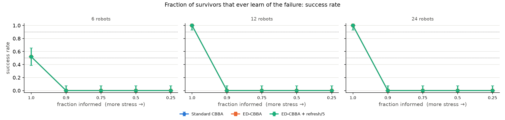
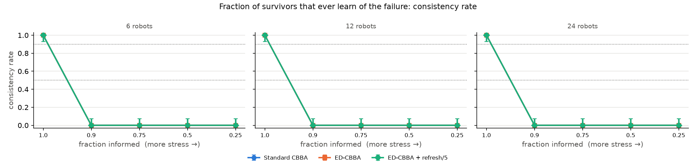
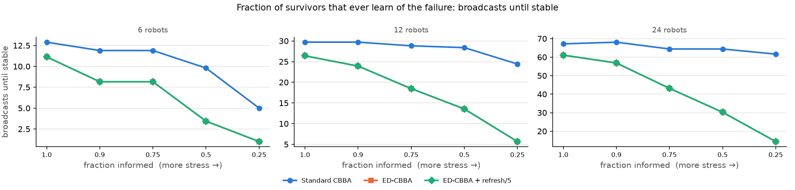
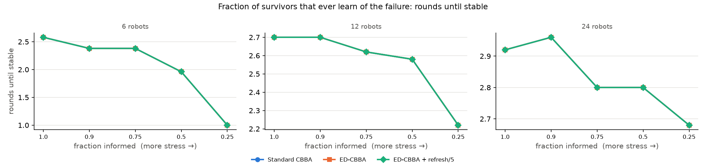

# Fraction of survivors that ever learn of the failure

50 seeds per cell. Rates: value [Wilson 95%].

## All levels

| robots | level | method | success | consistent | avoidable loss | groups | broadcasts | rounds | local rate |
| ---: | --- | --- | --- | --- | ---: | ---: | ---: | ---: | ---: |
| 6 | 1.0 | Standard CBBA | 0.52 [0.39, 0.65] | 1.00 [0.93, 1.00] | 0.62 | 1.0 | 13 | 2.6 | - |
| 6 | 1.0 | ED-CBBA | 0.52 [0.39, 0.65] | 1.00 [0.93, 1.00] | 0.62 | 1.0 | 11 | 2.6 | - |
| 6 | 1.0 | ED-CBBA + refresh/5 | 0.52 [0.39, 0.65] | 1.00 [0.93, 1.00] | 0.62 | 1.0 | 11 | 2.6 | - |
| 6 | 0.9 | Standard CBBA | 0.00 [0.00, 0.07] | 0.00 [0.00, 0.07] | 0.98 | 1.0 | 12 | 2.4 | - |
| 6 | 0.9 | ED-CBBA | 0.00 [0.00, 0.07] | 0.00 [0.00, 0.07] | 0.98 | 1.0 | 8 | 2.4 | - |
| 6 | 0.9 | ED-CBBA + refresh/5 | 0.00 [0.00, 0.07] | 0.00 [0.00, 0.07] | 0.98 | 1.0 | 8 | 2.4 | - |
| 6 | 0.75 | Standard CBBA | 0.00 [0.00, 0.07] | 0.00 [0.00, 0.07] | 0.98 | 1.0 | 12 | 2.4 | - |
| 6 | 0.75 | ED-CBBA | 0.00 [0.00, 0.07] | 0.00 [0.00, 0.07] | 0.98 | 1.0 | 8 | 2.4 | - |
| 6 | 0.75 | ED-CBBA + refresh/5 | 0.00 [0.00, 0.07] | 0.00 [0.00, 0.07] | 0.98 | 1.0 | 8 | 2.4 | - |
| 6 | 0.5 | Standard CBBA | 0.00 [0.00, 0.07] | 0.00 [0.00, 0.07] | 1.74 | 1.0 | 10 | 2.0 | - |
| 6 | 0.5 | ED-CBBA | 0.00 [0.00, 0.07] | 0.00 [0.00, 0.07] | 1.74 | 1.0 | 3 | 2.0 | - |
| 6 | 0.5 | ED-CBBA + refresh/5 | 0.00 [0.00, 0.07] | 0.00 [0.00, 0.07] | 1.74 | 1.0 | 3 | 2.0 | - |
| 6 | 0.25 | Standard CBBA | 0.00 [0.00, 0.07] | 0.00 [0.00, 0.07] | 2.28 | 1.0 | 5 | 1.0 | - |
| 6 | 0.25 | ED-CBBA | 0.00 [0.00, 0.07] | 0.00 [0.00, 0.07] | 2.28 | 1.0 | 1 | 1.0 | - |
| 6 | 0.25 | ED-CBBA + refresh/5 | 0.00 [0.00, 0.07] | 0.00 [0.00, 0.07] | 2.28 | 1.0 | 1 | 1.0 | - |
| 12 | 1.0 | Standard CBBA | 1.00 [0.93, 1.00] | 1.00 [0.93, 1.00] | 0.00 | 1.0 | 30 | 2.7 | - |
| 12 | 1.0 | ED-CBBA | 1.00 [0.93, 1.00] | 1.00 [0.93, 1.00] | 0.00 | 1.0 | 26 | 2.7 | - |
| 12 | 1.0 | ED-CBBA + refresh/5 | 1.00 [0.93, 1.00] | 1.00 [0.93, 1.00] | 0.00 | 1.0 | 26 | 2.7 | - |
| 12 | 0.9 | Standard CBBA | 0.00 [0.00, 0.07] | 0.00 [0.00, 0.07] | 0.00 | 1.0 | 30 | 2.7 | - |
| 12 | 0.9 | ED-CBBA | 0.00 [0.00, 0.07] | 0.00 [0.00, 0.07] | 0.00 | 1.0 | 24 | 2.7 | - |
| 12 | 0.9 | ED-CBBA + refresh/5 | 0.00 [0.00, 0.07] | 0.00 [0.00, 0.07] | 0.00 | 1.0 | 24 | 2.7 | - |
| 12 | 0.75 | Standard CBBA | 0.00 [0.00, 0.07] | 0.00 [0.00, 0.07] | 0.06 | 1.0 | 29 | 2.6 | - |
| 12 | 0.75 | ED-CBBA | 0.00 [0.00, 0.07] | 0.00 [0.00, 0.07] | 0.06 | 1.0 | 18 | 2.6 | - |
| 12 | 0.75 | ED-CBBA + refresh/5 | 0.00 [0.00, 0.07] | 0.00 [0.00, 0.07] | 0.06 | 1.0 | 18 | 2.6 | - |
| 12 | 0.5 | Standard CBBA | 0.00 [0.00, 0.07] | 0.00 [0.00, 0.07] | 0.18 | 1.0 | 28 | 2.6 | - |
| 12 | 0.5 | ED-CBBA | 0.00 [0.00, 0.07] | 0.00 [0.00, 0.07] | 0.18 | 1.0 | 14 | 2.6 | - |
| 12 | 0.5 | ED-CBBA + refresh/5 | 0.00 [0.00, 0.07] | 0.00 [0.00, 0.07] | 0.18 | 1.0 | 14 | 2.6 | - |
| 12 | 0.25 | Standard CBBA | 0.00 [0.00, 0.07] | 0.00 [0.00, 0.07] | 1.10 | 1.0 | 24 | 2.2 | - |
| 12 | 0.25 | ED-CBBA | 0.00 [0.00, 0.07] | 0.00 [0.00, 0.07] | 1.10 | 1.0 | 6 | 2.2 | - |
| 12 | 0.25 | ED-CBBA + refresh/5 | 0.00 [0.00, 0.07] | 0.00 [0.00, 0.07] | 1.10 | 1.0 | 6 | 2.2 | - |
| 24 | 1.0 | Standard CBBA | 1.00 [0.93, 1.00] | 1.00 [0.93, 1.00] | 0.00 | 1.0 | 67 | 2.9 | - |
| 24 | 1.0 | ED-CBBA | 1.00 [0.93, 1.00] | 1.00 [0.93, 1.00] | 0.00 | 1.0 | 61 | 2.9 | - |
| 24 | 1.0 | ED-CBBA + refresh/5 | 1.00 [0.93, 1.00] | 1.00 [0.93, 1.00] | 0.00 | 1.0 | 61 | 2.9 | - |
| 24 | 0.9 | Standard CBBA | 0.00 [0.00, 0.07] | 0.00 [0.00, 0.07] | 0.00 | 1.0 | 68 | 3.0 | - |
| 24 | 0.9 | ED-CBBA | 0.00 [0.00, 0.07] | 0.00 [0.00, 0.07] | 0.00 | 1.0 | 57 | 3.0 | - |
| 24 | 0.9 | ED-CBBA + refresh/5 | 0.00 [0.00, 0.07] | 0.00 [0.00, 0.07] | 0.00 | 1.0 | 57 | 3.0 | - |
| 24 | 0.75 | Standard CBBA | 0.00 [0.00, 0.07] | 0.00 [0.00, 0.07] | 0.00 | 1.0 | 64 | 2.8 | - |
| 24 | 0.75 | ED-CBBA | 0.00 [0.00, 0.07] | 0.00 [0.00, 0.07] | 0.00 | 1.0 | 43 | 2.8 | - |
| 24 | 0.75 | ED-CBBA + refresh/5 | 0.00 [0.00, 0.07] | 0.00 [0.00, 0.07] | 0.00 | 1.0 | 43 | 2.8 | - |
| 24 | 0.5 | Standard CBBA | 0.00 [0.00, 0.07] | 0.00 [0.00, 0.07] | 0.00 | 1.0 | 64 | 2.8 | - |
| 24 | 0.5 | ED-CBBA | 0.00 [0.00, 0.07] | 0.00 [0.00, 0.07] | 0.00 | 1.0 | 30 | 2.8 | - |
| 24 | 0.5 | ED-CBBA + refresh/5 | 0.00 [0.00, 0.07] | 0.00 [0.00, 0.07] | 0.00 | 1.0 | 30 | 2.8 | - |
| 24 | 0.25 | Standard CBBA | 0.00 [0.00, 0.07] | 0.00 [0.00, 0.07] | 0.30 | 1.0 | 62 | 2.7 | - |
| 24 | 0.25 | ED-CBBA | 0.00 [0.00, 0.07] | 0.00 [0.00, 0.07] | 0.30 | 1.0 | 14 | 2.7 | - |
| 24 | 0.25 | ED-CBBA + refresh/5 | 0.00 [0.00, 0.07] | 0.00 [0.00, 0.07] | 0.30 | 1.0 | 14 | 2.7 | - |

