# Experiment 3 (shared capabilities): baseline

Source: `results/exp3_shared/baseline`. 90 missions, 540 re-auction runs. Values are mean ± 95% CI half-width (t-distribution) over seeds.

## Post-failure broadcasts until the allocation stops changing

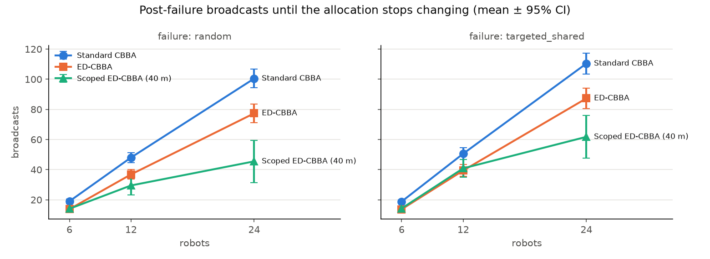

| failure | robots | Standard CBBA | ED-CBBA | Scoped ED-CBBA (40 m) |
| --- | ---: | ---: | ---: | ---: |
| random | 6 | 19.00 ± 1.50 | 13.77 ± 1.36 | 14.03 ± 1.50 |
| random | 12 | 48.03 ± 3.32 | 36.83 ± 3.18 | 29.50 ± 6.33 |
| random | 24 | 100.43 ± 6.17 | 77.37 ± 6.15 | 45.50 ± 14.04 |
| targeted_shared | 6 | 18.83 ± 0.94 | 13.70 ± 0.90 | 14.27 ± 1.24 |
| targeted_shared | 12 | 50.60 ± 3.98 | 39.43 ± 3.85 | 40.87 ± 5.74 |
| targeted_shared | 24 | 110.40 ± 6.91 | 87.30 ± 6.86 | 61.77 ± 14.09 |

## Post-failure broadcasts incl. quiet rounds of the stopping rule

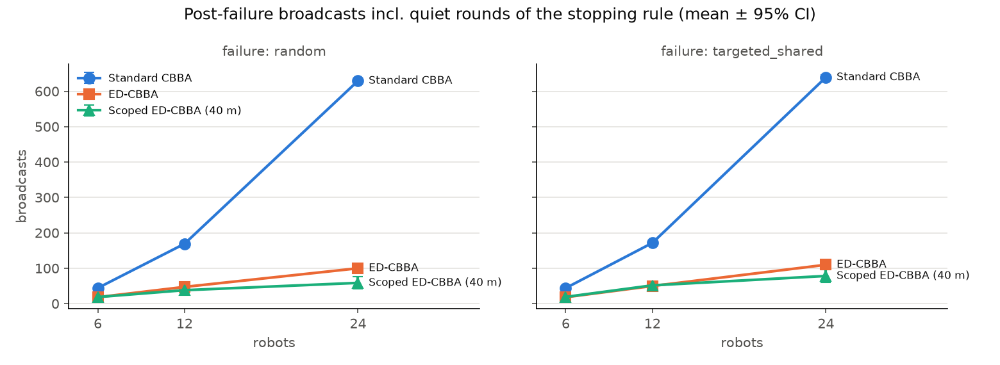

| failure | robots | Standard CBBA | ED-CBBA | Scoped ED-CBBA (40 m) |
| --- | ---: | ---: | ---: | ---: |
| random | 6 | 44.00 ± 1.50 | 18.10 ± 1.30 | 18.53 ± 1.51 |
| random | 12 | 169.03 ± 3.32 | 47.17 ± 3.10 | 37.93 ± 7.81 |
| random | 24 | 629.43 ± 6.17 | 99.80 ± 6.06 | 58.57 ± 17.58 |
| targeted_shared | 6 | 43.83 ± 0.94 | 18.07 ± 0.86 | 18.90 ± 1.38 |
| targeted_shared | 12 | 171.60 ± 3.98 | 49.77 ± 3.77 | 51.60 ± 6.59 |
| targeted_shared | 24 | 639.40 ± 6.91 | 109.70 ± 6.80 | 78.13 ± 17.30 |

## Broadcasts per affected task (incl. quiet rounds)

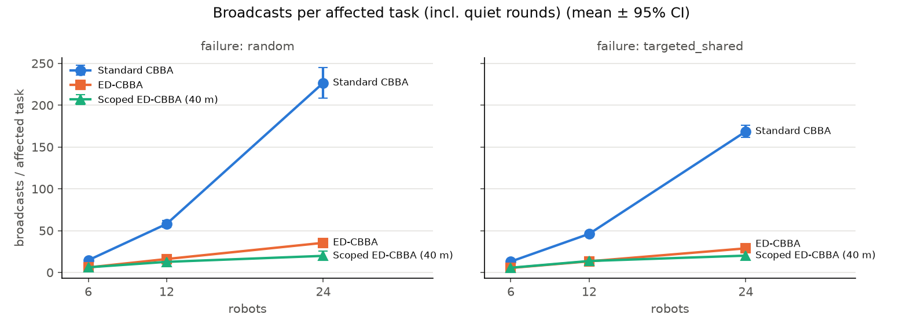

| failure | robots | Standard CBBA | ED-CBBA | Scoped ED-CBBA (40 m) |
| --- | ---: | ---: | ---: | ---: |
| random | 6 | 14.64 ± 1.20 | 6.01 ± 0.62 | 6.16 ± 0.69 |
| random | 12 | 58.02 ± 3.97 | 16.06 ± 1.25 | 12.68 ± 2.64 |
| random | 24 | 226.68 ± 18.39 | 35.44 ± 2.64 | 19.84 ± 5.49 |
| targeted_shared | 6 | 13.06 ± 0.81 | 5.39 ± 0.43 | 5.65 ± 0.56 |
| targeted_shared | 12 | 46.14 ± 2.22 | 13.32 ± 1.04 | 13.69 ± 1.70 |
| targeted_shared | 24 | 168.60 ± 7.25 | 28.82 ± 1.88 | 20.12 ± 4.21 |

## Consensus rounds until the allocation stops changing

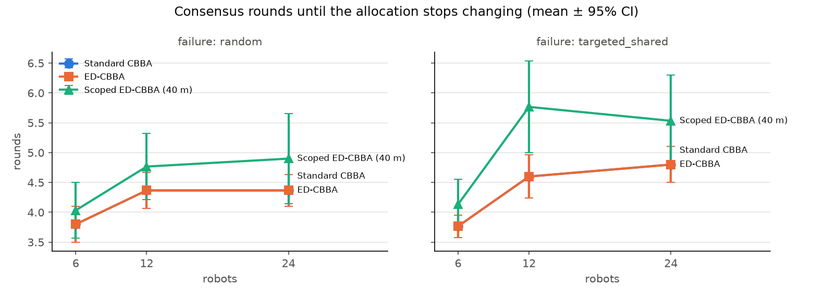

| failure | robots | Standard CBBA | ED-CBBA | Scoped ED-CBBA (40 m) |
| --- | ---: | ---: | ---: | ---: |
| random | 6 | 3.80 ± 0.30 | 3.80 ± 0.30 | 4.03 ± 0.46 |
| random | 12 | 4.37 ± 0.30 | 4.37 ± 0.30 | 4.77 ± 0.55 |
| random | 24 | 4.37 ± 0.27 | 4.37 ± 0.27 | 4.90 ± 0.76 |
| targeted_shared | 6 | 3.77 ± 0.19 | 3.77 ± 0.19 | 4.13 ± 0.42 |
| targeted_shared | 12 | 4.60 ± 0.36 | 4.60 ± 0.36 | 5.77 ± 0.77 |
| targeted_shared | 24 | 4.80 ± 0.30 | 4.80 ± 0.30 | 5.53 ± 0.76 |

## Consensus rounds incl. quiet rounds

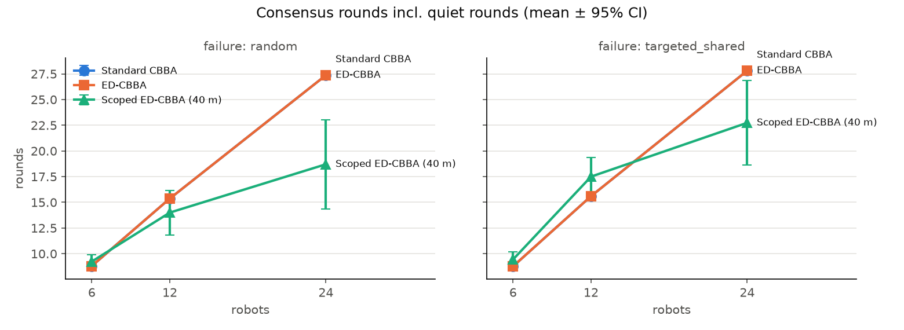

| failure | robots | Standard CBBA | ED-CBBA | Scoped ED-CBBA (40 m) |
| --- | ---: | ---: | ---: | ---: |
| random | 6 | 8.80 ± 0.30 | 8.80 ± 0.30 | 9.23 ± 0.65 |
| random | 12 | 15.37 ± 0.30 | 15.37 ± 0.30 | 14.00 ± 2.16 |
| random | 24 | 27.37 ± 0.27 | 27.37 ± 0.27 | 18.70 ± 4.33 |
| targeted_shared | 6 | 8.77 ± 0.19 | 8.77 ± 0.19 | 9.43 ± 0.74 |
| targeted_shared | 12 | 15.60 ± 0.36 | 15.60 ± 0.36 | 17.50 ± 1.88 |
| targeted_shared | 24 | 27.80 ± 0.30 | 27.80 ± 0.30 | 22.73 ± 4.11 |

## Re-auction runtime (CPU)

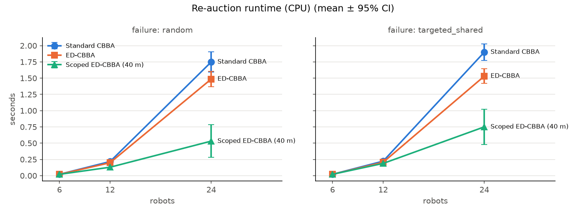

| failure | robots | Standard CBBA | ED-CBBA | Scoped ED-CBBA (40 m) |
| --- | ---: | ---: | ---: | ---: |
| random | 6 | 0.0212 ± 0.0027 | 0.0201 ± 0.0026 | 0.0205 ± 0.0027 |
| random | 12 | 0.2170 ± 0.0171 | 0.1989 ± 0.0159 | 0.1298 ± 0.0367 |
| random | 24 | 1.7494 ± 0.1583 | 1.4861 ± 0.1162 | 0.5315 ± 0.2512 |
| targeted_shared | 6 | 0.0214 ± 0.0029 | 0.0207 ± 0.0029 | 0.0210 ± 0.0032 |
| targeted_shared | 12 | 0.2231 ± 0.0158 | 0.2053 ± 0.0136 | 0.1880 ± 0.0274 |
| targeted_shared | 24 | 1.9004 ± 0.1266 | 1.5310 ± 0.1119 | 0.7505 ± 0.2705 |

## Assigned-task rate

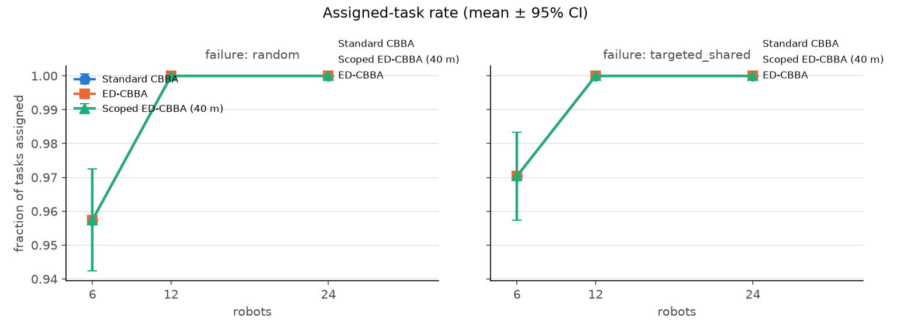

| failure | robots | Standard CBBA | ED-CBBA | Scoped ED-CBBA (40 m) |
| --- | ---: | ---: | ---: | ---: |
| random | 6 | 0.9574 ± 0.0151 | 0.9574 ± 0.0151 | 0.9574 ± 0.0151 |
| random | 12 | 1.0000 ± 0.0000 | 1.0000 ± 0.0000 | 1.0000 ± 0.0000 |
| random | 24 | 1.0000 ± 0.0000 | 1.0000 ± 0.0000 | 1.0000 ± 0.0000 |
| targeted_shared | 6 | 0.9704 ± 0.0130 | 0.9704 ± 0.0130 | 0.9704 ± 0.0130 |
| targeted_shared | 12 | 1.0000 ± 0.0000 | 1.0000 ± 0.0000 | 1.0000 ± 0.0000 |
| targeted_shared | 24 | 1.0000 ± 0.0000 | 1.0000 ± 0.0000 | 1.0000 ± 0.0000 |

## Assignment score

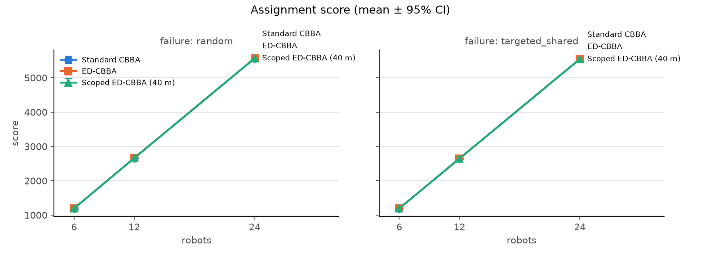

| failure | robots | Standard CBBA | ED-CBBA | Scoped ED-CBBA (40 m) |
| --- | ---: | ---: | ---: | ---: |
| random | 6 | 1195.20 ± 13.22 | 1195.20 ± 13.22 | 1195.20 ± 13.22 |
| random | 12 | 2664.46 ± 14.59 | 2664.46 ± 14.59 | 2660.80 ± 14.89 |
| random | 24 | 5571.78 ± 23.35 | 5571.78 ± 23.35 | 5568.15 ± 23.15 |
| targeted_shared | 6 | 1192.53 ± 15.66 | 1192.53 ± 15.66 | 1192.53 ± 15.66 |
| targeted_shared | 12 | 2646.68 ± 16.21 | 2646.68 ± 16.21 | 2645.92 ± 15.88 |
| targeted_shared | 24 | 5548.38 ± 25.58 | 5548.38 ± 25.58 | 5544.50 ± 24.87 |

## Mission completion time (last task finishes)

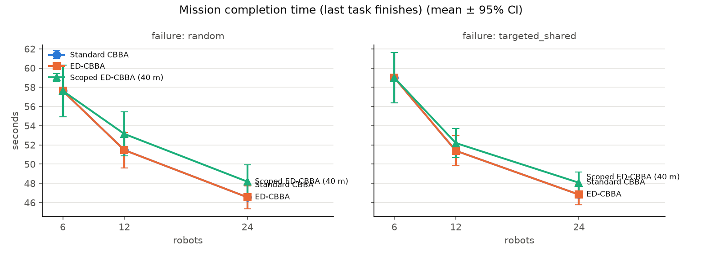

| failure | robots | Standard CBBA | ED-CBBA | Scoped ED-CBBA (40 m) |
| --- | ---: | ---: | ---: | ---: |
| random | 6 | 57.63 ± 2.69 | 57.63 ± 2.69 | 57.63 ± 2.69 |
| random | 12 | 51.46 ± 1.85 | 51.46 ± 1.85 | 53.14 ± 2.29 |
| random | 24 | 46.55 ± 1.20 | 46.55 ± 1.20 | 48.17 ± 1.73 |
| targeted_shared | 6 | 59.00 ± 2.62 | 59.00 ± 2.62 | 59.00 ± 2.62 |
| targeted_shared | 12 | 51.39 ± 1.57 | 51.39 ± 1.57 | 52.19 ± 1.53 |
| targeted_shared | 24 | 46.83 ± 1.08 | 46.83 ± 1.08 | 48.07 ± 1.11 |

## Total robot time spent on shared tasks

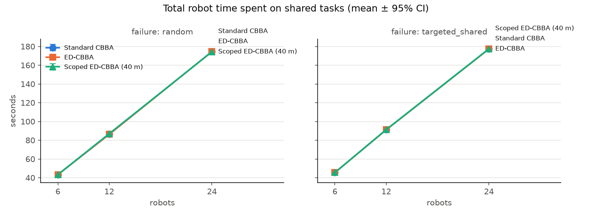

| failure | robots | Standard CBBA | ED-CBBA | Scoped ED-CBBA (40 m) |
| --- | ---: | ---: | ---: | ---: |
| random | 6 | 43.33 ± 1.72 | 43.33 ± 1.72 | 43.33 ± 1.72 |
| random | 12 | 86.33 ± 2.54 | 86.33 ± 2.54 | 87.00 ± 2.67 |
| random | 24 | 174.50 ± 3.15 | 174.50 ± 3.15 | 174.33 ± 3.20 |
| targeted_shared | 6 | 45.50 ± 1.86 | 45.50 ± 1.86 | 45.50 ± 1.86 |
| targeted_shared | 12 | 91.17 ± 2.12 | 91.17 ± 2.12 | 91.33 ± 2.13 |
| targeted_shared | 24 | 177.33 ± 3.24 | 177.33 ± 3.24 | 177.50 ± 3.28 |

## Surviving robots' tasks that changed owner

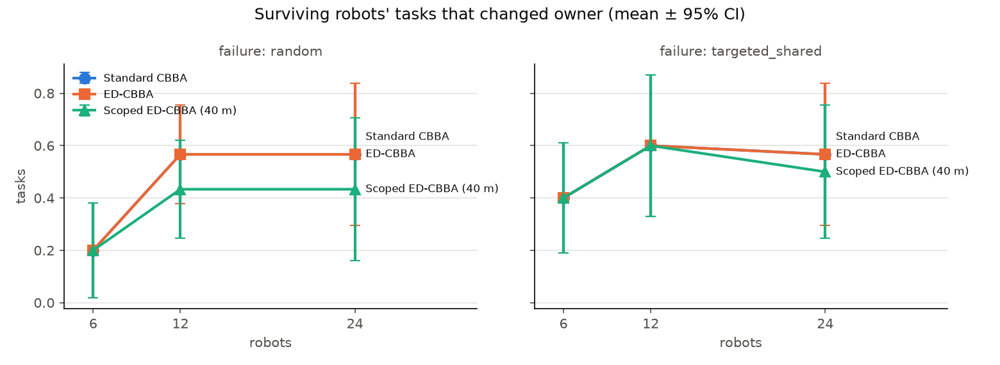

| failure | robots | Standard CBBA | ED-CBBA | Scoped ED-CBBA (40 m) |
| --- | ---: | ---: | ---: | ---: |
| random | 6 | 0.20 ± 0.18 | 0.20 ± 0.18 | 0.20 ± 0.18 |
| random | 12 | 0.57 ± 0.19 | 0.57 ± 0.19 | 0.43 ± 0.19 |
| random | 24 | 0.57 ± 0.27 | 0.57 ± 0.27 | 0.43 ± 0.27 |
| targeted_shared | 6 | 0.40 ± 0.21 | 0.40 ± 0.21 | 0.40 ± 0.21 |
| targeted_shared | 12 | 0.60 ± 0.27 | 0.60 ± 0.27 | 0.60 ± 0.27 |
| targeted_shared | 24 | 0.57 ± 0.27 | 0.57 ± 0.27 | 0.50 ± 0.25 |

## Paired differences vs standard CBBA

Per mission: method minus standard CBBA on the same mission and failed robot.

| failure | robots | method | Δ broadcasts | broadcast reduction | Δ score | Δ assigned tasks |
| --- | ---: | --- | ---: | ---: | ---: | ---: |
| random | 6 | ED-CBBA | -25.9 ± 0.3 | 59.2 ± 1.6% | 0.00 ± 0.00 | 0.00 ± 0.00 |
| random | 6 | Scoped ED-CBBA (40 m) | -25.5 ± 0.5 | 58.3 ± 2.0% | 0.00 ± 0.00 | 0.00 ± 0.00 |
| random | 12 | ED-CBBA | -121.9 ± 0.3 | 72.3 ± 1.3% | 0.00 ± 0.00 | 0.00 ± 0.00 |
| random | 12 | Scoped ED-CBBA (40 m) | -131.1 ± 6.7 | 77.8 ± 4.4% | -3.66 ± 2.55 | 0.00 ± 0.00 |
| random | 24 | ED-CBBA | -529.6 ± 0.2 | 84.2 ± 0.8% | 0.00 ± 0.00 | 0.00 ± 0.00 |
| random | 24 | Scoped ED-CBBA (40 m) | -570.9 ± 16.0 | 90.8 ± 2.7% | -3.63 ± 1.98 | 0.00 ± 0.00 |
| targeted_shared | 6 | ED-CBBA | -25.8 ± 0.3 | 58.9 ± 1.2% | 0.00 ± 0.00 | 0.00 ± 0.00 |
| targeted_shared | 6 | Scoped ED-CBBA (40 m) | -24.9 ± 1.0 | 57.1 ± 2.6% | 0.00 ± 0.00 | 0.00 ± 0.00 |
| targeted_shared | 12 | ED-CBBA | -121.8 ± 0.3 | 71.2 ± 1.4% | 0.00 ± 0.00 | 0.00 ± 0.00 |
| targeted_shared | 12 | Scoped ED-CBBA (40 m) | -120.0 ± 4.4 | 70.3 ± 3.4% | -0.77 ± 0.92 | 0.00 ± 0.00 |
| targeted_shared | 24 | ED-CBBA | -529.7 ± 0.2 | 82.9 ± 0.9% | 0.00 ± 0.00 | 0.00 ± 0.00 |
| targeted_shared | 24 | Scoped ED-CBBA (40 m) | -561.3 ± 16.0 | 87.8 ± 2.6% | -3.88 ± 2.13 | 0.00 ± 0.00 |

## Local recovery rate (scoped ED-CBBA)

| failure | robots | local / runs | rate [95% Wilson] | too many affected tasks | no nearby capable robot | local group disconnected | local capacity or schedule infeasible | nothing affected |
| --- | ---: | ---: | --- | ---: | ---: | ---: | ---: | ---: |
| random | 6 | 0/30 | 0.00 [0.00, 0.11] | 0 | 27 | 0 | 3 | 0 |
| random | 12 | 12/30 | 0.40 [0.25, 0.58] | 0 | 11 | 0 | 7 | 0 |
| random | 24 | 21/30 | 0.70 [0.52, 0.83] | 0 | 3 | 0 | 6 | 0 |
| targeted_shared | 6 | 1/30 | 0.03 [0.01, 0.17] | 0 | 25 | 0 | 4 | 0 |
| targeted_shared | 12 | 5/30 | 0.17 [0.07, 0.34] | 0 | 14 | 0 | 11 | 0 |
| targeted_shared | 24 | 18/30 | 0.60 [0.42, 0.75] | 0 | 4 | 0 | 8 | 0 |

## Consistency

| failure | robots | method | consensus reached [95% Wilson] | runs with duplicate claims |
| --- | ---: | --- | --- | ---: |
| random | 6 | Standard CBBA | 1.00 [0.89, 1.00] | 0 |
| random | 6 | ED-CBBA | 1.00 [0.89, 1.00] | 0 |
| random | 6 | Scoped ED-CBBA (40 m) | 1.00 [0.89, 1.00] | 0 |
| random | 12 | Standard CBBA | 1.00 [0.89, 1.00] | 0 |
| random | 12 | ED-CBBA | 1.00 [0.89, 1.00] | 0 |
| random | 12 | Scoped ED-CBBA (40 m) | 1.00 [0.89, 1.00] | 0 |
| random | 24 | Standard CBBA | 1.00 [0.89, 1.00] | 0 |
| random | 24 | ED-CBBA | 1.00 [0.89, 1.00] | 0 |
| random | 24 | Scoped ED-CBBA (40 m) | 1.00 [0.89, 1.00] | 0 |
| targeted_shared | 6 | Standard CBBA | 1.00 [0.89, 1.00] | 0 |
| targeted_shared | 6 | ED-CBBA | 1.00 [0.89, 1.00] | 0 |
| targeted_shared | 6 | Scoped ED-CBBA (40 m) | 1.00 [0.89, 1.00] | 0 |
| targeted_shared | 12 | Standard CBBA | 1.00 [0.89, 1.00] | 0 |
| targeted_shared | 12 | ED-CBBA | 1.00 [0.89, 1.00] | 0 |
| targeted_shared | 12 | Scoped ED-CBBA (40 m) | 1.00 [0.89, 1.00] | 0 |
| targeted_shared | 24 | Standard CBBA | 1.00 [0.89, 1.00] | 0 |
| targeted_shared | 24 | ED-CBBA | 1.00 [0.89, 1.00] | 0 |
| targeted_shared | 24 | Scoped ED-CBBA (40 m) | 1.00 [0.89, 1.00] | 0 |

## Shared-task winners

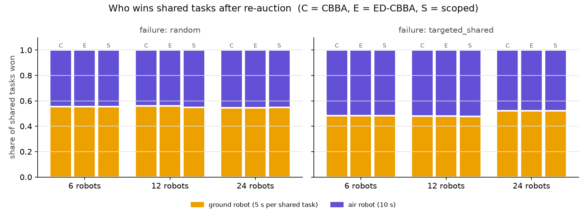

Ground robots take 5 s on a shared task and air robots 10 s, at equal speed.

| failure | robots | method | ground share | air share | unassigned | won by farther type |
| --- | ---: | --- | ---: | ---: | ---: | ---: |
| random | 6 | Standard CBBA | 0.56 | 0.44 | 0.00 | 0.23 |
| random | 6 | ED-CBBA | 0.56 | 0.44 | 0.00 | 0.23 |
| random | 6 | Scoped ED-CBBA (40 m) | 0.56 | 0.44 | 0.00 | 0.23 |
| random | 12 | Standard CBBA | 0.56 | 0.44 | 0.00 | 0.24 |
| random | 12 | ED-CBBA | 0.56 | 0.44 | 0.00 | 0.24 |
| random | 12 | Scoped ED-CBBA (40 m) | 0.55 | 0.45 | 0.00 | 0.23 |
| random | 24 | Standard CBBA | 0.55 | 0.45 | 0.00 | 0.23 |
| random | 24 | ED-CBBA | 0.55 | 0.45 | 0.00 | 0.23 |
| random | 24 | Scoped ED-CBBA (40 m) | 0.55 | 0.45 | 0.00 | 0.24 |
| targeted_shared | 6 | Standard CBBA | 0.48 | 0.52 | 0.00 | 0.24 |
| targeted_shared | 6 | ED-CBBA | 0.48 | 0.52 | 0.00 | 0.24 |
| targeted_shared | 6 | Scoped ED-CBBA (40 m) | 0.48 | 0.52 | 0.00 | 0.24 |
| targeted_shared | 12 | Standard CBBA | 0.48 | 0.52 | 0.00 | 0.22 |
| targeted_shared | 12 | ED-CBBA | 0.48 | 0.52 | 0.00 | 0.22 |
| targeted_shared | 12 | Scoped ED-CBBA (40 m) | 0.48 | 0.52 | 0.00 | 0.22 |
| targeted_shared | 24 | Standard CBBA | 0.52 | 0.48 | 0.00 | 0.25 |
| targeted_shared | 24 | ED-CBBA | 0.52 | 0.48 | 0.00 | 0.25 |
| targeted_shared | 24 | Scoped ED-CBBA (40 m) | 0.52 | 0.48 | 0.00 | 0.24 |

*won by farther type*: the winner's type has no robot closer to the task than the nearest robot of the other type.
