# Experiment 3 (shared capabilities): cascading

Source: `results/exp3_shared/cascading`. 90 missions, 270 re-auction runs. Values are mean ± 95% CI half-width (t-distribution) over seeds.

## Post-failure broadcasts until the allocation stops changing

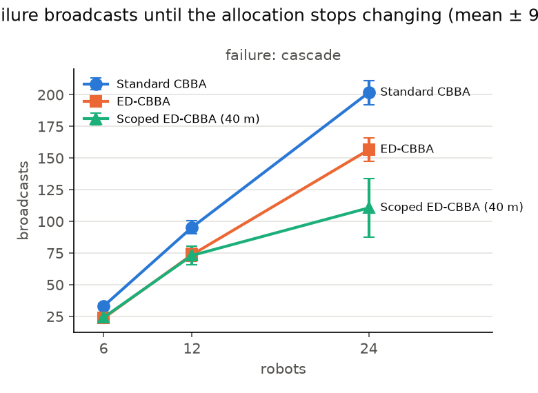

| failure | robots | Standard CBBA | ED-CBBA | Scoped ED-CBBA (40 m) |
| --- | ---: | ---: | ---: | ---: |
| cascade | 6 | 33.10 ± 2.02 | 23.63 ± 1.86 | 24.17 ± 1.98 |
| cascade | 12 | 95.30 ± 5.30 | 73.70 ± 5.08 | 73.13 ± 7.39 |
| cascade | 24 | 201.70 ± 9.45 | 156.53 ± 9.37 | 110.70 ± 22.94 |

## Post-failure broadcasts incl. quiet rounds of the stopping rule

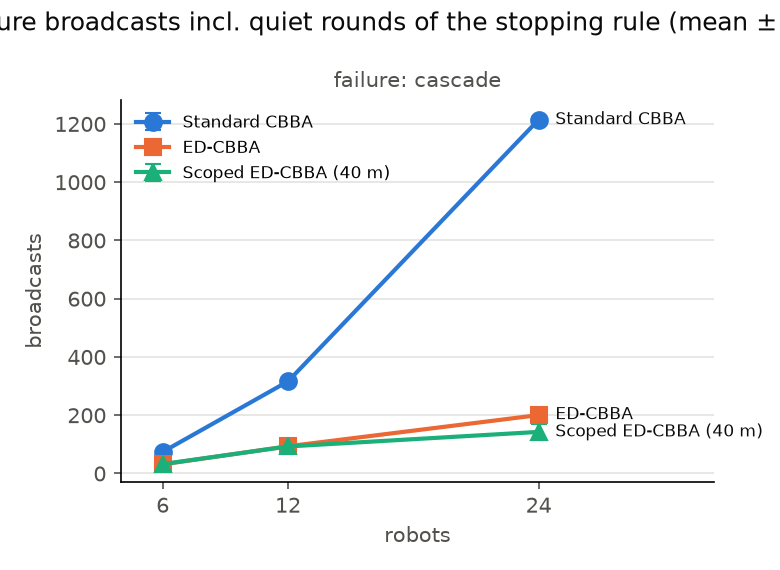

| failure | robots | Standard CBBA | ED-CBBA | Scoped ED-CBBA (40 m) |
| --- | ---: | ---: | ---: | ---: |
| cascade | 6 | 74.10 ± 2.02 | 31.43 ± 1.76 | 32.23 ± 1.93 |
| cascade | 12 | 316.30 ± 5.30 | 93.50 ± 4.91 | 92.77 ± 8.51 |
| cascade | 24 | 1214.70 ± 9.45 | 200.57 ± 9.31 | 142.80 ± 28.13 |

## Broadcasts per affected task (incl. quiet rounds)

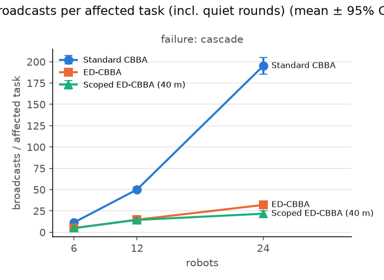

| failure | robots | Standard CBBA | ED-CBBA | Scoped ED-CBBA (40 m) |
| --- | ---: | ---: | ---: | ---: |
| cascade | 6 | 11.47 ± 0.48 | 4.84 ± 0.23 | 4.96 ± 0.26 |
| cascade | 12 | 50.13 ± 3.06 | 14.78 ± 1.11 | 14.48 ± 1.47 |
| cascade | 24 | 195.15 ± 9.93 | 32.04 ± 1.77 | 21.78 ± 3.75 |

## Consensus rounds until the allocation stops changing

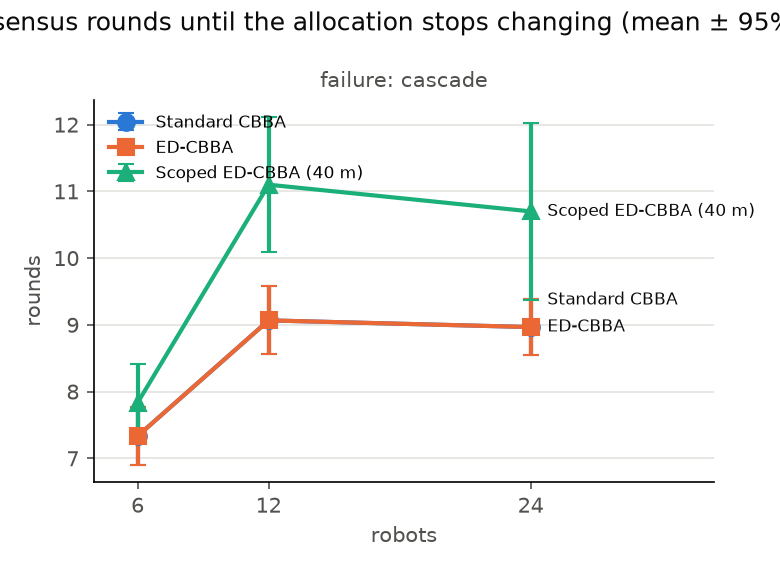

| failure | robots | Standard CBBA | ED-CBBA | Scoped ED-CBBA (40 m) |
| --- | ---: | ---: | ---: | ---: |
| cascade | 6 | 7.33 ± 0.43 | 7.33 ± 0.43 | 7.83 ± 0.58 |
| cascade | 12 | 9.07 ± 0.51 | 9.07 ± 0.51 | 11.10 ± 1.02 |
| cascade | 24 | 8.97 ± 0.42 | 8.97 ± 0.42 | 10.70 ± 1.32 |

## Consensus rounds incl. quiet rounds

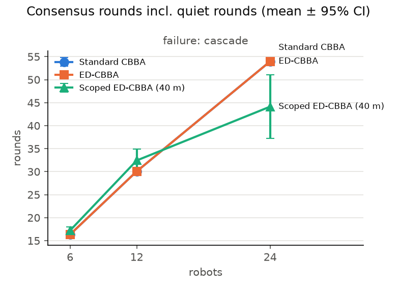

| failure | robots | Standard CBBA | ED-CBBA | Scoped ED-CBBA (40 m) |
| --- | ---: | ---: | ---: | ---: |
| cascade | 6 | 16.33 ± 0.43 | 16.33 ± 0.43 | 17.20 ± 0.82 |
| cascade | 12 | 30.07 ± 0.51 | 30.07 ± 0.51 | 32.43 ± 2.48 |
| cascade | 24 | 53.97 ± 0.42 | 53.97 ± 0.42 | 44.13 ± 6.89 |

## Re-auction runtime (CPU)

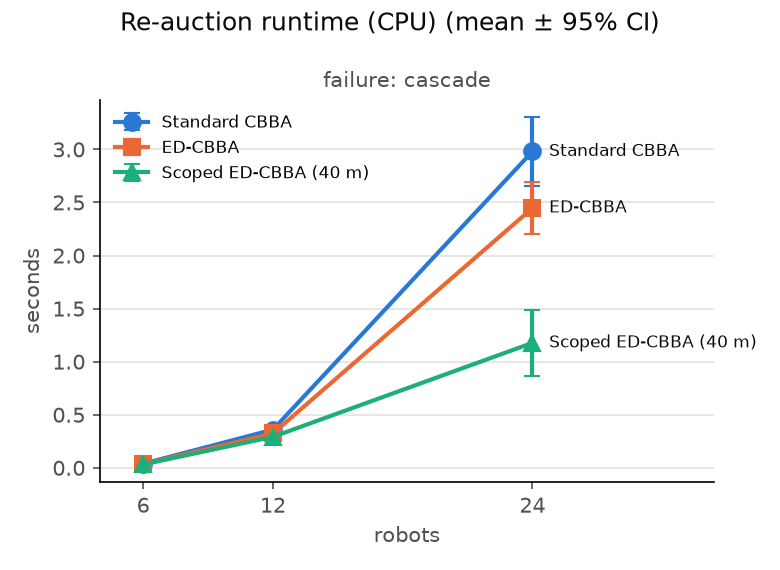

| failure | robots | Standard CBBA | ED-CBBA | Scoped ED-CBBA (40 m) |
| --- | ---: | ---: | ---: | ---: |
| cascade | 6 | 0.0386 ± 0.0034 | 0.0344 ± 0.0034 | 0.0318 ± 0.0038 |
| cascade | 12 | 0.3596 ± 0.0311 | 0.3236 ± 0.0312 | 0.2919 ± 0.0419 |
| cascade | 24 | 2.9805 ± 0.3256 | 2.4473 ± 0.2465 | 1.1770 ± 0.3143 |

## Assigned-task rate

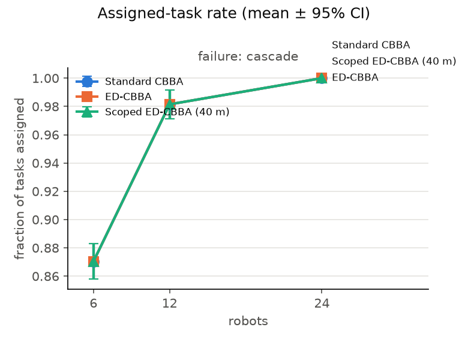

| failure | robots | Standard CBBA | ED-CBBA | Scoped ED-CBBA (40 m) |
| --- | ---: | ---: | ---: | ---: |
| cascade | 6 | 0.8704 ± 0.0126 | 0.8704 ± 0.0126 | 0.8704 ± 0.0126 |
| cascade | 12 | 0.9815 ± 0.0103 | 0.9815 ± 0.0103 | 0.9815 ± 0.0103 |
| cascade | 24 | 1.0000 ± 0.0000 | 1.0000 ± 0.0000 | 1.0000 ± 0.0000 |

## Assignment score

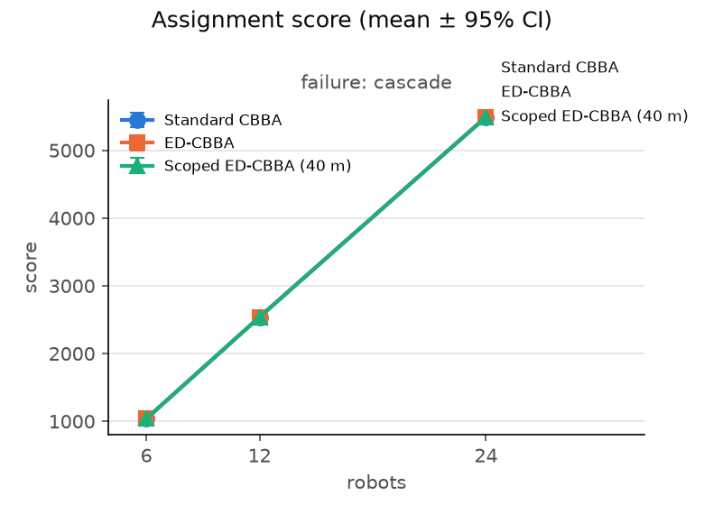

| failure | robots | Standard CBBA | ED-CBBA | Scoped ED-CBBA (40 m) |
| --- | ---: | ---: | ---: | ---: |
| cascade | 6 | 1037.69 ± 13.50 | 1037.69 ± 13.50 | 1037.69 ± 13.50 |
| cascade | 12 | 2539.10 ± 19.90 | 2539.10 ± 19.90 | 2539.55 ± 19.59 |
| cascade | 24 | 5492.72 ± 25.67 | 5492.72 ± 25.67 | 5490.19 ± 25.43 |

## Mission completion time (last task finishes)

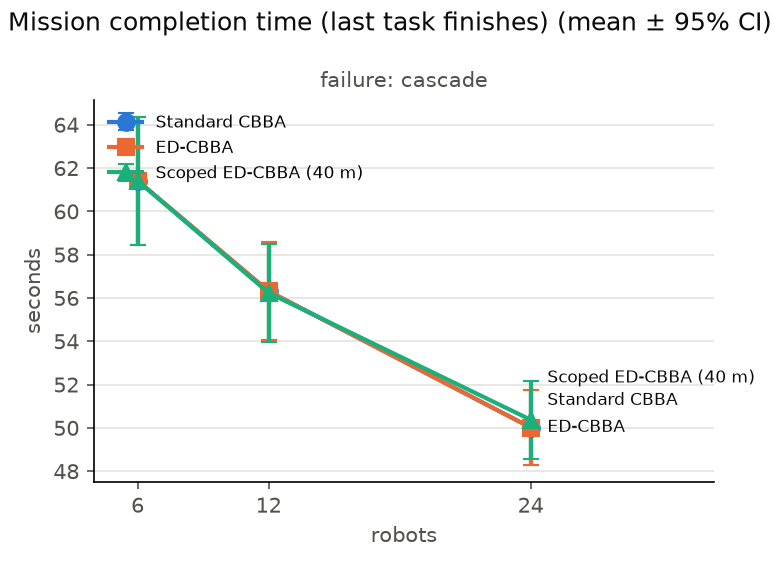

| failure | robots | Standard CBBA | ED-CBBA | Scoped ED-CBBA (40 m) |
| --- | ---: | ---: | ---: | ---: |
| cascade | 6 | 61.41 ± 2.95 | 61.41 ± 2.95 | 61.41 ± 2.95 |
| cascade | 12 | 56.31 ± 2.27 | 56.31 ± 2.27 | 56.23 ± 2.27 |
| cascade | 24 | 50.02 ± 1.72 | 50.02 ± 1.72 | 50.37 ± 1.81 |

## Total robot time spent on shared tasks

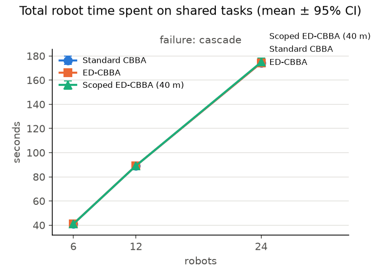

| failure | robots | Standard CBBA | ED-CBBA | Scoped ED-CBBA (40 m) |
| --- | ---: | ---: | ---: | ---: |
| cascade | 6 | 41.00 ± 2.32 | 41.00 ± 2.32 | 41.00 ± 2.32 |
| cascade | 12 | 89.17 ± 2.60 | 89.17 ± 2.60 | 89.17 ± 2.60 |
| cascade | 24 | 174.33 ± 3.24 | 174.33 ± 3.24 | 174.83 ± 3.55 |

## Surviving robots' tasks that changed owner

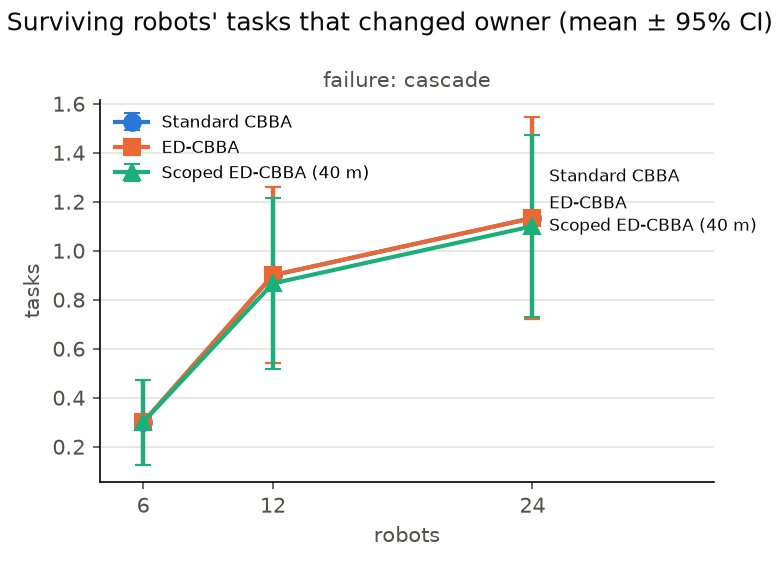

| failure | robots | Standard CBBA | ED-CBBA | Scoped ED-CBBA (40 m) |
| --- | ---: | ---: | ---: | ---: |
| cascade | 6 | 0.30 ± 0.17 | 0.30 ± 0.17 | 0.30 ± 0.17 |
| cascade | 12 | 0.90 ± 0.36 | 0.90 ± 0.36 | 0.87 ± 0.35 |
| cascade | 24 | 1.13 ± 0.41 | 1.13 ± 0.41 | 1.10 ± 0.37 |

## Paired differences vs standard CBBA

Per mission: method minus standard CBBA on the same mission and failed robot.

| failure | robots | method | Δ broadcasts | broadcast reduction | Δ score | Δ assigned tasks |
| --- | ---: | --- | ---: | ---: | ---: | ---: |
| cascade | 6 | ED-CBBA | -42.7 ± 0.4 | 57.8 ± 1.2% | 0.00 ± 0.00 | 0.00 ± 0.00 |
| cascade | 6 | Scoped ED-CBBA (40 m) | -41.9 ± 0.8 | 56.7 ± 1.5% | 0.00 ± 0.00 | 0.00 ± 0.00 |
| cascade | 12 | ED-CBBA | -222.8 ± 0.5 | 70.6 ± 1.0% | 0.00 ± 0.00 | 0.00 ± 0.00 |
| cascade | 12 | Scoped ED-CBBA (40 m) | -223.5 ± 6.6 | 70.8 ± 2.4% | 0.46 ± 1.85 | 0.00 ± 0.00 |
| cascade | 24 | ED-CBBA | -1014.1 ± 0.3 | 83.5 ± 0.6% | 0.00 ± 0.00 | 0.00 ± 0.00 |
| cascade | 24 | Scoped ED-CBBA (40 m) | -1071.9 ± 23.7 | 88.3 ± 2.2% | -2.53 ± 3.77 | 0.00 ± 0.00 |

## Local recovery rate (scoped ED-CBBA)

| failure | robots | local / runs | rate [95% Wilson] | too many affected tasks | no nearby capable robot | local group disconnected | local capacity or schedule infeasible | nothing affected |
| --- | ---: | ---: | --- | ---: | ---: | ---: | ---: | ---: |
| cascade | 6 | 0/30 | 0.00 [0.00, 0.11] | 0 | 30 | 0 | 0 | 0 |
| cascade | 12 | 4/30 | 0.13 [0.05, 0.30] | 0 | 17 | 0 | 9 | 0 |
| cascade | 24 | 12/30 | 0.40 [0.25, 0.58] | 0 | 4 | 0 | 14 | 0 |

## Consistency

| failure | robots | method | consensus reached [95% Wilson] | runs with duplicate claims |
| --- | ---: | --- | --- | ---: |
| cascade | 6 | Standard CBBA | 1.00 [0.89, 1.00] | 0 |
| cascade | 6 | ED-CBBA | 1.00 [0.89, 1.00] | 0 |
| cascade | 6 | Scoped ED-CBBA (40 m) | 1.00 [0.89, 1.00] | 0 |
| cascade | 12 | Standard CBBA | 1.00 [0.89, 1.00] | 0 |
| cascade | 12 | ED-CBBA | 1.00 [0.89, 1.00] | 0 |
| cascade | 12 | Scoped ED-CBBA (40 m) | 1.00 [0.89, 1.00] | 0 |
| cascade | 24 | Standard CBBA | 1.00 [0.89, 1.00] | 0 |
| cascade | 24 | ED-CBBA | 1.00 [0.89, 1.00] | 0 |
| cascade | 24 | Scoped ED-CBBA (40 m) | 1.00 [0.89, 1.00] | 0 |

## Shared-task winners

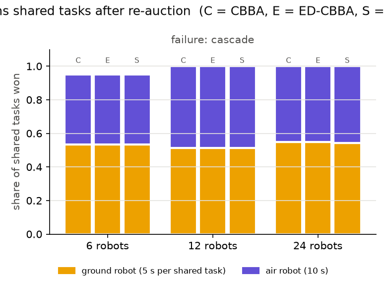

Ground robots take 5 s on a shared task and air robots 10 s, at equal speed.

| failure | robots | method | ground share | air share | unassigned | won by farther type |
| --- | ---: | --- | ---: | ---: | ---: | ---: |
| cascade | 6 | Standard CBBA | 0.53 | 0.42 | 0.05 | 0.26 |
| cascade | 6 | ED-CBBA | 0.53 | 0.42 | 0.05 | 0.26 |
| cascade | 6 | Scoped ED-CBBA (40 m) | 0.53 | 0.42 | 0.05 | 0.26 |
| cascade | 12 | Standard CBBA | 0.51 | 0.49 | 0.00 | 0.23 |
| cascade | 12 | ED-CBBA | 0.51 | 0.49 | 0.00 | 0.23 |
| cascade | 12 | Scoped ED-CBBA (40 m) | 0.51 | 0.49 | 0.00 | 0.23 |
| cascade | 24 | Standard CBBA | 0.55 | 0.45 | 0.00 | 0.24 |
| cascade | 24 | ED-CBBA | 0.55 | 0.45 | 0.00 | 0.24 |
| cascade | 24 | Scoped ED-CBBA (40 m) | 0.54 | 0.46 | 0.00 | 0.24 |

*won by farther type*: the winner's type has no robot closer to the task than the nearest robot of the other type.
