# Experiment 3 (shared capabilities): clustered

Source: `results/exp3_shared/clustered`. 90 missions, 540 re-auction runs. Values are mean ± 95% CI half-width (t-distribution) over seeds.

## Post-failure broadcasts until the allocation stops changing

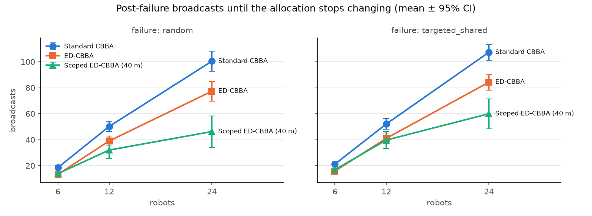

| failure | robots | Standard CBBA | ED-CBBA | Scoped ED-CBBA (40 m) |
| --- | ---: | ---: | ---: | ---: |
| random | 6 | 18.50 ± 1.48 | 13.27 ± 1.34 | 13.83 ± 1.82 |
| random | 12 | 50.23 ± 3.99 | 39.03 ± 3.91 | 32.03 ± 6.35 |
| random | 24 | 100.43 ± 7.64 | 77.33 ± 7.56 | 46.23 ± 12.05 |
| targeted_shared | 6 | 21.17 ± 1.94 | 15.80 ± 1.77 | 16.87 ± 2.06 |
| targeted_shared | 12 | 52.07 ± 4.03 | 41.00 ± 3.99 | 39.70 ± 6.64 |
| targeted_shared | 24 | 107.33 ± 6.11 | 84.30 ± 6.10 | 60.00 ± 11.52 |

## Post-failure broadcasts incl. quiet rounds of the stopping rule

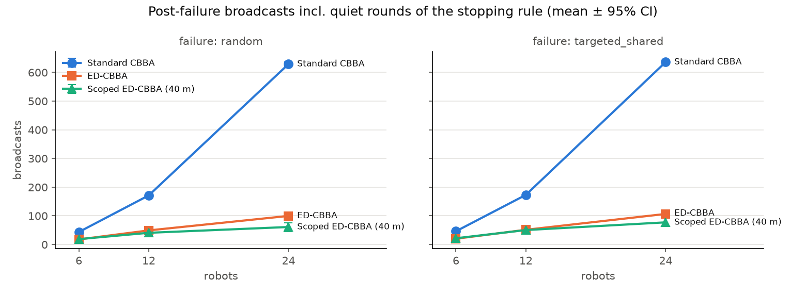

| failure | robots | Standard CBBA | ED-CBBA | Scoped ED-CBBA (40 m) |
| --- | ---: | ---: | ---: | ---: |
| random | 6 | 43.50 ± 1.48 | 17.77 ± 1.21 | 18.70 ± 2.05 |
| random | 12 | 171.23 ± 3.99 | 49.17 ± 3.86 | 40.87 ± 7.75 |
| random | 24 | 629.43 ± 7.64 | 99.73 ± 7.48 | 61.07 ± 15.32 |
| targeted_shared | 6 | 46.17 ± 1.94 | 20.10 ± 1.66 | 21.80 ± 2.13 |
| targeted_shared | 12 | 173.07 ± 4.03 | 51.37 ± 3.92 | 50.40 ± 7.98 |
| targeted_shared | 24 | 636.33 ± 6.11 | 106.67 ± 6.06 | 77.30 ± 15.00 |

## Broadcasts per affected task (incl. quiet rounds)

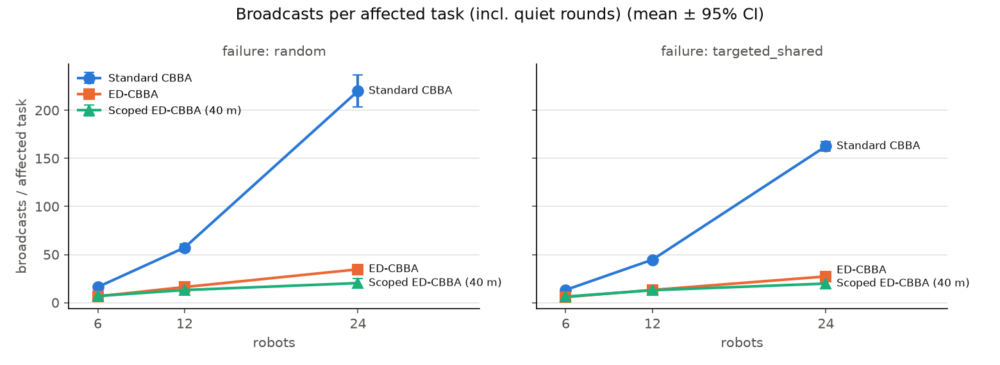

| failure | robots | Standard CBBA | ED-CBBA | Scoped ED-CBBA (40 m) |
| --- | ---: | ---: | ---: | ---: |
| random | 6 | 16.22 ± 1.38 | 6.58 ± 0.60 | 6.86 ± 0.80 |
| random | 12 | 57.20 ± 4.11 | 16.18 ± 1.25 | 13.10 ± 2.43 |
| random | 24 | 220.03 ± 16.78 | 34.64 ± 3.27 | 20.33 ± 4.73 |
| targeted_shared | 6 | 13.19 ± 0.90 | 5.74 ± 0.57 | 6.26 ± 0.76 |
| targeted_shared | 12 | 44.64 ± 1.63 | 13.21 ± 0.96 | 12.89 ± 1.98 |
| targeted_shared | 24 | 162.60 ± 5.13 | 27.24 ± 1.69 | 19.82 ± 3.94 |

## Consensus rounds until the allocation stops changing

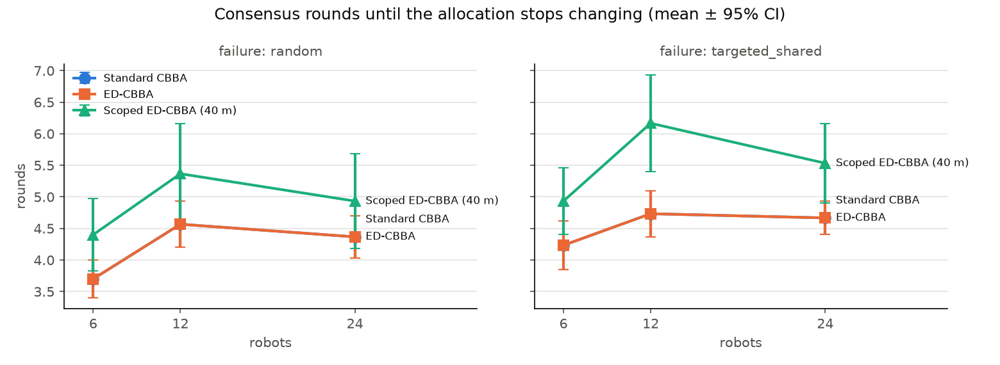

| failure | robots | Standard CBBA | ED-CBBA | Scoped ED-CBBA (40 m) |
| --- | ---: | ---: | ---: | ---: |
| random | 6 | 3.70 ± 0.30 | 3.70 ± 0.30 | 4.40 ± 0.58 |
| random | 12 | 4.57 ± 0.36 | 4.57 ± 0.36 | 5.37 ± 0.79 |
| random | 24 | 4.37 ± 0.33 | 4.37 ± 0.33 | 4.93 ± 0.75 |
| targeted_shared | 6 | 4.23 ± 0.39 | 4.23 ± 0.39 | 4.93 ± 0.53 |
| targeted_shared | 12 | 4.73 ± 0.37 | 4.73 ± 0.37 | 6.17 ± 0.77 |
| targeted_shared | 24 | 4.67 ± 0.27 | 4.67 ± 0.27 | 5.53 ± 0.63 |

## Consensus rounds incl. quiet rounds

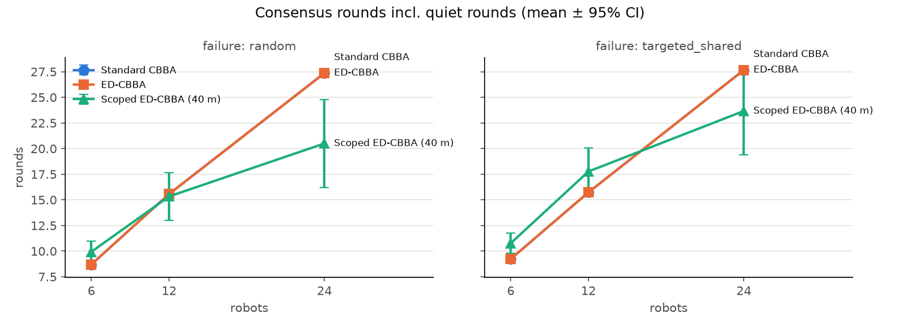

| failure | robots | Standard CBBA | ED-CBBA | Scoped ED-CBBA (40 m) |
| --- | ---: | ---: | ---: | ---: |
| random | 6 | 8.70 ± 0.30 | 8.70 ± 0.30 | 9.93 ± 1.02 |
| random | 12 | 15.57 ± 0.36 | 15.57 ± 0.36 | 15.33 ± 2.31 |
| random | 24 | 27.37 ± 0.33 | 27.37 ± 0.33 | 20.50 ± 4.31 |
| targeted_shared | 6 | 9.23 ± 0.39 | 9.23 ± 0.39 | 10.77 ± 0.97 |
| targeted_shared | 12 | 15.73 ± 0.37 | 15.73 ± 0.37 | 17.77 ± 2.30 |
| targeted_shared | 24 | 27.67 ± 0.27 | 27.67 ± 0.27 | 23.67 ± 4.27 |

## Re-auction runtime (CPU)

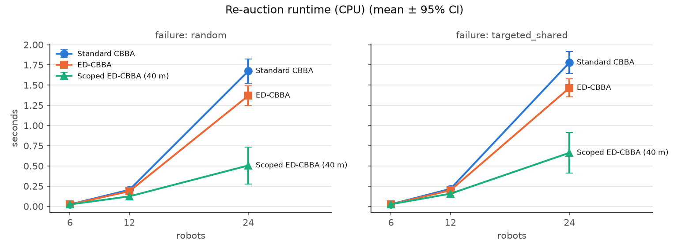

| failure | robots | Standard CBBA | ED-CBBA | Scoped ED-CBBA (40 m) |
| --- | ---: | ---: | ---: | ---: |
| random | 6 | 0.0241 ± 0.0022 | 0.0233 ± 0.0022 | 0.0237 ± 0.0033 |
| random | 12 | 0.2049 ± 0.0223 | 0.1874 ± 0.0197 | 0.1236 ± 0.0338 |
| random | 24 | 1.6746 ± 0.1500 | 1.3693 ± 0.1212 | 0.5058 ± 0.2277 |
| targeted_shared | 6 | 0.0259 ± 0.0024 | 0.0253 ± 0.0024 | 0.0264 ± 0.0031 |
| targeted_shared | 12 | 0.2168 ± 0.0213 | 0.1986 ± 0.0205 | 0.1567 ± 0.0365 |
| targeted_shared | 24 | 1.7789 ± 0.1372 | 1.4656 ± 0.1095 | 0.6625 ± 0.2528 |

## Assigned-task rate

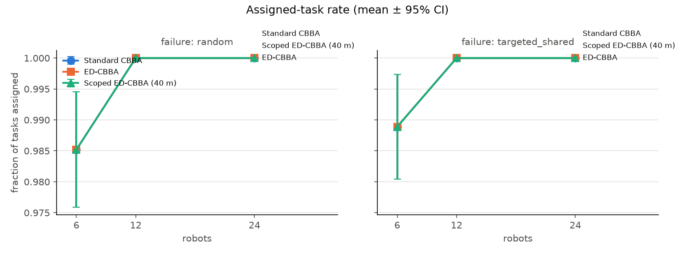

| failure | robots | Standard CBBA | ED-CBBA | Scoped ED-CBBA (40 m) |
| --- | ---: | ---: | ---: | ---: |
| random | 6 | 0.9852 ± 0.0093 | 0.9852 ± 0.0093 | 0.9852 ± 0.0093 |
| random | 12 | 1.0000 ± 0.0000 | 1.0000 ± 0.0000 | 1.0000 ± 0.0000 |
| random | 24 | 1.0000 ± 0.0000 | 1.0000 ± 0.0000 | 1.0000 ± 0.0000 |
| targeted_shared | 6 | 0.9889 ± 0.0084 | 0.9889 ± 0.0084 | 0.9889 ± 0.0084 |
| targeted_shared | 12 | 1.0000 ± 0.0000 | 1.0000 ± 0.0000 | 1.0000 ± 0.0000 |
| targeted_shared | 24 | 1.0000 ± 0.0000 | 1.0000 ± 0.0000 | 1.0000 ± 0.0000 |

## Assignment score

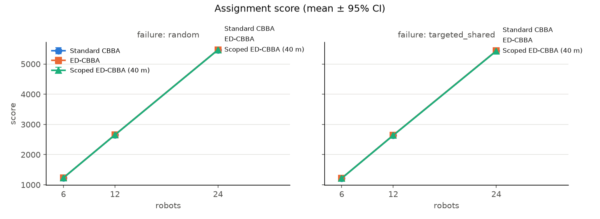

| failure | robots | Standard CBBA | ED-CBBA | Scoped ED-CBBA (40 m) |
| --- | ---: | ---: | ---: | ---: |
| random | 6 | 1233.12 ± 19.09 | 1233.12 ± 19.09 | 1232.80 ± 19.03 |
| random | 12 | 2655.60 ± 25.44 | 2655.60 ± 25.44 | 2653.32 ± 25.65 |
| random | 24 | 5470.59 ± 33.84 | 5470.59 ± 33.84 | 5467.94 ± 34.33 |
| targeted_shared | 6 | 1217.72 ± 17.59 | 1217.72 ± 17.59 | 1217.54 ± 17.59 |
| targeted_shared | 12 | 2641.44 ± 22.37 | 2641.44 ± 22.37 | 2638.76 ± 22.17 |
| targeted_shared | 24 | 5433.86 ± 34.26 | 5433.86 ± 34.26 | 5429.91 ± 34.63 |

## Mission completion time (last task finishes)

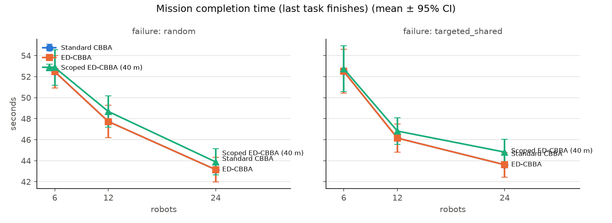

| failure | robots | Standard CBBA | ED-CBBA | Scoped ED-CBBA (40 m) |
| --- | ---: | ---: | ---: | ---: |
| random | 6 | 52.47 ± 1.55 | 52.47 ± 1.55 | 52.87 ± 1.68 |
| random | 12 | 47.73 ± 1.54 | 47.73 ± 1.54 | 48.68 ± 1.50 |
| random | 24 | 43.15 ± 1.16 | 43.15 ± 1.16 | 43.89 ± 1.25 |
| targeted_shared | 6 | 52.50 ± 2.08 | 52.50 ± 2.08 | 52.75 ± 2.19 |
| targeted_shared | 12 | 46.15 ± 1.35 | 46.15 ± 1.35 | 46.82 ± 1.28 |
| targeted_shared | 24 | 43.62 ± 1.17 | 43.62 ± 1.17 | 44.82 ± 1.20 |

## Total robot time spent on shared tasks

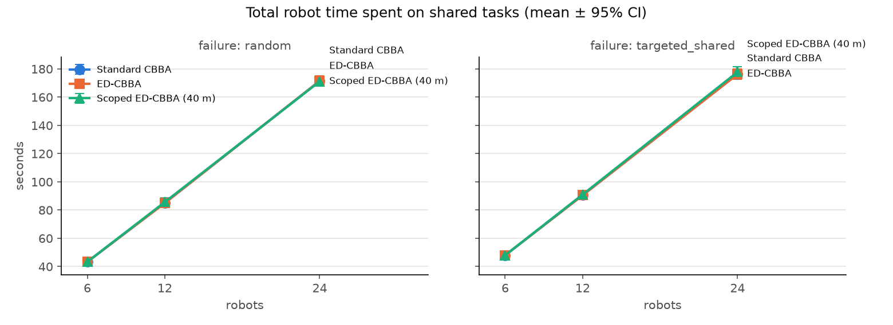

| failure | robots | Standard CBBA | ED-CBBA | Scoped ED-CBBA (40 m) |
| --- | ---: | ---: | ---: | ---: |
| random | 6 | 43.33 ± 2.26 | 43.33 ± 2.26 | 43.33 ± 2.26 |
| random | 12 | 85.00 ± 2.64 | 85.00 ± 2.64 | 85.67 ± 2.89 |
| random | 24 | 171.50 ± 3.54 | 171.50 ± 3.54 | 171.17 ± 3.35 |
| targeted_shared | 6 | 48.00 ± 2.11 | 48.00 ± 2.11 | 48.00 ± 2.11 |
| targeted_shared | 12 | 90.50 ± 1.86 | 90.50 ± 1.86 | 91.00 ± 2.27 |
| targeted_shared | 24 | 176.33 ± 3.57 | 176.33 ± 3.57 | 177.83 ± 3.79 |

## Surviving robots' tasks that changed owner

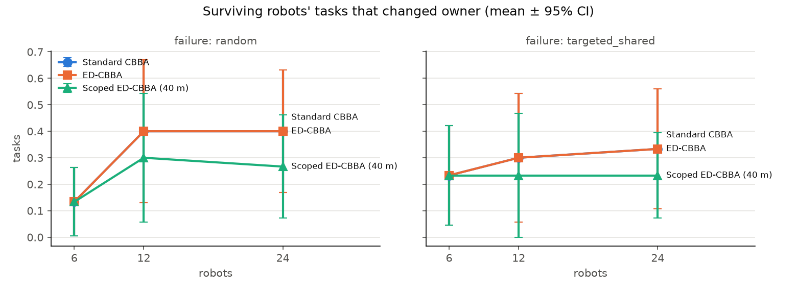

| failure | robots | Standard CBBA | ED-CBBA | Scoped ED-CBBA (40 m) |
| --- | ---: | ---: | ---: | ---: |
| random | 6 | 0.13 ± 0.13 | 0.13 ± 0.13 | 0.13 ± 0.13 |
| random | 12 | 0.40 ± 0.27 | 0.40 ± 0.27 | 0.30 ± 0.24 |
| random | 24 | 0.40 ± 0.23 | 0.40 ± 0.23 | 0.27 ± 0.19 |
| targeted_shared | 6 | 0.23 ± 0.19 | 0.23 ± 0.19 | 0.23 ± 0.19 |
| targeted_shared | 12 | 0.30 ± 0.24 | 0.30 ± 0.24 | 0.23 ± 0.23 |
| targeted_shared | 24 | 0.33 ± 0.23 | 0.33 ± 0.23 | 0.23 ± 0.16 |

## Paired differences vs standard CBBA

Per mission: method minus standard CBBA on the same mission and failed robot.

| failure | robots | method | Δ broadcasts | broadcast reduction | Δ score | Δ assigned tasks |
| --- | ---: | --- | ---: | ---: | ---: | ---: |
| random | 6 | ED-CBBA | -25.7 ± 0.3 | 59.5 ± 1.3% | 0.00 ± 0.00 | 0.00 ± 0.00 |
| random | 6 | Scoped ED-CBBA (40 m) | -24.8 ± 1.7 | 57.3 ± 4.0% | -0.32 ± 0.46 | 0.00 ± 0.00 |
| random | 12 | ED-CBBA | -122.1 ± 0.2 | 71.5 ± 1.5% | 0.00 ± 0.00 | 0.00 ± 0.00 |
| random | 12 | Scoped ED-CBBA (40 m) | -130.4 ± 7.6 | 76.3 ± 4.3% | -2.28 ± 2.10 | 0.00 ± 0.00 |
| random | 24 | ED-CBBA | -529.7 ± 0.3 | 84.2 ± 1.0% | 0.00 ± 0.00 | 0.00 ± 0.00 |
| random | 24 | Scoped ED-CBBA (40 m) | -568.4 ± 16.6 | 90.3 ± 2.4% | -2.65 ± 1.41 | 0.00 ± 0.00 |
| targeted_shared | 6 | ED-CBBA | -26.1 ± 0.3 | 57.0 ± 1.8% | 0.00 ± 0.00 | 0.00 ± 0.00 |
| targeted_shared | 6 | Scoped ED-CBBA (40 m) | -24.4 ± 1.6 | 53.2 ± 3.7% | -0.19 ± 0.38 | 0.00 ± 0.00 |
| targeted_shared | 12 | ED-CBBA | -121.7 ± 0.2 | 70.6 ± 1.5% | 0.00 ± 0.00 | 0.00 ± 0.00 |
| targeted_shared | 12 | Scoped ED-CBBA (40 m) | -122.7 ± 7.5 | 71.1 ± 4.3% | -2.68 ± 2.03 | 0.00 ± 0.00 |
| targeted_shared | 24 | ED-CBBA | -529.7 ± 0.2 | 83.3 ± 0.8% | 0.00 ± 0.00 | 0.00 ± 0.00 |
| targeted_shared | 24 | Scoped ED-CBBA (40 m) | -559.0 ± 17.0 | 87.8 ± 2.4% | -3.95 ± 1.59 | 0.00 ± 0.00 |

## Local recovery rate (scoped ED-CBBA)

| failure | robots | local / runs | rate [95% Wilson] | too many affected tasks | no nearby capable robot | local group disconnected | local capacity or schedule infeasible | nothing affected |
| --- | ---: | ---: | --- | ---: | ---: | ---: | ---: | ---: |
| random | 6 | 2/30 | 0.07 [0.02, 0.21] | 0 | 19 | 0 | 9 | 0 |
| random | 12 | 13/30 | 0.43 [0.27, 0.61] | 0 | 6 | 0 | 11 | 0 |
| random | 24 | 23/30 | 0.77 [0.59, 0.88] | 0 | 0 | 0 | 7 | 0 |
| targeted_shared | 6 | 1/30 | 0.03 [0.01, 0.17] | 0 | 19 | 0 | 10 | 0 |
| targeted_shared | 12 | 10/30 | 0.33 [0.19, 0.51] | 0 | 5 | 0 | 15 | 0 |
| targeted_shared | 24 | 21/30 | 0.70 [0.52, 0.83] | 0 | 0 | 0 | 9 | 0 |

## Consistency

| failure | robots | method | consensus reached [95% Wilson] | runs with duplicate claims |
| --- | ---: | --- | --- | ---: |
| random | 6 | Standard CBBA | 1.00 [0.89, 1.00] | 0 |
| random | 6 | ED-CBBA | 1.00 [0.89, 1.00] | 0 |
| random | 6 | Scoped ED-CBBA (40 m) | 1.00 [0.89, 1.00] | 0 |
| random | 12 | Standard CBBA | 1.00 [0.89, 1.00] | 0 |
| random | 12 | ED-CBBA | 1.00 [0.89, 1.00] | 0 |
| random | 12 | Scoped ED-CBBA (40 m) | 1.00 [0.89, 1.00] | 0 |
| random | 24 | Standard CBBA | 1.00 [0.89, 1.00] | 0 |
| random | 24 | ED-CBBA | 1.00 [0.89, 1.00] | 0 |
| random | 24 | Scoped ED-CBBA (40 m) | 1.00 [0.89, 1.00] | 0 |
| targeted_shared | 6 | Standard CBBA | 1.00 [0.89, 1.00] | 0 |
| targeted_shared | 6 | ED-CBBA | 1.00 [0.89, 1.00] | 0 |
| targeted_shared | 6 | Scoped ED-CBBA (40 m) | 1.00 [0.89, 1.00] | 0 |
| targeted_shared | 12 | Standard CBBA | 1.00 [0.89, 1.00] | 0 |
| targeted_shared | 12 | ED-CBBA | 1.00 [0.89, 1.00] | 0 |
| targeted_shared | 12 | Scoped ED-CBBA (40 m) | 1.00 [0.89, 1.00] | 0 |
| targeted_shared | 24 | Standard CBBA | 1.00 [0.89, 1.00] | 0 |
| targeted_shared | 24 | ED-CBBA | 1.00 [0.89, 1.00] | 0 |
| targeted_shared | 24 | Scoped ED-CBBA (40 m) | 1.00 [0.89, 1.00] | 0 |

## Shared-task winners

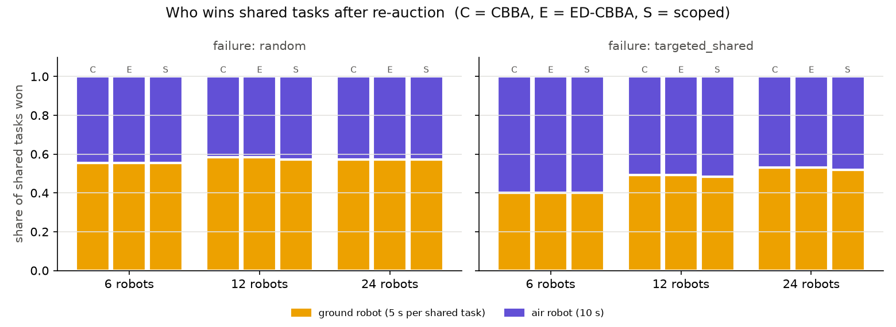

Ground robots take 5 s on a shared task and air robots 10 s, at equal speed.

| failure | robots | method | ground share | air share | unassigned | won by farther type |
| --- | ---: | --- | ---: | ---: | ---: | ---: |
| random | 6 | Standard CBBA | 0.56 | 0.44 | 0.00 | 0.28 |
| random | 6 | ED-CBBA | 0.56 | 0.44 | 0.00 | 0.28 |
| random | 6 | Scoped ED-CBBA (40 m) | 0.56 | 0.44 | 0.00 | 0.28 |
| random | 12 | Standard CBBA | 0.58 | 0.42 | 0.00 | 0.29 |
| random | 12 | ED-CBBA | 0.58 | 0.42 | 0.00 | 0.29 |
| random | 12 | Scoped ED-CBBA (40 m) | 0.57 | 0.43 | 0.00 | 0.28 |
| random | 24 | Standard CBBA | 0.57 | 0.43 | 0.00 | 0.35 |
| random | 24 | ED-CBBA | 0.57 | 0.43 | 0.00 | 0.35 |
| random | 24 | Scoped ED-CBBA (40 m) | 0.57 | 0.43 | 0.00 | 0.36 |
| targeted_shared | 6 | Standard CBBA | 0.40 | 0.60 | 0.00 | 0.32 |
| targeted_shared | 6 | ED-CBBA | 0.40 | 0.60 | 0.00 | 0.32 |
| targeted_shared | 6 | Scoped ED-CBBA (40 m) | 0.40 | 0.60 | 0.00 | 0.32 |
| targeted_shared | 12 | Standard CBBA | 0.49 | 0.51 | 0.00 | 0.32 |
| targeted_shared | 12 | ED-CBBA | 0.49 | 0.51 | 0.00 | 0.32 |
| targeted_shared | 12 | Scoped ED-CBBA (40 m) | 0.48 | 0.52 | 0.00 | 0.32 |
| targeted_shared | 24 | Standard CBBA | 0.53 | 0.47 | 0.00 | 0.35 |
| targeted_shared | 24 | ED-CBBA | 0.53 | 0.47 | 0.00 | 0.35 |
| targeted_shared | 24 | Scoped ED-CBBA (40 m) | 0.52 | 0.48 | 0.00 | 0.35 |

*won by farther type*: the winner's type has no robot closer to the task than the nearest robot of the other type.
