# Experiment 3 (shared capabilities): double_failure

Source: `results/exp3_shared/double_failure`. 90 missions, 540 re-auction runs. Values are mean ± 95% CI half-width (t-distribution) over seeds.

## Post-failure broadcasts until the allocation stops changing

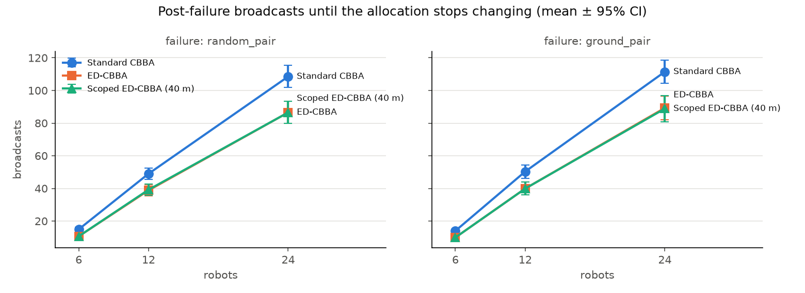

| failure | robots | Standard CBBA | ED-CBBA | Scoped ED-CBBA (40 m) |
| --- | ---: | ---: | ---: | ---: |
| random_pair | 6 | 14.93 ± 1.24 | 10.67 ± 1.09 | 10.67 ± 1.09 |
| random_pair | 12 | 49.00 ± 3.58 | 38.83 ± 3.47 | 39.20 ± 3.57 |
| random_pair | 24 | 108.53 ± 6.80 | 86.53 ± 6.80 | 86.53 ± 6.80 |
| ground_pair | 6 | 14.00 ± 0.94 | 9.93 ± 0.88 | 9.93 ± 0.88 |
| ground_pair | 12 | 50.33 ± 4.10 | 39.90 ± 3.90 | 39.90 ± 3.90 |
| ground_pair | 24 | 111.47 ± 7.13 | 89.30 ± 7.11 | 88.87 ± 8.04 |

## Post-failure broadcasts incl. quiet rounds of the stopping rule

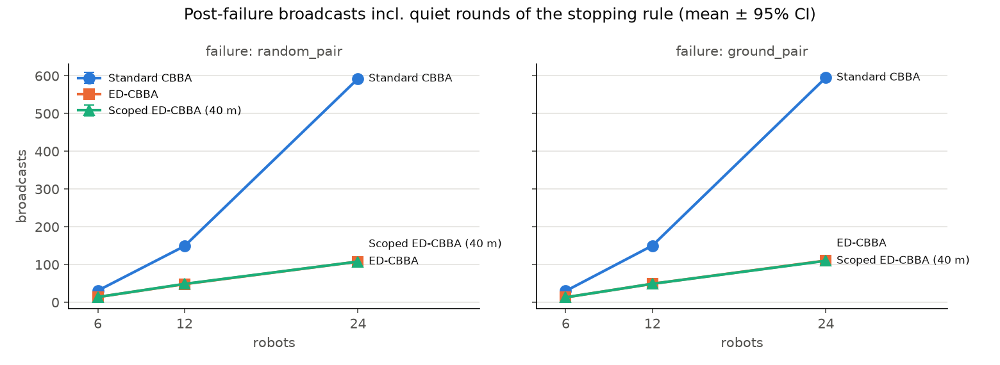

| failure | robots | Standard CBBA | ED-CBBA | Scoped ED-CBBA (40 m) |
| --- | ---: | ---: | ---: | ---: |
| random_pair | 6 | 30.93 ± 1.24 | 13.93 ± 1.03 | 13.93 ± 1.03 |
| random_pair | 12 | 149.00 ± 3.58 | 48.30 ± 3.40 | 48.77 ± 3.55 |
| random_pair | 24 | 592.53 ± 6.80 | 107.90 ± 6.70 | 107.90 ± 6.70 |
| ground_pair | 6 | 30.00 ± 0.94 | 13.17 ± 0.82 | 13.17 ± 0.82 |
| ground_pair | 12 | 150.33 ± 4.10 | 49.10 ± 3.81 | 49.10 ± 3.81 |
| ground_pair | 24 | 595.47 ± 7.13 | 110.63 ± 7.01 | 110.07 ± 8.44 |

## Broadcasts per affected task (incl. quiet rounds)

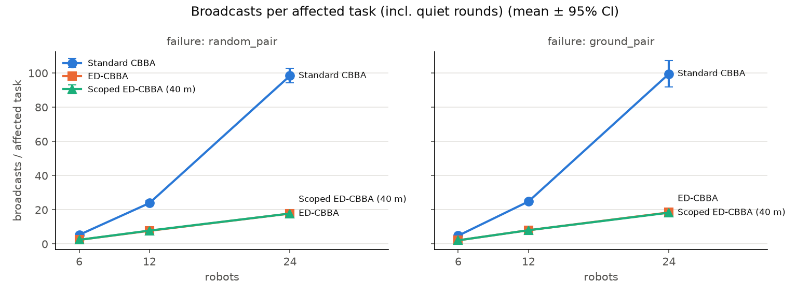

| failure | robots | Standard CBBA | ED-CBBA | Scoped ED-CBBA (40 m) |
| --- | ---: | ---: | ---: | ---: |
| random_pair | 6 | 5.35 ± 0.37 | 2.41 ± 0.24 | 2.41 ± 0.24 |
| random_pair | 12 | 23.93 ± 1.32 | 7.71 ± 0.56 | 7.82 ± 0.73 |
| random_pair | 24 | 98.44 ± 4.23 | 17.80 ± 1.04 | 17.80 ± 1.04 |
| ground_pair | 6 | 4.86 ± 0.23 | 2.13 ± 0.14 | 2.13 ± 0.14 |
| ground_pair | 12 | 24.86 ± 1.23 | 8.05 ± 0.57 | 8.05 ± 0.57 |
| ground_pair | 24 | 99.60 ± 7.76 | 18.46 ± 1.71 | 18.32 ± 1.99 |

## Consensus rounds until the allocation stops changing

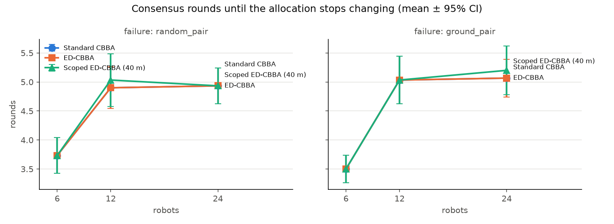

| failure | robots | Standard CBBA | ED-CBBA | Scoped ED-CBBA (40 m) |
| --- | ---: | ---: | ---: | ---: |
| random_pair | 6 | 3.73 ± 0.31 | 3.73 ± 0.31 | 3.73 ± 0.31 |
| random_pair | 12 | 4.90 ± 0.36 | 4.90 ± 0.36 | 5.03 ± 0.45 |
| random_pair | 24 | 4.93 ± 0.31 | 4.93 ± 0.31 | 4.93 ± 0.31 |
| ground_pair | 6 | 3.50 ± 0.24 | 3.50 ± 0.24 | 3.50 ± 0.24 |
| ground_pair | 12 | 5.03 ± 0.41 | 5.03 ± 0.41 | 5.03 ± 0.41 |
| ground_pair | 24 | 5.07 ± 0.32 | 5.07 ± 0.32 | 5.20 ± 0.42 |

## Consensus rounds incl. quiet rounds

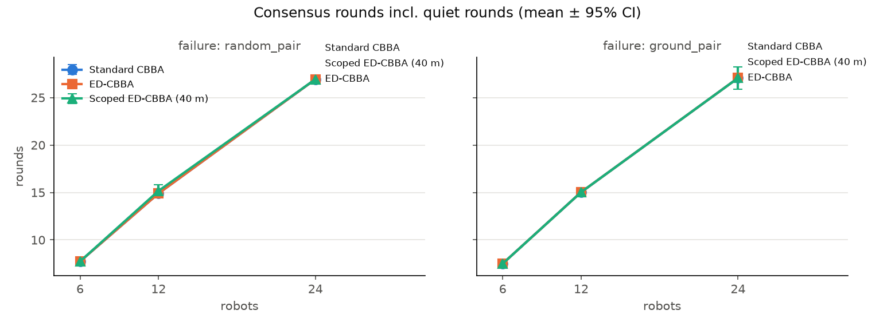

| failure | robots | Standard CBBA | ED-CBBA | Scoped ED-CBBA (40 m) |
| --- | ---: | ---: | ---: | ---: |
| random_pair | 6 | 7.73 ± 0.31 | 7.73 ± 0.31 | 7.73 ± 0.31 |
| random_pair | 12 | 14.90 ± 0.36 | 14.90 ± 0.36 | 15.17 ± 0.66 |
| random_pair | 24 | 26.93 ± 0.31 | 26.93 ± 0.31 | 26.93 ± 0.31 |
| ground_pair | 6 | 7.50 ± 0.24 | 7.50 ± 0.24 | 7.50 ± 0.24 |
| ground_pair | 12 | 15.03 ± 0.41 | 15.03 ± 0.41 | 15.03 ± 0.41 |
| ground_pair | 24 | 27.07 ± 0.32 | 27.07 ± 0.32 | 27.07 ± 1.17 |

## Re-auction runtime (CPU)

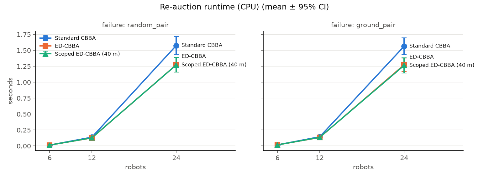

| failure | robots | Standard CBBA | ED-CBBA | Scoped ED-CBBA (40 m) |
| --- | ---: | ---: | ---: | ---: |
| random_pair | 6 | 0.0140 ± 0.0011 | 0.0136 ± 0.0011 | 0.0136 ± 0.0011 |
| random_pair | 12 | 0.1371 ± 0.0141 | 0.1258 ± 0.0124 | 0.1273 ± 0.0127 |
| random_pair | 24 | 1.5754 ± 0.1409 | 1.2726 ± 0.1163 | 1.2708 ± 0.1152 |
| ground_pair | 6 | 0.0176 ± 0.0015 | 0.0171 ± 0.0014 | 0.0170 ± 0.0014 |
| ground_pair | 12 | 0.1438 ± 0.0161 | 0.1329 ± 0.0150 | 0.1347 ± 0.0147 |
| ground_pair | 24 | 1.5641 ± 0.1332 | 1.2733 ± 0.1053 | 1.2636 ± 0.1205 |

## Assigned-task rate

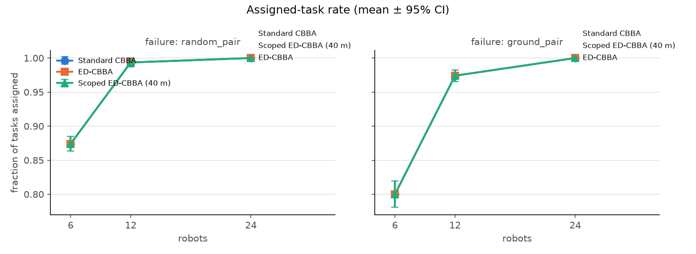

| failure | robots | Standard CBBA | ED-CBBA | Scoped ED-CBBA (40 m) |
| --- | ---: | ---: | ---: | ---: |
| random_pair | 6 | 0.8741 ± 0.0108 | 0.8741 ± 0.0108 | 0.8741 ± 0.0108 |
| random_pair | 12 | 0.9935 ± 0.0065 | 0.9935 ± 0.0065 | 0.9935 ± 0.0065 |
| random_pair | 24 | 1.0000 ± 0.0000 | 1.0000 ± 0.0000 | 1.0000 ± 0.0000 |
| ground_pair | 6 | 0.8000 ± 0.0193 | 0.8000 ± 0.0193 | 0.8000 ± 0.0193 |
| ground_pair | 12 | 0.9741 ± 0.0086 | 0.9741 ± 0.0086 | 0.9741 ± 0.0086 |
| ground_pair | 24 | 1.0000 ± 0.0000 | 1.0000 ± 0.0000 | 1.0000 ± 0.0000 |

## Assignment score

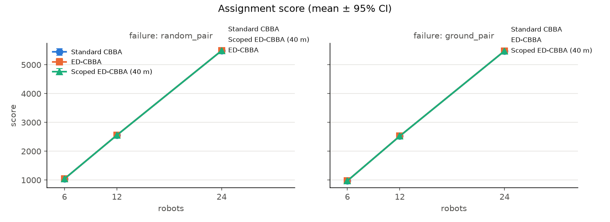

| failure | robots | Standard CBBA | ED-CBBA | Scoped ED-CBBA (40 m) |
| --- | ---: | ---: | ---: | ---: |
| random_pair | 6 | 1043.02 ± 10.08 | 1043.02 ± 10.08 | 1043.02 ± 10.08 |
| random_pair | 12 | 2557.04 ± 22.61 | 2557.04 ± 22.61 | 2557.04 ± 22.61 |
| random_pair | 24 | 5491.41 ± 25.63 | 5491.41 ± 25.63 | 5491.41 ± 25.63 |
| ground_pair | 6 | 974.21 ± 16.09 | 974.21 ± 16.09 | 974.21 ± 16.09 |
| ground_pair | 12 | 2526.35 ± 16.82 | 2526.35 ± 16.82 | 2526.35 ± 16.82 |
| ground_pair | 24 | 5481.38 ± 22.58 | 5481.38 ± 22.58 | 5481.14 ± 22.60 |

## Mission completion time (last task finishes)

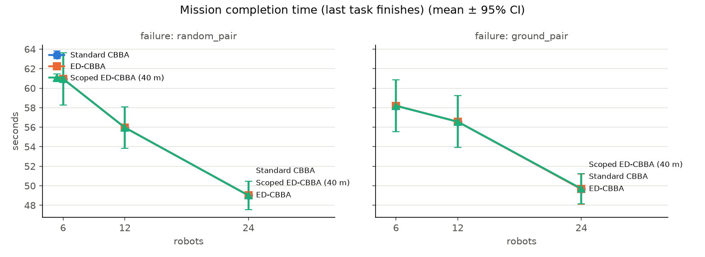

| failure | robots | Standard CBBA | ED-CBBA | Scoped ED-CBBA (40 m) |
| --- | ---: | ---: | ---: | ---: |
| random_pair | 6 | 60.96 ± 2.68 | 60.96 ± 2.68 | 60.96 ± 2.68 |
| random_pair | 12 | 55.97 ± 2.13 | 55.97 ± 2.13 | 55.97 ± 2.13 |
| random_pair | 24 | 49.01 ± 1.45 | 49.01 ± 1.45 | 49.01 ± 1.45 |
| ground_pair | 6 | 58.20 ± 2.65 | 58.20 ± 2.65 | 58.20 ± 2.65 |
| ground_pair | 12 | 56.56 ± 2.66 | 56.56 ± 2.66 | 56.56 ± 2.66 |
| ground_pair | 24 | 49.66 ± 1.56 | 49.66 ± 1.56 | 49.70 ± 1.56 |

## Total robot time spent on shared tasks

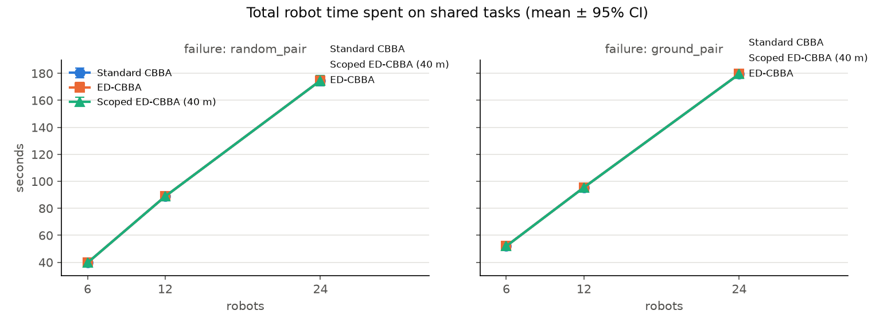

| failure | robots | Standard CBBA | ED-CBBA | Scoped ED-CBBA (40 m) |
| --- | ---: | ---: | ---: | ---: |
| random_pair | 6 | 39.67 ± 2.40 | 39.67 ± 2.40 | 39.67 ± 2.40 |
| random_pair | 12 | 88.83 ± 3.17 | 88.83 ± 3.17 | 88.83 ± 3.17 |
| random_pair | 24 | 174.67 ± 3.89 | 174.67 ± 3.89 | 174.67 ± 3.89 |
| ground_pair | 6 | 52.00 ± 1.74 | 52.00 ± 1.74 | 52.00 ± 1.74 |
| ground_pair | 12 | 95.50 ± 1.65 | 95.50 ± 1.65 | 95.50 ± 1.65 |
| ground_pair | 24 | 179.50 ± 3.04 | 179.50 ± 3.04 | 179.50 ± 3.04 |

## Surviving robots' tasks that changed owner

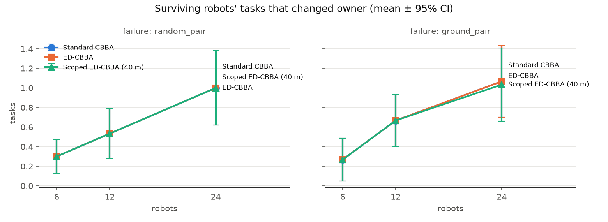

| failure | robots | Standard CBBA | ED-CBBA | Scoped ED-CBBA (40 m) |
| --- | ---: | ---: | ---: | ---: |
| random_pair | 6 | 0.30 ± 0.17 | 0.30 ± 0.17 | 0.30 ± 0.17 |
| random_pair | 12 | 0.53 ± 0.25 | 0.53 ± 0.25 | 0.53 ± 0.25 |
| random_pair | 24 | 1.00 ± 0.38 | 1.00 ± 0.38 | 1.00 ± 0.38 |
| ground_pair | 6 | 0.27 ± 0.22 | 0.27 ± 0.22 | 0.27 ± 0.22 |
| ground_pair | 12 | 0.67 ± 0.27 | 0.67 ± 0.27 | 0.67 ± 0.27 |
| ground_pair | 24 | 1.07 ± 0.37 | 1.07 ± 0.37 | 1.03 ± 0.37 |

## Paired differences vs standard CBBA

Per mission: method minus standard CBBA on the same mission and failed robot.

| failure | robots | method | Δ broadcasts | broadcast reduction | Δ score | Δ assigned tasks |
| --- | ---: | --- | ---: | ---: | ---: | ---: |
| random_pair | 6 | ED-CBBA | -17.0 ± 0.3 | 55.4 ± 1.7% | 0.00 ± 0.00 | 0.00 ± 0.00 |
| random_pair | 6 | Scoped ED-CBBA (40 m) | -17.0 ± 0.3 | 55.4 ± 1.7% | 0.00 ± 0.00 | 0.00 ± 0.00 |
| random_pair | 12 | ED-CBBA | -100.7 ± 0.3 | 67.8 ± 1.5% | 0.00 ± 0.00 | 0.00 ± 0.00 |
| random_pair | 12 | Scoped ED-CBBA (40 m) | -100.2 ± 1.0 | 67.5 ± 1.6% | 0.00 ± 0.00 | 0.00 ± 0.00 |
| random_pair | 24 | ED-CBBA | -484.6 ± 0.2 | 81.9 ± 0.9% | 0.00 ± 0.00 | 0.00 ± 0.00 |
| random_pair | 24 | Scoped ED-CBBA (40 m) | -484.6 ± 0.2 | 81.9 ± 0.9% | 0.00 ± 0.00 | 0.00 ± 0.00 |
| ground_pair | 6 | ED-CBBA | -16.8 ± 0.2 | 56.4 ± 1.4% | 0.00 ± 0.00 | 0.00 ± 0.00 |
| ground_pair | 6 | Scoped ED-CBBA (40 m) | -16.8 ± 0.2 | 56.4 ± 1.4% | 0.00 ± 0.00 | 0.00 ± 0.00 |
| ground_pair | 12 | ED-CBBA | -101.2 ± 0.3 | 67.6 ± 1.6% | 0.00 ± 0.00 | 0.00 ± 0.00 |
| ground_pair | 12 | Scoped ED-CBBA (40 m) | -101.2 ± 0.3 | 67.6 ± 1.6% | 0.00 ± 0.00 | 0.00 ± 0.00 |
| ground_pair | 24 | ED-CBBA | -484.8 ± 0.3 | 81.5 ± 1.0% | 0.00 ± 0.00 | 0.00 ± 0.00 |
| ground_pair | 24 | Scoped ED-CBBA (40 m) | -485.4 ± 3.5 | 81.6 ± 1.2% | -0.25 ± 0.51 | 0.00 ± 0.00 |

## Local recovery rate (scoped ED-CBBA)

| failure | robots | local / runs | rate [95% Wilson] | too many affected tasks | no nearby capable robot | local group disconnected | local capacity or schedule infeasible | nothing affected |
| --- | ---: | ---: | --- | ---: | ---: | ---: | ---: | ---: |
| random_pair | 6 | 0/30 | 0.00 [0.00, 0.11] | 29 | 1 | 0 | 0 | 0 |
| random_pair | 12 | 0/30 | 0.00 [0.00, 0.11] | 29 | 0 | 0 | 1 | 0 |
| random_pair | 24 | 0/30 | 0.00 [0.00, 0.11] | 30 | 0 | 0 | 0 | 0 |
| ground_pair | 6 | 0/30 | 0.00 [0.00, 0.11] | 30 | 0 | 0 | 0 | 0 |
| ground_pair | 12 | 0/30 | 0.00 [0.00, 0.11] | 29 | 1 | 0 | 0 | 0 |
| ground_pair | 24 | 1/30 | 0.03 [0.01, 0.17] | 27 | 1 | 0 | 1 | 0 |

## Consistency

| failure | robots | method | consensus reached [95% Wilson] | runs with duplicate claims |
| --- | ---: | --- | --- | ---: |
| random_pair | 6 | Standard CBBA | 1.00 [0.89, 1.00] | 0 |
| random_pair | 6 | ED-CBBA | 1.00 [0.89, 1.00] | 0 |
| random_pair | 6 | Scoped ED-CBBA (40 m) | 1.00 [0.89, 1.00] | 0 |
| random_pair | 12 | Standard CBBA | 1.00 [0.89, 1.00] | 0 |
| random_pair | 12 | ED-CBBA | 1.00 [0.89, 1.00] | 0 |
| random_pair | 12 | Scoped ED-CBBA (40 m) | 1.00 [0.89, 1.00] | 0 |
| random_pair | 24 | Standard CBBA | 1.00 [0.89, 1.00] | 0 |
| random_pair | 24 | ED-CBBA | 1.00 [0.89, 1.00] | 0 |
| random_pair | 24 | Scoped ED-CBBA (40 m) | 1.00 [0.89, 1.00] | 0 |
| ground_pair | 6 | Standard CBBA | 1.00 [0.89, 1.00] | 0 |
| ground_pair | 6 | ED-CBBA | 1.00 [0.89, 1.00] | 0 |
| ground_pair | 6 | Scoped ED-CBBA (40 m) | 1.00 [0.89, 1.00] | 0 |
| ground_pair | 12 | Standard CBBA | 1.00 [0.89, 1.00] | 0 |
| ground_pair | 12 | ED-CBBA | 1.00 [0.89, 1.00] | 0 |
| ground_pair | 12 | Scoped ED-CBBA (40 m) | 1.00 [0.89, 1.00] | 0 |
| ground_pair | 24 | Standard CBBA | 1.00 [0.89, 1.00] | 0 |
| ground_pair | 24 | ED-CBBA | 1.00 [0.89, 1.00] | 0 |
| ground_pair | 24 | Scoped ED-CBBA (40 m) | 1.00 [0.89, 1.00] | 0 |

## Shared-task winners

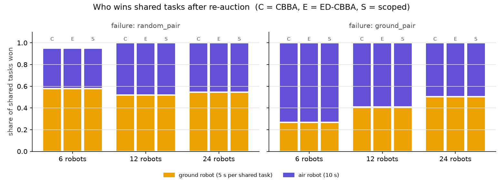

Ground robots take 5 s on a shared task and air robots 10 s, at equal speed.

| failure | robots | method | ground share | air share | unassigned | won by farther type |
| --- | ---: | --- | ---: | ---: | ---: | ---: |
| random_pair | 6 | Standard CBBA | 0.58 | 0.37 | 0.05 | 0.28 |
| random_pair | 6 | ED-CBBA | 0.58 | 0.37 | 0.05 | 0.28 |
| random_pair | 6 | Scoped ED-CBBA (40 m) | 0.58 | 0.37 | 0.05 | 0.28 |
| random_pair | 12 | Standard CBBA | 0.52 | 0.48 | 0.00 | 0.23 |
| random_pair | 12 | ED-CBBA | 0.52 | 0.48 | 0.00 | 0.23 |
| random_pair | 12 | Scoped ED-CBBA (40 m) | 0.52 | 0.48 | 0.00 | 0.23 |
| random_pair | 24 | Standard CBBA | 0.54 | 0.46 | 0.00 | 0.24 |
| random_pair | 24 | ED-CBBA | 0.54 | 0.46 | 0.00 | 0.24 |
| random_pair | 24 | Scoped ED-CBBA (40 m) | 0.54 | 0.46 | 0.00 | 0.24 |
| ground_pair | 6 | Standard CBBA | 0.27 | 0.73 | 0.00 | 0.23 |
| ground_pair | 6 | ED-CBBA | 0.27 | 0.73 | 0.00 | 0.23 |
| ground_pair | 6 | Scoped ED-CBBA (40 m) | 0.27 | 0.73 | 0.00 | 0.23 |
| ground_pair | 12 | Standard CBBA | 0.41 | 0.59 | 0.00 | 0.21 |
| ground_pair | 12 | ED-CBBA | 0.41 | 0.59 | 0.00 | 0.21 |
| ground_pair | 12 | Scoped ED-CBBA (40 m) | 0.41 | 0.59 | 0.00 | 0.21 |
| ground_pair | 24 | Standard CBBA | 0.50 | 0.50 | 0.00 | 0.25 |
| ground_pair | 24 | ED-CBBA | 0.50 | 0.50 | 0.00 | 0.25 |
| ground_pair | 24 | Scoped ED-CBBA (40 m) | 0.50 | 0.50 | 0.00 | 0.25 |

*won by farther type*: the winner's type has no robot closer to the task than the nearest robot of the other type.
