# Experiment 3 (shared capabilities): imbalanced

Source: `results/exp3_shared/imbalanced`. 90 missions, 540 re-auction runs. Values are mean ± 95% CI half-width (t-distribution) over seeds.

## Post-failure broadcasts until the allocation stops changing

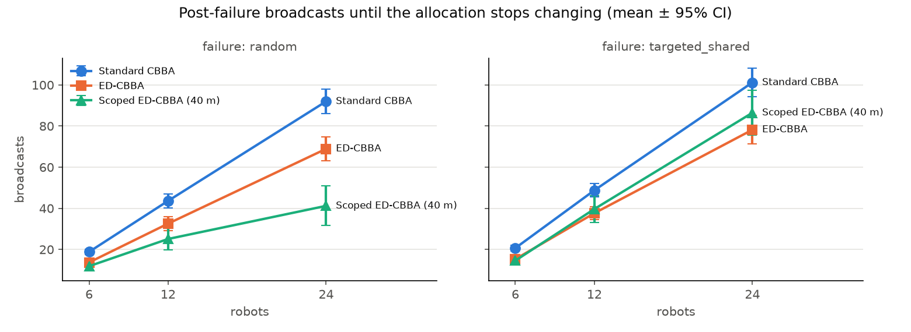

| failure | robots | Standard CBBA | ED-CBBA | Scoped ED-CBBA (40 m) |
| --- | ---: | ---: | ---: | ---: |
| random | 6 | 18.83 ± 1.17 | 13.70 ± 1.11 | 11.87 ± 2.22 |
| random | 12 | 43.63 ± 3.49 | 32.57 ± 3.45 | 25.10 ± 5.30 |
| random | 24 | 92.00 ± 5.97 | 68.93 ± 5.93 | 41.20 ± 9.65 |
| targeted_shared | 6 | 20.67 ± 1.36 | 15.30 ± 1.24 | 14.57 ± 1.77 |
| targeted_shared | 12 | 48.77 ± 3.18 | 37.63 ± 3.13 | 39.67 ± 6.59 |
| targeted_shared | 24 | 101.20 ± 6.99 | 78.20 ± 6.99 | 86.47 ± 10.86 |

## Post-failure broadcasts incl. quiet rounds of the stopping rule

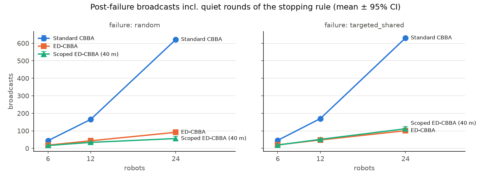

| failure | robots | Standard CBBA | ED-CBBA | Scoped ED-CBBA (40 m) |
| --- | ---: | ---: | ---: | ---: |
| random | 6 | 43.83 ± 1.17 | 18.07 ± 1.06 | 16.03 ± 2.64 |
| random | 12 | 164.63 ± 3.49 | 43.03 ± 3.38 | 33.93 ± 6.79 |
| random | 24 | 621.00 ± 5.97 | 91.40 ± 5.84 | 55.80 ± 12.72 |
| targeted_shared | 6 | 45.67 ± 1.36 | 19.70 ± 1.16 | 18.83 ± 1.97 |
| targeted_shared | 12 | 169.77 ± 3.18 | 47.83 ± 3.07 | 51.17 ± 7.63 |
| targeted_shared | 24 | 630.20 ± 6.99 | 100.57 ± 6.90 | 111.67 ± 12.72 |

## Broadcasts per affected task (incl. quiet rounds)

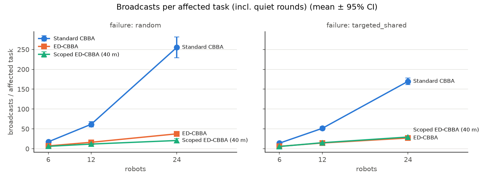

| failure | robots | Standard CBBA | ED-CBBA | Scoped ED-CBBA (40 m) |
| --- | ---: | ---: | ---: | ---: |
| random | 6 | 17.49 ± 1.72 | 7.18 ± 0.75 | 6.14 ± 1.19 |
| random | 12 | 61.60 ± 6.92 | 16.31 ± 2.37 | 11.82 ± 2.44 |
| random | 24 | 255.30 ± 26.32 | 37.60 ± 4.41 | 20.79 ± 4.52 |
| targeted_shared | 6 | 14.11 ± 1.38 | 6.11 ± 0.68 | 5.67 ± 0.72 |
| targeted_shared | 12 | 51.43 ± 4.33 | 14.51 ± 1.48 | 15.22 ± 2.39 |
| targeted_shared | 24 | 169.75 ± 8.47 | 27.05 ± 2.18 | 29.54 ± 3.39 |

## Consensus rounds until the allocation stops changing

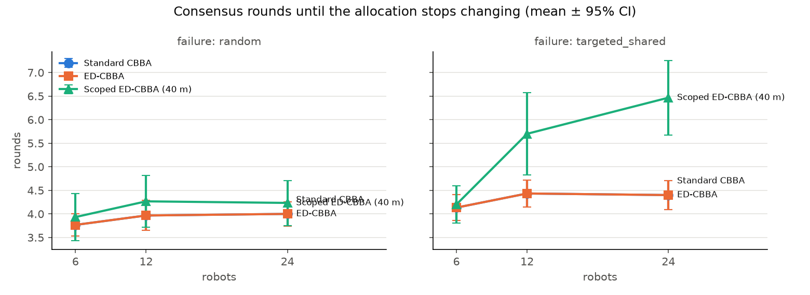

| failure | robots | Standard CBBA | ED-CBBA | Scoped ED-CBBA (40 m) |
| --- | ---: | ---: | ---: | ---: |
| random | 6 | 3.77 ± 0.23 | 3.77 ± 0.23 | 3.93 ± 0.50 |
| random | 12 | 3.97 ± 0.32 | 3.97 ± 0.32 | 4.27 ± 0.55 |
| random | 24 | 4.00 ± 0.26 | 4.00 ± 0.26 | 4.23 ± 0.48 |
| targeted_shared | 6 | 4.13 ± 0.27 | 4.13 ± 0.27 | 4.20 ± 0.40 |
| targeted_shared | 12 | 4.43 ± 0.29 | 4.43 ± 0.29 | 5.70 ± 0.87 |
| targeted_shared | 24 | 4.40 ± 0.30 | 4.40 ± 0.30 | 6.47 ± 0.79 |

## Consensus rounds incl. quiet rounds

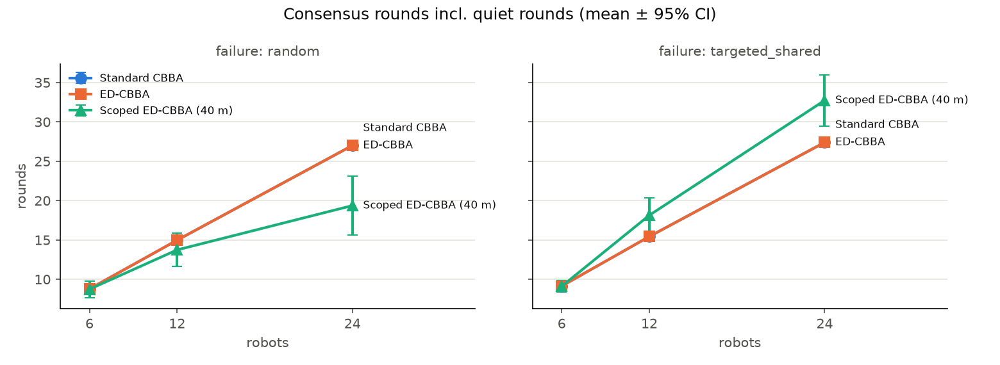

| failure | robots | Standard CBBA | ED-CBBA | Scoped ED-CBBA (40 m) |
| --- | ---: | ---: | ---: | ---: |
| random | 6 | 8.77 ± 0.23 | 8.77 ± 0.23 | 8.73 ± 1.07 |
| random | 12 | 14.97 ± 0.32 | 14.97 ± 0.32 | 13.73 ± 2.13 |
| random | 24 | 27.00 ± 0.26 | 27.00 ± 0.26 | 19.37 ± 3.74 |
| targeted_shared | 6 | 9.13 ± 0.27 | 9.13 ± 0.27 | 9.10 ± 0.72 |
| targeted_shared | 12 | 15.43 ± 0.29 | 15.43 ± 0.29 | 18.13 ± 2.21 |
| targeted_shared | 24 | 27.40 ± 0.30 | 27.40 ± 0.30 | 32.73 ± 3.25 |

## Re-auction runtime (CPU)

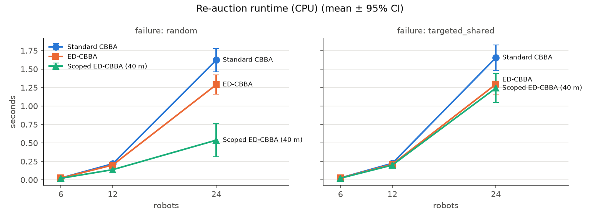

| failure | robots | Standard CBBA | ED-CBBA | Scoped ED-CBBA (40 m) |
| --- | ---: | ---: | ---: | ---: |
| random | 6 | 0.0255 ± 0.0028 | 0.0249 ± 0.0027 | 0.0216 ± 0.0043 |
| random | 12 | 0.2180 ± 0.0194 | 0.2008 ± 0.0174 | 0.1381 ± 0.0381 |
| random | 24 | 1.6221 ± 0.1578 | 1.2888 ± 0.1300 | 0.5377 ± 0.2271 |
| targeted_shared | 6 | 0.0266 ± 0.0027 | 0.0257 ± 0.0026 | 0.0230 ± 0.0035 |
| targeted_shared | 12 | 0.2243 ± 0.0210 | 0.2103 ± 0.0184 | 0.1998 ± 0.0347 |
| targeted_shared | 24 | 1.6544 ± 0.1724 | 1.2943 ± 0.1451 | 1.2433 ± 0.1968 |

## Assigned-task rate

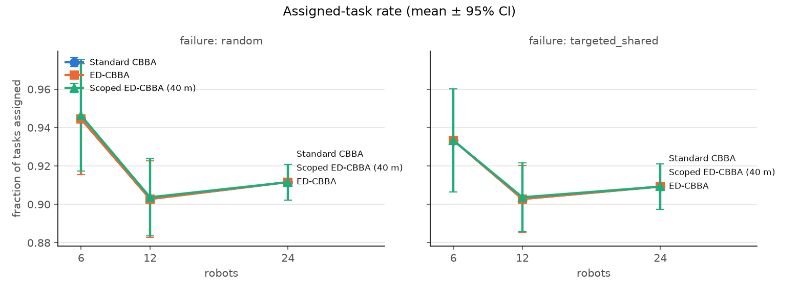

| failure | robots | Standard CBBA | ED-CBBA | Scoped ED-CBBA (40 m) |
| --- | ---: | ---: | ---: | ---: |
| random | 6 | 0.9444 ± 0.0288 | 0.9444 ± 0.0288 | 0.9463 ± 0.0291 |
| random | 12 | 0.9028 ± 0.0200 | 0.9028 ± 0.0200 | 0.9037 ± 0.0201 |
| random | 24 | 0.9116 ± 0.0093 | 0.9116 ± 0.0093 | 0.9116 ± 0.0093 |
| targeted_shared | 6 | 0.9333 ± 0.0269 | 0.9333 ± 0.0269 | 0.9333 ± 0.0269 |
| targeted_shared | 12 | 0.9028 ± 0.0174 | 0.9028 ± 0.0174 | 0.9037 ± 0.0178 |
| targeted_shared | 24 | 0.9093 ± 0.0119 | 0.9093 ± 0.0119 | 0.9093 ± 0.0119 |

## Assignment score

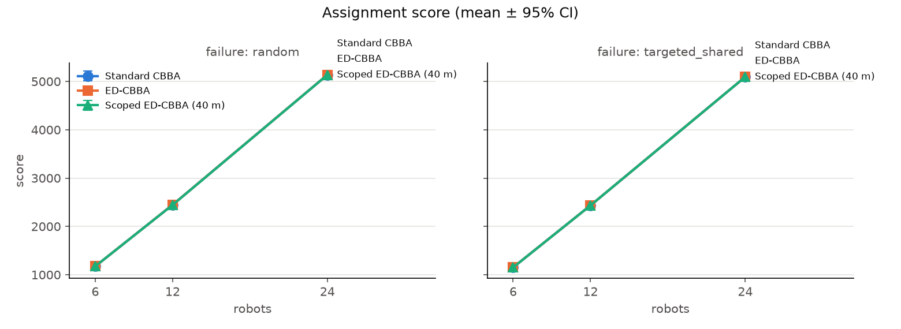

| failure | robots | Standard CBBA | ED-CBBA | Scoped ED-CBBA (40 m) |
| --- | ---: | ---: | ---: | ---: |
| random | 6 | 1173.82 ± 25.98 | 1173.82 ± 25.98 | 1174.34 ± 26.11 |
| random | 12 | 2447.15 ± 35.41 | 2447.15 ± 35.41 | 2445.23 ± 35.46 |
| random | 24 | 5137.01 ± 39.04 | 5137.01 ± 39.04 | 5135.57 ± 39.13 |
| targeted_shared | 6 | 1151.78 ± 23.95 | 1151.78 ± 23.95 | 1151.16 ± 23.64 |
| targeted_shared | 12 | 2434.45 ± 32.79 | 2434.45 ± 32.79 | 2434.48 ± 32.59 |
| targeted_shared | 24 | 5094.76 ± 43.56 | 5094.76 ± 43.56 | 5094.21 ± 43.41 |

## Mission completion time (last task finishes)

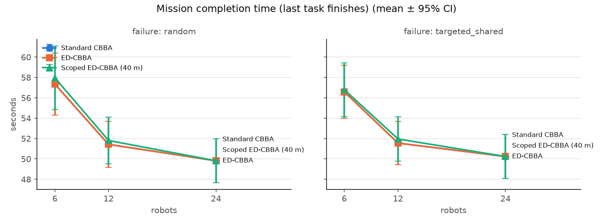

| failure | robots | Standard CBBA | ED-CBBA | Scoped ED-CBBA (40 m) |
| --- | ---: | ---: | ---: | ---: |
| random | 6 | 57.36 ± 3.06 | 57.36 ± 3.06 | 57.97 ± 3.13 |
| random | 12 | 51.43 ± 2.27 | 51.43 ± 2.27 | 51.81 ± 2.29 |
| random | 24 | 49.82 ± 2.15 | 49.82 ± 2.15 | 49.82 ± 2.15 |
| targeted_shared | 6 | 56.59 ± 2.62 | 56.59 ± 2.62 | 56.80 ± 2.64 |
| targeted_shared | 12 | 51.55 ± 2.13 | 51.55 ± 2.13 | 51.96 ± 2.17 |
| targeted_shared | 24 | 50.24 ± 2.16 | 50.24 ± 2.16 | 50.24 ± 2.16 |

## Total robot time spent on shared tasks

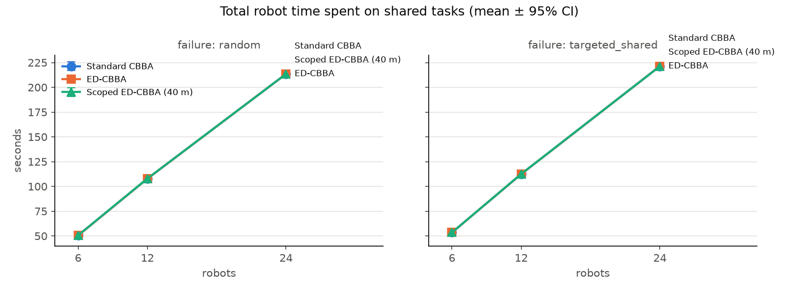

| failure | robots | Standard CBBA | ED-CBBA | Scoped ED-CBBA (40 m) |
| --- | ---: | ---: | ---: | ---: |
| random | 6 | 50.50 ± 2.04 | 50.50 ± 2.04 | 50.67 ± 2.01 |
| random | 12 | 107.83 ± 2.23 | 107.83 ± 2.23 | 108.00 ± 2.23 |
| random | 24 | 213.50 ± 3.29 | 213.50 ± 3.29 | 213.50 ± 3.29 |
| targeted_shared | 6 | 53.50 ± 1.84 | 53.50 ± 1.84 | 53.50 ± 1.84 |
| targeted_shared | 12 | 112.50 ± 1.88 | 112.50 ± 1.88 | 112.67 ± 1.88 |
| targeted_shared | 24 | 221.33 ± 2.59 | 221.33 ± 2.59 | 221.33 ± 2.59 |

## Surviving robots' tasks that changed owner

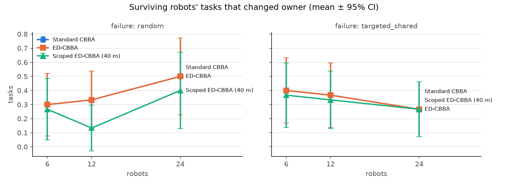

| failure | robots | Standard CBBA | ED-CBBA | Scoped ED-CBBA (40 m) |
| --- | ---: | ---: | ---: | ---: |
| random | 6 | 0.30 ± 0.22 | 0.30 ± 0.22 | 0.27 ± 0.22 |
| random | 12 | 0.33 ± 0.20 | 0.33 ± 0.20 | 0.13 ± 0.16 |
| random | 24 | 0.50 ± 0.27 | 0.50 ± 0.27 | 0.40 ± 0.27 |
| targeted_shared | 6 | 0.40 ± 0.23 | 0.40 ± 0.23 | 0.37 ± 0.23 |
| targeted_shared | 12 | 0.37 ± 0.23 | 0.37 ± 0.23 | 0.33 ± 0.20 |
| targeted_shared | 24 | 0.27 ± 0.19 | 0.27 ± 0.19 | 0.27 ± 0.19 |

## Paired differences vs standard CBBA

Per mission: method minus standard CBBA on the same mission and failed robot.

| failure | robots | method | Δ broadcasts | broadcast reduction | Δ score | Δ assigned tasks |
| --- | ---: | --- | ---: | ---: | ---: | ---: |
| random | 6 | ED-CBBA | -25.8 ± 0.3 | 59.0 ± 1.4% | 0.00 ± 0.00 | 0.00 ± 0.00 |
| random | 6 | Scoped ED-CBBA (40 m) | -27.8 ± 2.5 | 63.6 ± 5.7% | 0.51 ± 2.35 | 0.03 ± 0.07 |
| random | 12 | ED-CBBA | -121.6 ± 0.2 | 74.1 ± 1.5% | 0.00 ± 0.00 | 0.00 ± 0.00 |
| random | 12 | Scoped ED-CBBA (40 m) | -130.7 ± 7.3 | 79.4 ± 4.0% | -1.92 ± 4.09 | 0.03 ± 0.07 |
| random | 24 | ED-CBBA | -529.6 ± 0.2 | 85.3 ± 0.8% | 0.00 ± 0.00 | 0.00 ± 0.00 |
| random | 24 | Scoped ED-CBBA (40 m) | -565.2 ± 13.9 | 91.0 ± 2.0% | -1.43 ± 1.25 | 0.00 ± 0.00 |
| targeted_shared | 6 | ED-CBBA | -26.0 ± 0.3 | 57.1 ± 1.3% | 0.00 ± 0.00 | 0.00 ± 0.00 |
| targeted_shared | 6 | Scoped ED-CBBA (40 m) | -26.8 ± 1.6 | 59.0 ± 3.7% | -0.62 ± 0.74 | 0.00 ± 0.00 |
| targeted_shared | 12 | ED-CBBA | -121.9 ± 0.2 | 72.0 ± 1.3% | 0.00 ± 0.00 | 0.00 ± 0.00 |
| targeted_shared | 12 | Scoped ED-CBBA (40 m) | -118.6 ± 5.9 | 70.2 ± 4.1% | 0.02 ± 2.34 | 0.03 ± 0.07 |
| targeted_shared | 24 | ED-CBBA | -529.6 ± 0.2 | 84.1 ± 0.9% | 0.00 ± 0.00 | 0.00 ± 0.00 |
| targeted_shared | 24 | Scoped ED-CBBA (40 m) | -518.5 ± 10.2 | 82.4 ± 1.9% | -0.55 ± 0.84 | 0.00 ± 0.00 |

## Local recovery rate (scoped ED-CBBA)

| failure | robots | local / runs | rate [95% Wilson] | too many affected tasks | no nearby capable robot | local group disconnected | local capacity or schedule infeasible | nothing affected |
| --- | ---: | ---: | --- | ---: | ---: | ---: | ---: | ---: |
| random | 6 | 8/30 | 0.27 [0.14, 0.44] | 0 | 16 | 0 | 6 | 0 |
| random | 12 | 13/30 | 0.43 [0.27, 0.61] | 0 | 11 | 0 | 6 | 0 |
| random | 24 | 21/30 | 0.70 [0.52, 0.83] | 0 | 4 | 0 | 5 | 0 |
| targeted_shared | 6 | 4/30 | 0.13 [0.05, 0.30] | 0 | 24 | 0 | 2 | 0 |
| targeted_shared | 12 | 5/30 | 0.17 [0.07, 0.34] | 0 | 12 | 0 | 13 | 0 |
| targeted_shared | 24 | 4/30 | 0.13 [0.05, 0.30] | 0 | 9 | 0 | 17 | 0 |

## Consistency

| failure | robots | method | consensus reached [95% Wilson] | runs with duplicate claims |
| --- | ---: | --- | --- | ---: |
| random | 6 | Standard CBBA | 1.00 [0.89, 1.00] | 0 |
| random | 6 | ED-CBBA | 1.00 [0.89, 1.00] | 0 |
| random | 6 | Scoped ED-CBBA (40 m) | 1.00 [0.89, 1.00] | 0 |
| random | 12 | Standard CBBA | 1.00 [0.89, 1.00] | 0 |
| random | 12 | ED-CBBA | 1.00 [0.89, 1.00] | 0 |
| random | 12 | Scoped ED-CBBA (40 m) | 1.00 [0.89, 1.00] | 0 |
| random | 24 | Standard CBBA | 1.00 [0.89, 1.00] | 0 |
| random | 24 | ED-CBBA | 1.00 [0.89, 1.00] | 0 |
| random | 24 | Scoped ED-CBBA (40 m) | 1.00 [0.89, 1.00] | 0 |
| targeted_shared | 6 | Standard CBBA | 1.00 [0.89, 1.00] | 0 |
| targeted_shared | 6 | ED-CBBA | 1.00 [0.89, 1.00] | 0 |
| targeted_shared | 6 | Scoped ED-CBBA (40 m) | 1.00 [0.89, 1.00] | 0 |
| targeted_shared | 12 | Standard CBBA | 1.00 [0.89, 1.00] | 0 |
| targeted_shared | 12 | ED-CBBA | 1.00 [0.89, 1.00] | 0 |
| targeted_shared | 12 | Scoped ED-CBBA (40 m) | 1.00 [0.89, 1.00] | 0 |
| targeted_shared | 24 | Standard CBBA | 1.00 [0.89, 1.00] | 0 |
| targeted_shared | 24 | ED-CBBA | 1.00 [0.89, 1.00] | 0 |
| targeted_shared | 24 | Scoped ED-CBBA (40 m) | 1.00 [0.89, 1.00] | 0 |

## Shared-task winners

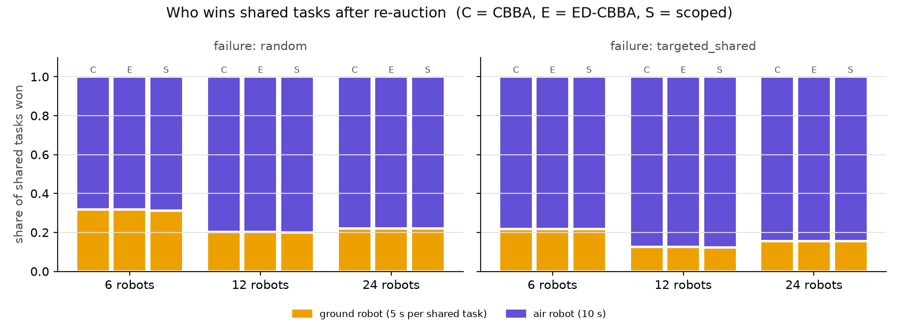

Ground robots take 5 s on a shared task and air robots 10 s, at equal speed.

| failure | robots | method | ground share | air share | unassigned | won by farther type |
| --- | ---: | --- | ---: | ---: | ---: | ---: |
| random | 6 | Standard CBBA | 0.32 | 0.68 | 0.00 | 0.17 |
| random | 6 | ED-CBBA | 0.32 | 0.68 | 0.00 | 0.17 |
| random | 6 | Scoped ED-CBBA (40 m) | 0.31 | 0.69 | 0.00 | 0.17 |
| random | 12 | Standard CBBA | 0.20 | 0.80 | 0.00 | 0.17 |
| random | 12 | ED-CBBA | 0.20 | 0.80 | 0.00 | 0.17 |
| random | 12 | Scoped ED-CBBA (40 m) | 0.20 | 0.80 | 0.00 | 0.17 |
| random | 24 | Standard CBBA | 0.22 | 0.78 | 0.00 | 0.16 |
| random | 24 | ED-CBBA | 0.22 | 0.78 | 0.00 | 0.16 |
| random | 24 | Scoped ED-CBBA (40 m) | 0.22 | 0.78 | 0.00 | 0.16 |
| targeted_shared | 6 | Standard CBBA | 0.22 | 0.78 | 0.00 | 0.23 |
| targeted_shared | 6 | ED-CBBA | 0.22 | 0.78 | 0.00 | 0.23 |
| targeted_shared | 6 | Scoped ED-CBBA (40 m) | 0.22 | 0.78 | 0.00 | 0.23 |
| targeted_shared | 12 | Standard CBBA | 0.12 | 0.88 | 0.00 | 0.18 |
| targeted_shared | 12 | ED-CBBA | 0.12 | 0.88 | 0.00 | 0.18 |
| targeted_shared | 12 | Scoped ED-CBBA (40 m) | 0.12 | 0.88 | 0.00 | 0.18 |
| targeted_shared | 24 | Standard CBBA | 0.16 | 0.84 | 0.00 | 0.14 |
| targeted_shared | 24 | ED-CBBA | 0.16 | 0.84 | 0.00 | 0.14 |
| targeted_shared | 24 | Scoped ED-CBBA (40 m) | 0.16 | 0.84 | 0.00 | 0.14 |

*won by farther type*: the winner's type has no robot closer to the task than the nearest robot of the other type.
