# Experiment 3 (shared capabilities): mid_mission

Source: `results/exp3_shared/mid_mission`. 90 missions, 540 re-auction runs. Values are mean ± 95% CI half-width (t-distribution) over seeds.

## Post-failure broadcasts until the allocation stops changing

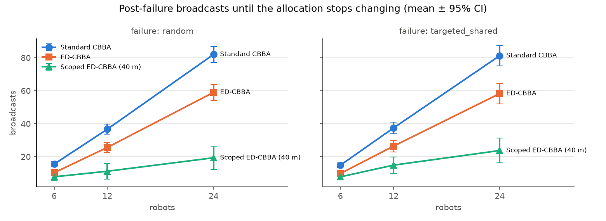

| failure | robots | Standard CBBA | ED-CBBA | Scoped ED-CBBA (40 m) |
| --- | ---: | ---: | ---: | ---: |
| random | 6 | 15.50 ± 1.65 | 10.30 ± 1.52 | 7.80 ± 2.08 |
| random | 12 | 36.67 ± 3.11 | 25.60 ± 3.06 | 11.17 ± 4.71 |
| random | 24 | 82.03 ± 4.88 | 59.00 ± 4.87 | 19.33 ± 6.97 |
| targeted_shared | 6 | 14.83 ± 1.34 | 9.77 ± 1.31 | 7.77 ± 1.91 |
| targeted_shared | 12 | 37.40 ± 3.51 | 26.40 ± 3.51 | 14.87 ± 4.93 |
| targeted_shared | 24 | 81.27 ± 6.27 | 58.27 ± 6.27 | 23.73 ± 7.47 |

## Post-failure broadcasts incl. quiet rounds of the stopping rule

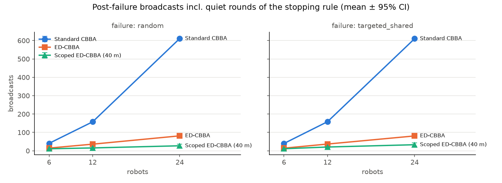

| failure | robots | Standard CBBA | ED-CBBA | Scoped ED-CBBA (40 m) |
| --- | ---: | ---: | ---: | ---: |
| random | 6 | 40.50 ± 1.65 | 14.77 ± 1.39 | 11.00 ± 2.55 |
| random | 12 | 157.67 ± 3.11 | 36.07 ± 2.97 | 15.60 ± 5.81 |
| random | 24 | 611.03 ± 4.88 | 81.37 ± 4.75 | 27.27 ± 9.48 |
| targeted_shared | 6 | 39.83 ± 1.34 | 14.30 ± 1.18 | 11.23 ± 2.35 |
| targeted_shared | 12 | 158.40 ± 3.51 | 36.73 ± 3.42 | 20.57 ± 6.13 |
| targeted_shared | 24 | 610.27 ± 6.27 | 80.90 ± 6.16 | 33.07 ± 9.38 |

## Broadcasts per affected task (incl. quiet rounds)

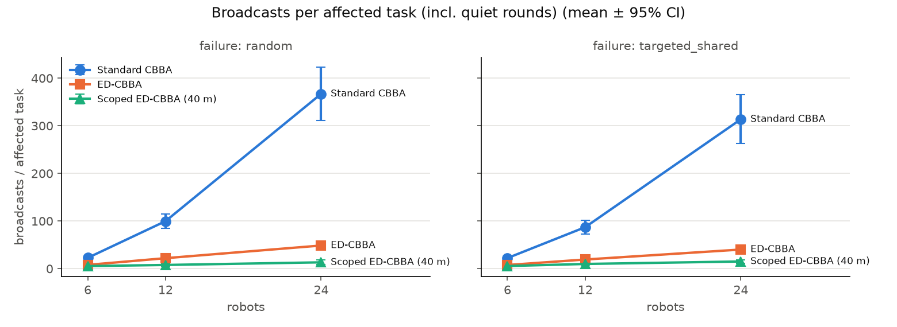

| failure | robots | Standard CBBA | ED-CBBA | Scoped ED-CBBA (40 m) |
| --- | ---: | ---: | ---: | ---: |
| random | 6 | 22.73 ± 2.94 | 8.01 ± 0.94 | 5.49 ± 1.29 |
| random | 12 | 99.73 ± 14.74 | 22.05 ± 3.01 | 7.80 ± 2.33 |
| random | 24 | 367.04 ± 56.24 | 48.63 ± 7.01 | 13.32 ± 4.79 |
| targeted_shared | 6 | 22.25 ± 2.93 | 7.74 ± 0.89 | 5.57 ± 1.09 |
| targeted_shared | 12 | 87.17 ± 14.07 | 19.23 ± 2.59 | 9.91 ± 2.78 |
| targeted_shared | 24 | 313.69 ± 51.18 | 40.19 ± 5.59 | 15.14 ± 3.55 |

## Consensus rounds until the allocation stops changing

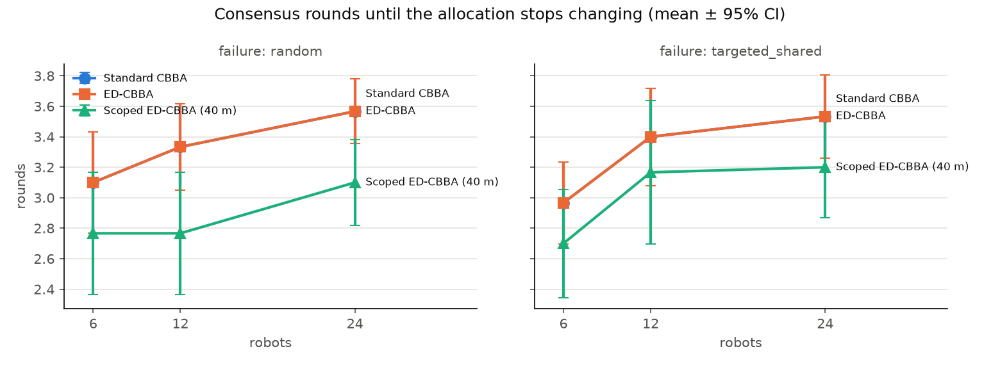

| failure | robots | Standard CBBA | ED-CBBA | Scoped ED-CBBA (40 m) |
| --- | ---: | ---: | ---: | ---: |
| random | 6 | 3.10 ± 0.33 | 3.10 ± 0.33 | 2.77 ± 0.40 |
| random | 12 | 3.33 ± 0.28 | 3.33 ± 0.28 | 2.77 ± 0.40 |
| random | 24 | 3.57 ± 0.21 | 3.57 ± 0.21 | 3.10 ± 0.28 |
| targeted_shared | 6 | 2.97 ± 0.27 | 2.97 ± 0.27 | 2.70 ± 0.36 |
| targeted_shared | 12 | 3.40 ± 0.32 | 3.40 ± 0.32 | 3.17 ± 0.47 |
| targeted_shared | 24 | 3.53 ± 0.27 | 3.53 ± 0.27 | 3.20 ± 0.33 |

## Consensus rounds incl. quiet rounds

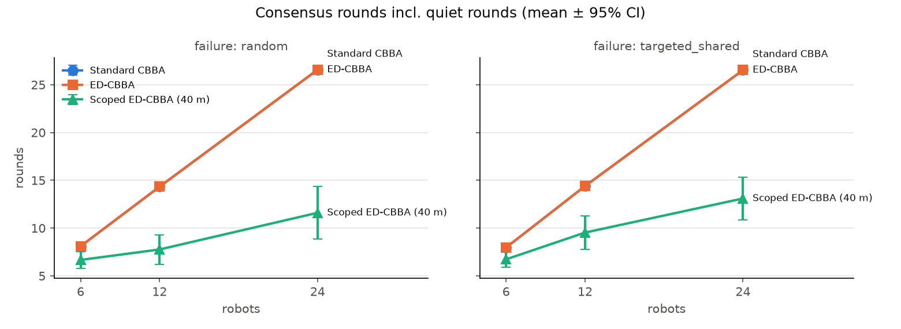

| failure | robots | Standard CBBA | ED-CBBA | Scoped ED-CBBA (40 m) |
| --- | ---: | ---: | ---: | ---: |
| random | 6 | 8.10 ± 0.33 | 8.10 ± 0.33 | 6.67 ± 0.87 |
| random | 12 | 14.33 ± 0.28 | 14.33 ± 0.28 | 7.77 ± 1.53 |
| random | 24 | 26.57 ± 0.21 | 26.57 ± 0.21 | 11.60 ± 2.74 |
| targeted_shared | 6 | 7.97 ± 0.27 | 7.97 ± 0.27 | 6.73 ± 0.81 |
| targeted_shared | 12 | 14.40 ± 0.32 | 14.40 ± 0.32 | 9.53 ± 1.73 |
| targeted_shared | 24 | 26.53 ± 0.27 | 26.53 ± 0.27 | 13.10 ± 2.24 |

## Re-auction runtime (CPU)

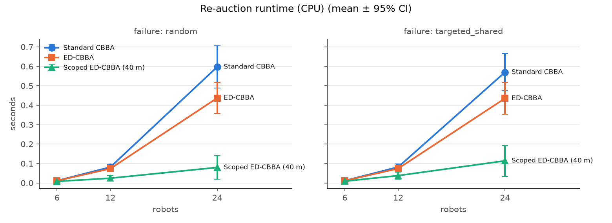

| failure | robots | Standard CBBA | ED-CBBA | Scoped ED-CBBA (40 m) |
| --- | ---: | ---: | ---: | ---: |
| random | 6 | 0.0114 ± 0.0020 | 0.0110 ± 0.0020 | 0.0079 ± 0.0025 |
| random | 12 | 0.0814 ± 0.0142 | 0.0736 ± 0.0132 | 0.0243 ± 0.0129 |
| random | 24 | 0.5971 ± 0.1090 | 0.4370 ± 0.0794 | 0.0797 ± 0.0613 |
| targeted_shared | 6 | 0.0116 ± 0.0022 | 0.0113 ± 0.0022 | 0.0089 ± 0.0028 |
| targeted_shared | 12 | 0.0819 ± 0.0150 | 0.0740 ± 0.0144 | 0.0377 ± 0.0188 |
| targeted_shared | 24 | 0.5699 ± 0.0947 | 0.4353 ± 0.0811 | 0.1138 ± 0.0795 |

## Assigned-task rate

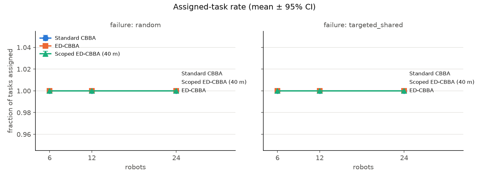

| failure | robots | Standard CBBA | ED-CBBA | Scoped ED-CBBA (40 m) |
| --- | ---: | ---: | ---: | ---: |
| random | 6 | 1.0000 ± 0.0000 | 1.0000 ± 0.0000 | 1.0000 ± 0.0000 |
| random | 12 | 1.0000 ± 0.0000 | 1.0000 ± 0.0000 | 1.0000 ± 0.0000 |
| random | 24 | 1.0000 ± 0.0000 | 1.0000 ± 0.0000 | 1.0000 ± 0.0000 |
| targeted_shared | 6 | 1.0000 ± 0.0000 | 1.0000 ± 0.0000 | 1.0000 ± 0.0000 |
| targeted_shared | 12 | 1.0000 ± 0.0000 | 1.0000 ± 0.0000 | 1.0000 ± 0.0000 |
| targeted_shared | 24 | 1.0000 ± 0.0000 | 1.0000 ± 0.0000 | 1.0000 ± 0.0000 |

## Assignment score

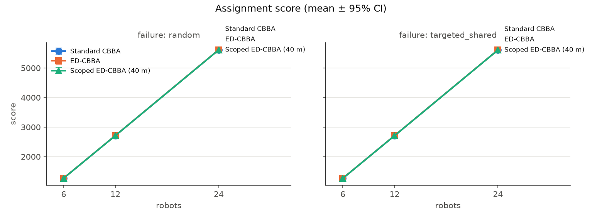

| failure | robots | Standard CBBA | ED-CBBA | Scoped ED-CBBA (40 m) |
| --- | ---: | ---: | ---: | ---: |
| random | 6 | 1272.86 ± 12.60 | 1272.86 ± 12.60 | 1270.95 ± 12.29 |
| random | 12 | 2713.19 ± 15.83 | 2713.19 ± 15.83 | 2711.34 ± 16.00 |
| random | 24 | 5615.64 ± 25.31 | 5615.64 ± 25.31 | 5612.22 ± 25.58 |
| targeted_shared | 6 | 1268.76 ± 15.54 | 1268.76 ± 15.54 | 1267.37 ± 15.42 |
| targeted_shared | 12 | 2712.11 ± 17.54 | 2712.11 ± 17.54 | 2709.16 ± 17.73 |
| targeted_shared | 24 | 5609.35 ± 25.51 | 5609.35 ± 25.51 | 5607.54 ± 25.55 |

## Mission completion time (last task finishes)

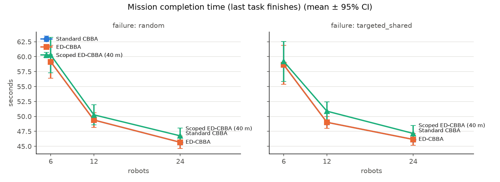

| failure | robots | Standard CBBA | ED-CBBA | Scoped ED-CBBA (40 m) |
| --- | ---: | ---: | ---: | ---: |
| random | 6 | 59.14 ± 2.75 | 59.14 ± 2.75 | 60.28 ± 2.96 |
| random | 12 | 49.39 ± 1.21 | 49.39 ± 1.21 | 50.26 ± 1.67 |
| random | 24 | 45.67 ± 1.03 | 45.67 ± 1.03 | 46.75 ± 1.28 |
| targeted_shared | 6 | 58.63 ± 3.28 | 58.63 ± 3.28 | 59.20 ± 3.32 |
| targeted_shared | 12 | 49.01 ± 0.99 | 49.01 ± 0.99 | 50.88 ± 1.54 |
| targeted_shared | 24 | 46.14 ± 1.00 | 46.14 ± 1.00 | 47.15 ± 1.32 |

## Total robot time spent on shared tasks

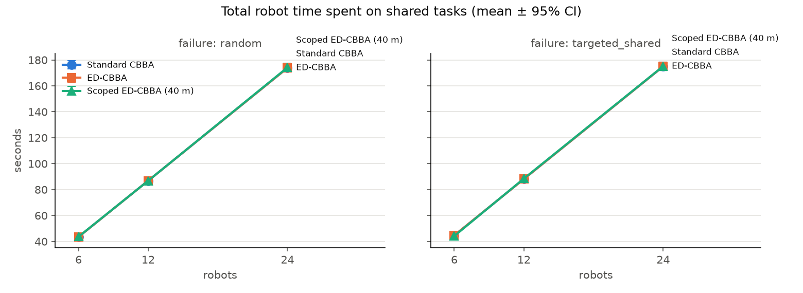

| failure | robots | Standard CBBA | ED-CBBA | Scoped ED-CBBA (40 m) |
| --- | ---: | ---: | ---: | ---: |
| random | 6 | 43.50 ± 1.64 | 43.50 ± 1.64 | 43.67 ± 1.76 |
| random | 12 | 86.83 ± 2.11 | 86.83 ± 2.11 | 86.83 ± 2.11 |
| random | 24 | 173.83 ± 3.13 | 173.83 ± 3.13 | 174.17 ± 3.10 |
| targeted_shared | 6 | 44.67 ± 1.47 | 44.67 ± 1.47 | 44.17 ± 1.70 |
| targeted_shared | 12 | 88.17 ± 1.51 | 88.17 ± 1.51 | 88.50 ± 1.56 |
| targeted_shared | 24 | 175.00 ± 3.06 | 175.00 ± 3.06 | 175.17 ± 3.12 |

## Surviving robots' tasks that changed owner

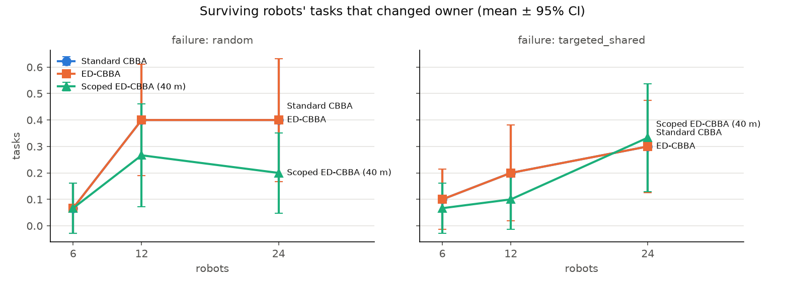

| failure | robots | Standard CBBA | ED-CBBA | Scoped ED-CBBA (40 m) |
| --- | ---: | ---: | ---: | ---: |
| random | 6 | 0.07 ± 0.09 | 0.07 ± 0.09 | 0.07 ± 0.09 |
| random | 12 | 0.40 ± 0.21 | 0.40 ± 0.21 | 0.27 ± 0.19 |
| random | 24 | 0.40 ± 0.23 | 0.40 ± 0.23 | 0.20 ± 0.15 |
| targeted_shared | 6 | 0.10 ± 0.11 | 0.10 ± 0.11 | 0.07 ± 0.09 |
| targeted_shared | 12 | 0.20 ± 0.18 | 0.20 ± 0.18 | 0.10 ± 0.11 |
| targeted_shared | 24 | 0.30 ± 0.17 | 0.30 ± 0.17 | 0.33 ± 0.20 |

## Paired differences vs standard CBBA

Per mission: method minus standard CBBA on the same mission and failed robot.

| failure | robots | method | Δ broadcasts | broadcast reduction | Δ score | Δ assigned tasks |
| --- | ---: | --- | ---: | ---: | ---: | ---: |
| random | 6 | ED-CBBA | -25.7 ± 0.3 | 64.1 ± 2.0% | 0.00 ± 0.00 | 0.00 ± 0.00 |
| random | 6 | Scoped ED-CBBA (40 m) | -29.5 ± 2.0 | 73.6 ± 5.7% | -1.91 ± 1.83 | 0.00 ± 0.00 |
| random | 12 | ED-CBBA | -121.6 ± 0.2 | 77.3 ± 1.4% | 0.00 ± 0.00 | 0.00 ± 0.00 |
| random | 12 | Scoped ED-CBBA (40 m) | -142.1 ± 4.5 | 90.4 ± 3.4% | -1.85 ± 1.05 | 0.00 ± 0.00 |
| random | 24 | ED-CBBA | -529.7 ± 0.2 | 86.7 ± 0.7% | 0.00 ± 0.00 | 0.00 ± 0.00 |
| random | 24 | Scoped ED-CBBA (40 m) | -583.8 ± 10.7 | 95.5 ± 1.6% | -3.41 ± 2.08 | 0.00 ± 0.00 |
| targeted_shared | 6 | ED-CBBA | -25.5 ± 0.2 | 64.5 ± 1.8% | 0.00 ± 0.00 | 0.00 ± 0.00 |
| targeted_shared | 6 | Scoped ED-CBBA (40 m) | -28.6 ± 1.8 | 72.5 ± 5.3% | -1.40 ± 1.64 | 0.00 ± 0.00 |
| targeted_shared | 12 | ED-CBBA | -121.7 ± 0.2 | 77.1 ± 1.6% | 0.00 ± 0.00 | 0.00 ± 0.00 |
| targeted_shared | 12 | Scoped ED-CBBA (40 m) | -137.8 ± 5.2 | 87.3 ± 3.6% | -2.95 ± 1.82 | 0.00 ± 0.00 |
| targeted_shared | 24 | ED-CBBA | -529.4 ± 0.2 | 86.8 ± 0.9% | 0.00 ± 0.00 | 0.00 ± 0.00 |
| targeted_shared | 24 | Scoped ED-CBBA (40 m) | -577.2 ± 8.8 | 94.6 ± 1.5% | -1.80 ± 1.26 | 0.00 ± 0.00 |

## Local recovery rate (scoped ED-CBBA)

| failure | robots | local / runs | rate [95% Wilson] | too many affected tasks | no nearby capable robot | local group disconnected | local capacity or schedule infeasible | nothing affected |
| --- | ---: | ---: | --- | ---: | ---: | ---: | ---: | ---: |
| random | 6 | 12/30 | 0.40 [0.25, 0.58] | 0 | 17 | 0 | 0 | 1 |
| random | 12 | 25/30 | 0.83 [0.66, 0.93] | 0 | 5 | 0 | 0 | 0 |
| random | 24 | 25/30 | 0.83 [0.66, 0.93] | 0 | 3 | 0 | 0 | 2 |
| targeted_shared | 6 | 11/30 | 0.37 [0.22, 0.54] | 0 | 19 | 0 | 0 | 0 |
| targeted_shared | 12 | 20/30 | 0.67 [0.49, 0.81] | 0 | 9 | 0 | 1 | 0 |
| targeted_shared | 24 | 27/30 | 0.90 [0.74, 0.97] | 0 | 3 | 0 | 0 | 0 |

## Consistency

| failure | robots | method | consensus reached [95% Wilson] | runs with duplicate claims |
| --- | ---: | --- | --- | ---: |
| random | 6 | Standard CBBA | 1.00 [0.89, 1.00] | 0 |
| random | 6 | ED-CBBA | 1.00 [0.89, 1.00] | 0 |
| random | 6 | Scoped ED-CBBA (40 m) | 1.00 [0.89, 1.00] | 0 |
| random | 12 | Standard CBBA | 1.00 [0.89, 1.00] | 0 |
| random | 12 | ED-CBBA | 1.00 [0.89, 1.00] | 0 |
| random | 12 | Scoped ED-CBBA (40 m) | 1.00 [0.89, 1.00] | 0 |
| random | 24 | Standard CBBA | 1.00 [0.89, 1.00] | 0 |
| random | 24 | ED-CBBA | 1.00 [0.89, 1.00] | 0 |
| random | 24 | Scoped ED-CBBA (40 m) | 1.00 [0.89, 1.00] | 0 |
| targeted_shared | 6 | Standard CBBA | 1.00 [0.89, 1.00] | 0 |
| targeted_shared | 6 | ED-CBBA | 1.00 [0.89, 1.00] | 0 |
| targeted_shared | 6 | Scoped ED-CBBA (40 m) | 1.00 [0.89, 1.00] | 0 |
| targeted_shared | 12 | Standard CBBA | 1.00 [0.89, 1.00] | 0 |
| targeted_shared | 12 | ED-CBBA | 1.00 [0.89, 1.00] | 0 |
| targeted_shared | 12 | Scoped ED-CBBA (40 m) | 1.00 [0.89, 1.00] | 0 |
| targeted_shared | 24 | Standard CBBA | 1.00 [0.89, 1.00] | 0 |
| targeted_shared | 24 | ED-CBBA | 1.00 [0.89, 1.00] | 0 |
| targeted_shared | 24 | Scoped ED-CBBA (40 m) | 1.00 [0.89, 1.00] | 0 |

## Shared-task winners

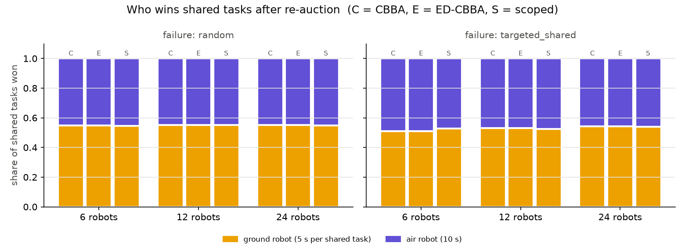

Ground robots take 5 s on a shared task and air robots 10 s, at equal speed.

| failure | robots | method | ground share | air share | unassigned | won by farther type |
| --- | ---: | --- | ---: | ---: | ---: | ---: |
| random | 6 | Standard CBBA | 0.55 | 0.45 | 0.00 | 0.31 |
| random | 6 | ED-CBBA | 0.55 | 0.45 | 0.00 | 0.31 |
| random | 6 | Scoped ED-CBBA (40 m) | 0.54 | 0.46 | 0.00 | 0.29 |
| random | 12 | Standard CBBA | 0.55 | 0.45 | 0.00 | 0.23 |
| random | 12 | ED-CBBA | 0.55 | 0.45 | 0.00 | 0.23 |
| random | 12 | Scoped ED-CBBA (40 m) | 0.55 | 0.45 | 0.00 | 0.23 |
| random | 24 | Standard CBBA | 0.55 | 0.45 | 0.00 | 0.27 |
| random | 24 | ED-CBBA | 0.55 | 0.45 | 0.00 | 0.27 |
| random | 24 | Scoped ED-CBBA (40 m) | 0.55 | 0.45 | 0.00 | 0.27 |
| targeted_shared | 6 | Standard CBBA | 0.51 | 0.49 | 0.00 | 0.33 |
| targeted_shared | 6 | ED-CBBA | 0.51 | 0.49 | 0.00 | 0.33 |
| targeted_shared | 6 | Scoped ED-CBBA (40 m) | 0.53 | 0.47 | 0.00 | 0.32 |
| targeted_shared | 12 | Standard CBBA | 0.53 | 0.47 | 0.00 | 0.28 |
| targeted_shared | 12 | ED-CBBA | 0.53 | 0.47 | 0.00 | 0.28 |
| targeted_shared | 12 | Scoped ED-CBBA (40 m) | 0.53 | 0.47 | 0.00 | 0.28 |
| targeted_shared | 24 | Standard CBBA | 0.54 | 0.46 | 0.00 | 0.28 |
| targeted_shared | 24 | ED-CBBA | 0.54 | 0.46 | 0.00 | 0.28 |
| targeted_shared | 24 | Scoped ED-CBBA (40 m) | 0.54 | 0.46 | 0.00 | 0.28 |

*won by farther type*: the winner's type has no robot closer to the task than the nearest robot of the other type.
