# Experiment 3 (shared capabilities): range_limited

Source: `results/exp3_shared/range_limited`. 90 missions, 540 re-auction runs. Values are mean ± 95% CI half-width (t-distribution) over seeds.

## Post-failure broadcasts until the allocation stops changing

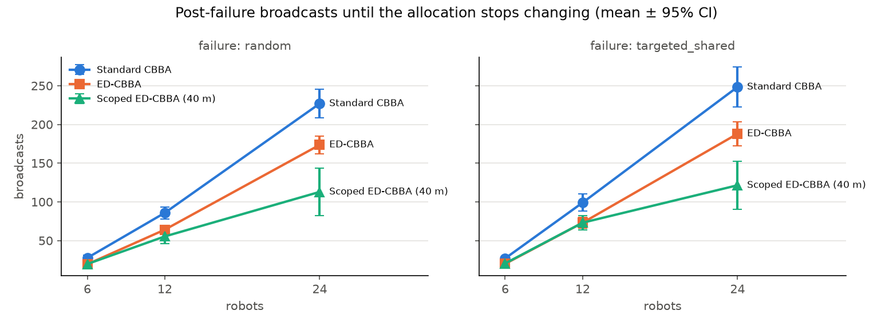

| failure | robots | Standard CBBA | ED-CBBA | Scoped ED-CBBA (40 m) |
| --- | ---: | ---: | ---: | ---: |
| random | 6 | 27.67 ± 3.49 | 19.47 ± 2.11 | 19.73 ± 2.19 |
| random | 12 | 85.80 ± 7.88 | 64.07 ± 5.08 | 55.37 ± 9.58 |
| random | 24 | 226.93 ± 18.28 | 173.60 ± 11.43 | 112.87 ± 30.89 |
| targeted_shared | 6 | 27.00 ± 2.38 | 19.97 ± 1.65 | 20.53 ± 1.79 |
| targeted_shared | 12 | 99.00 ± 10.95 | 73.03 ± 7.05 | 73.10 ± 9.03 |
| targeted_shared | 24 | 248.40 ± 25.95 | 187.93 ± 15.50 | 121.43 ± 30.79 |

## Post-failure broadcasts incl. quiet rounds of the stopping rule

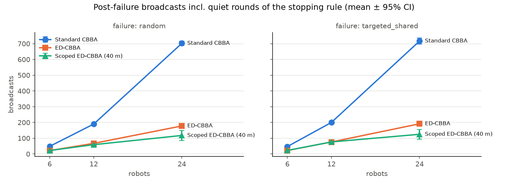

| failure | robots | Standard CBBA | ED-CBBA | Scoped ED-CBBA (40 m) |
| --- | ---: | ---: | ---: | ---: |
| random | 6 | 48.17 ± 2.66 | 21.47 ± 1.88 | 21.90 ± 1.98 |
| random | 12 | 189.93 ± 6.00 | 67.20 ± 4.97 | 58.97 ± 9.87 |
| random | 24 | 702.27 ± 13.67 | 177.77 ± 10.82 | 117.47 ± 31.49 |
| targeted_shared | 6 | 46.83 ± 1.87 | 21.83 ± 1.53 | 22.60 ± 1.80 |
| targeted_shared | 12 | 200.20 ± 9.37 | 75.87 ± 6.90 | 76.37 ± 9.10 |
| targeted_shared | 24 | 716.83 ± 19.54 | 191.50 ± 15.41 | 124.90 ± 31.12 |

## Broadcasts per affected task (incl. quiet rounds)

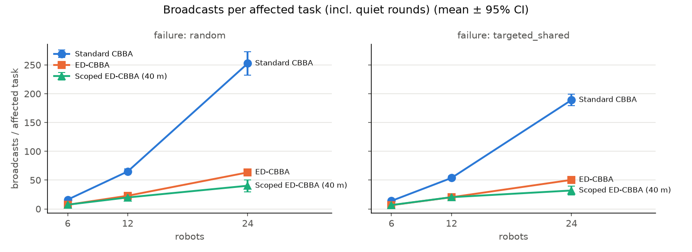

| failure | robots | Standard CBBA | ED-CBBA | Scoped ED-CBBA (40 m) |
| --- | ---: | ---: | ---: | ---: |
| random | 6 | 16.14 ± 1.74 | 7.19 ± 0.94 | 7.34 ± 0.98 |
| random | 12 | 65.02 ± 4.30 | 22.86 ± 1.91 | 19.90 ± 3.46 |
| random | 24 | 252.68 ± 20.35 | 63.39 ± 5.44 | 40.27 ± 10.39 |
| targeted_shared | 6 | 13.94 ± 0.98 | 6.49 ± 0.58 | 6.72 ± 0.66 |
| targeted_shared | 12 | 53.78 ± 3.31 | 20.28 ± 1.87 | 20.36 ± 2.42 |
| targeted_shared | 24 | 189.18 ± 10.00 | 50.44 ± 4.44 | 31.99 ± 7.58 |

## Consensus rounds until the allocation stops changing

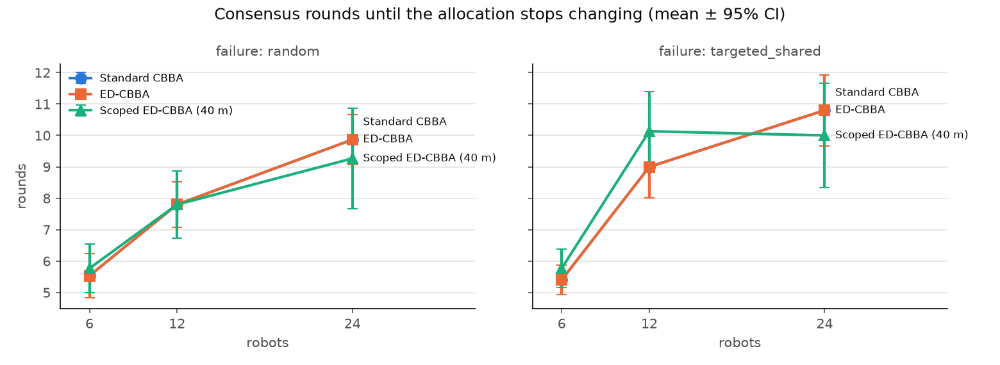

| failure | robots | Standard CBBA | ED-CBBA | Scoped ED-CBBA (40 m) |
| --- | ---: | ---: | ---: | ---: |
| random | 6 | 5.53 ± 0.70 | 5.53 ± 0.70 | 5.77 ± 0.77 |
| random | 12 | 7.80 ± 0.72 | 7.80 ± 0.72 | 7.80 ± 1.06 |
| random | 24 | 9.87 ± 0.79 | 9.87 ± 0.79 | 9.27 ± 1.60 |
| targeted_shared | 6 | 5.40 ± 0.48 | 5.40 ± 0.48 | 5.77 ± 0.61 |
| targeted_shared | 12 | 9.00 ± 1.00 | 9.00 ± 1.00 | 10.13 ± 1.27 |
| targeted_shared | 24 | 10.80 ± 1.13 | 10.80 ± 1.13 | 10.00 ± 1.66 |

## Consensus rounds incl. quiet rounds

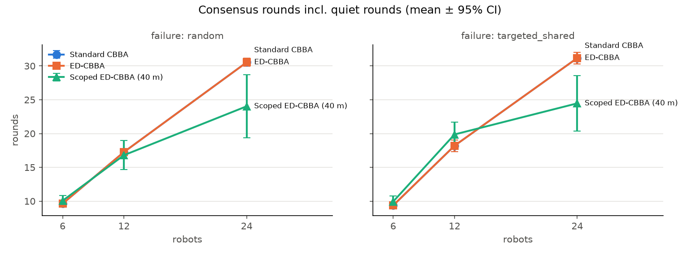

| failure | robots | Standard CBBA | ED-CBBA | Scoped ED-CBBA (40 m) |
| --- | ---: | ---: | ---: | ---: |
| random | 6 | 9.63 ± 0.53 | 9.63 ± 0.53 | 10.07 ± 0.77 |
| random | 12 | 17.27 ± 0.55 | 17.27 ± 0.55 | 16.80 ± 2.15 |
| random | 24 | 30.53 ± 0.59 | 30.53 ± 0.59 | 24.03 ± 4.66 |
| targeted_shared | 6 | 9.37 ± 0.37 | 9.37 ± 0.37 | 9.93 ± 0.81 |
| targeted_shared | 12 | 18.20 ± 0.85 | 18.20 ± 0.85 | 19.87 ± 1.82 |
| targeted_shared | 24 | 31.17 ± 0.85 | 31.17 ± 0.85 | 24.47 ± 4.09 |

## Re-auction runtime (CPU)

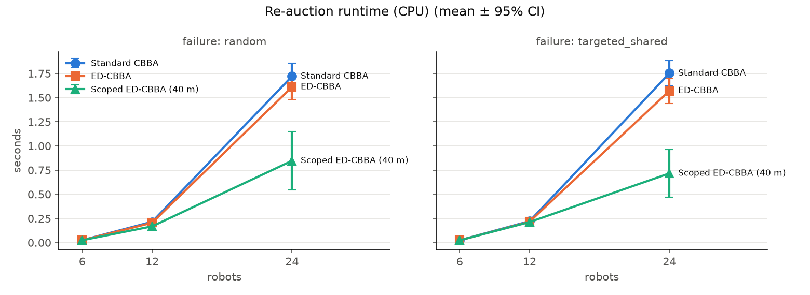

| failure | robots | Standard CBBA | ED-CBBA | Scoped ED-CBBA (40 m) |
| --- | ---: | ---: | ---: | ---: |
| random | 6 | 0.0250 ± 0.0030 | 0.0242 ± 0.0029 | 0.0247 ± 0.0030 |
| random | 12 | 0.2156 ± 0.0184 | 0.2051 ± 0.0191 | 0.1681 ± 0.0362 |
| random | 24 | 1.7203 ± 0.1363 | 1.6095 ± 0.1292 | 0.8467 ± 0.3010 |
| targeted_shared | 6 | 0.0241 ± 0.0026 | 0.0237 ± 0.0027 | 0.0241 ± 0.0030 |
| targeted_shared | 12 | 0.2220 ± 0.0221 | 0.2166 ± 0.0206 | 0.2124 ± 0.0310 |
| targeted_shared | 24 | 1.7523 ± 0.1315 | 1.5700 ± 0.1317 | 0.7165 ± 0.2441 |

## Assigned-task rate

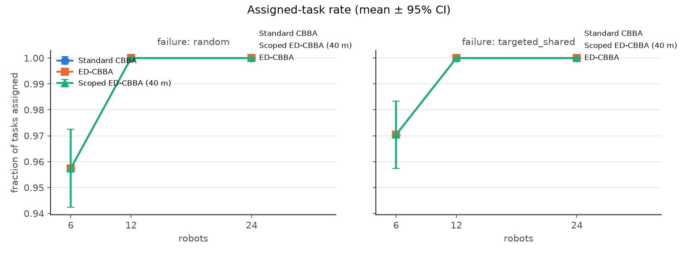

| failure | robots | Standard CBBA | ED-CBBA | Scoped ED-CBBA (40 m) |
| --- | ---: | ---: | ---: | ---: |
| random | 6 | 0.9574 ± 0.0151 | 0.9574 ± 0.0151 | 0.9574 ± 0.0151 |
| random | 12 | 1.0000 ± 0.0000 | 1.0000 ± 0.0000 | 1.0000 ± 0.0000 |
| random | 24 | 1.0000 ± 0.0000 | 1.0000 ± 0.0000 | 1.0000 ± 0.0000 |
| targeted_shared | 6 | 0.9704 ± 0.0130 | 0.9704 ± 0.0130 | 0.9704 ± 0.0130 |
| targeted_shared | 12 | 1.0000 ± 0.0000 | 1.0000 ± 0.0000 | 1.0000 ± 0.0000 |
| targeted_shared | 24 | 1.0000 ± 0.0000 | 1.0000 ± 0.0000 | 1.0000 ± 0.0000 |

## Assignment score

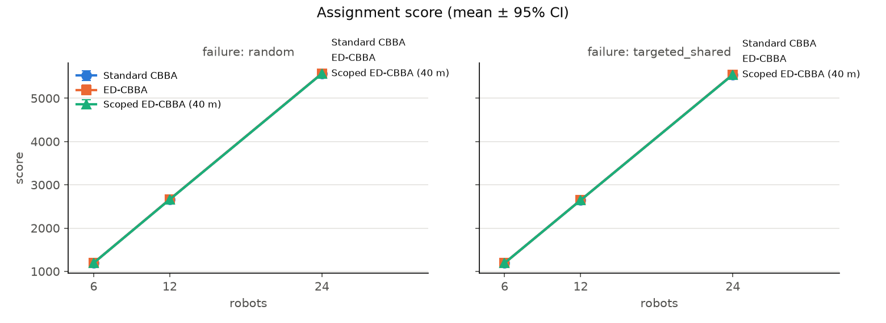

| failure | robots | Standard CBBA | ED-CBBA | Scoped ED-CBBA (40 m) |
| --- | ---: | ---: | ---: | ---: |
| random | 6 | 1194.99 ± 13.10 | 1194.99 ± 13.10 | 1194.99 ± 13.10 |
| random | 12 | 2664.46 ± 14.59 | 2664.46 ± 14.59 | 2661.62 ± 14.93 |
| random | 24 | 5571.78 ± 23.35 | 5571.78 ± 23.35 | 5569.44 ± 23.26 |
| targeted_shared | 6 | 1192.08 ± 15.27 | 1192.08 ± 15.27 | 1192.08 ± 15.27 |
| targeted_shared | 12 | 2646.68 ± 16.21 | 2646.68 ± 16.21 | 2646.28 ± 16.06 |
| targeted_shared | 24 | 5548.38 ± 25.58 | 5548.38 ± 25.58 | 5545.06 ± 25.21 |

## Mission completion time (last task finishes)

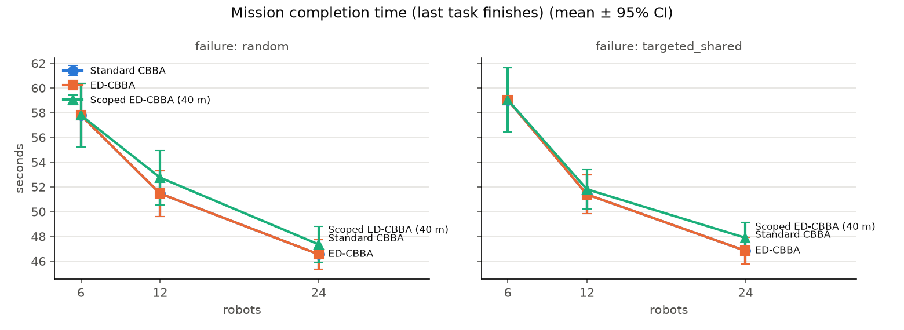

| failure | robots | Standard CBBA | ED-CBBA | Scoped ED-CBBA (40 m) |
| --- | ---: | ---: | ---: | ---: |
| random | 6 | 57.79 ± 2.57 | 57.79 ± 2.57 | 57.79 ± 2.57 |
| random | 12 | 51.46 ± 1.85 | 51.46 ± 1.85 | 52.75 ± 2.20 |
| random | 24 | 46.55 ± 1.20 | 46.55 ± 1.20 | 47.35 ± 1.46 |
| targeted_shared | 6 | 59.03 ± 2.61 | 59.03 ± 2.61 | 59.03 ± 2.61 |
| targeted_shared | 12 | 51.39 ± 1.57 | 51.39 ± 1.57 | 51.81 ± 1.59 |
| targeted_shared | 24 | 46.83 ± 1.08 | 46.83 ± 1.08 | 47.88 ± 1.23 |

## Total robot time spent on shared tasks

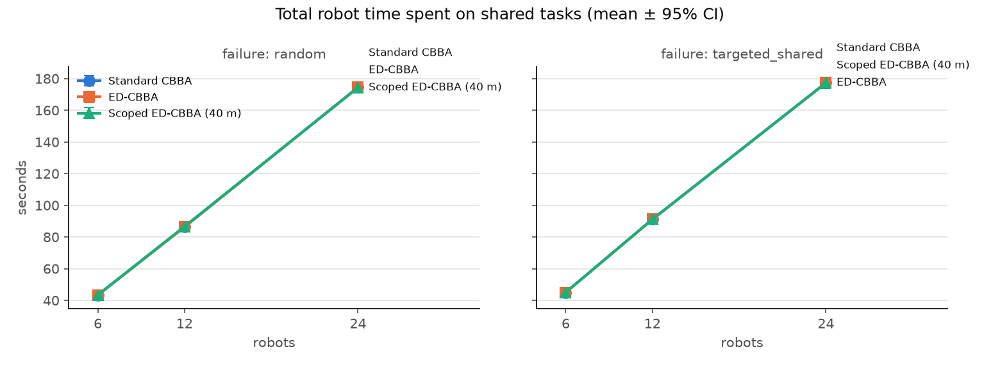

| failure | robots | Standard CBBA | ED-CBBA | Scoped ED-CBBA (40 m) |
| --- | ---: | ---: | ---: | ---: |
| random | 6 | 43.33 ± 1.72 | 43.33 ± 1.72 | 43.33 ± 1.72 |
| random | 12 | 86.33 ± 2.54 | 86.33 ± 2.54 | 86.67 ± 2.66 |
| random | 24 | 174.50 ± 3.15 | 174.50 ± 3.15 | 174.33 ± 3.20 |
| targeted_shared | 6 | 45.00 ± 1.96 | 45.00 ± 1.96 | 45.00 ± 1.96 |
| targeted_shared | 12 | 91.17 ± 2.12 | 91.17 ± 2.12 | 91.17 ± 2.12 |
| targeted_shared | 24 | 177.33 ± 3.24 | 177.33 ± 3.24 | 177.33 ± 3.32 |

## Surviving robots' tasks that changed owner

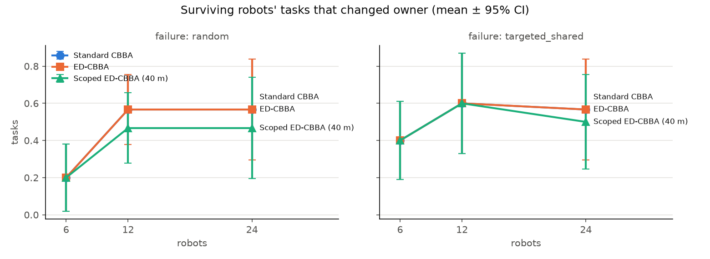

| failure | robots | Standard CBBA | ED-CBBA | Scoped ED-CBBA (40 m) |
| --- | ---: | ---: | ---: | ---: |
| random | 6 | 0.20 ± 0.18 | 0.20 ± 0.18 | 0.20 ± 0.18 |
| random | 12 | 0.57 ± 0.19 | 0.57 ± 0.19 | 0.47 ± 0.19 |
| random | 24 | 0.57 ± 0.27 | 0.57 ± 0.27 | 0.47 ± 0.27 |
| targeted_shared | 6 | 0.40 ± 0.21 | 0.40 ± 0.21 | 0.40 ± 0.21 |
| targeted_shared | 12 | 0.60 ± 0.27 | 0.60 ± 0.27 | 0.60 ± 0.27 |
| targeted_shared | 24 | 0.57 ± 0.27 | 0.57 ± 0.27 | 0.50 ± 0.25 |

## Paired differences vs standard CBBA

Per mission: method minus standard CBBA on the same mission and failed robot.

| failure | robots | method | Δ broadcasts | broadcast reduction | Δ score | Δ assigned tasks |
| --- | ---: | --- | ---: | ---: | ---: | ---: |
| random | 6 | ED-CBBA | -26.7 ± 1.1 | 55.9 ± 1.9% | 0.00 ± 0.00 | 0.00 ± 0.00 |
| random | 6 | Scoped ED-CBBA (40 m) | -26.3 ± 1.1 | 55.0 ± 2.1% | 0.00 ± 0.00 | 0.00 ± 0.00 |
| random | 12 | ED-CBBA | -122.7 ± 2.2 | 64.9 ± 1.7% | 0.00 ± 0.00 | 0.00 ± 0.00 |
| random | 12 | Scoped ED-CBBA (40 m) | -131.0 ± 9.4 | 69.2 ± 4.9% | -2.84 ± 2.50 | 0.00 ± 0.00 |
| random | 24 | ED-CBBA | -524.5 ± 8.2 | 74.8 ± 1.2% | 0.00 ± 0.00 | 0.00 ± 0.00 |
| random | 24 | Scoped ED-CBBA (40 m) | -584.8 ± 28.4 | 83.5 ± 4.3% | -2.34 ± 1.81 | 0.00 ± 0.00 |
| targeted_shared | 6 | ED-CBBA | -25.0 ± 0.9 | 53.6 ± 1.8% | 0.00 ± 0.00 | 0.00 ± 0.00 |
| targeted_shared | 6 | Scoped ED-CBBA (40 m) | -24.2 ± 1.2 | 52.1 ± 2.7% | 0.00 ± 0.00 | 0.00 ± 0.00 |
| targeted_shared | 12 | ED-CBBA | -124.3 ± 4.5 | 62.5 ± 2.1% | 0.00 ± 0.00 | 0.00 ± 0.00 |
| targeted_shared | 12 | Scoped ED-CBBA (40 m) | -123.8 ± 6.1 | 62.4 ± 3.6% | -0.40 ± 0.57 | 0.00 ± 0.00 |
| targeted_shared | 24 | ED-CBBA | -525.3 ± 8.1 | 73.5 ± 1.5% | 0.00 ± 0.00 | 0.00 ± 0.00 |
| targeted_shared | 24 | Scoped ED-CBBA (40 m) | -591.9 ± 30.5 | 82.8 ± 4.1% | -3.32 ± 1.94 | 0.00 ± 0.00 |

## Local recovery rate (scoped ED-CBBA)

| failure | robots | local / runs | rate [95% Wilson] | too many affected tasks | no nearby capable robot | local group disconnected | local capacity or schedule infeasible | nothing affected |
| --- | ---: | ---: | --- | ---: | ---: | ---: | ---: | ---: |
| random | 6 | 0/30 | 0.00 [0.00, 0.11] | 0 | 27 | 0 | 3 | 0 |
| random | 12 | 7/30 | 0.23 [0.12, 0.41] | 0 | 11 | 5 | 7 | 0 |
| random | 24 | 16/30 | 0.53 [0.36, 0.70] | 0 | 3 | 5 | 6 | 0 |
| targeted_shared | 6 | 1/30 | 0.03 [0.01, 0.17] | 0 | 26 | 0 | 3 | 0 |
| targeted_shared | 12 | 4/30 | 0.13 [0.05, 0.30] | 0 | 14 | 3 | 9 | 0 |
| targeted_shared | 24 | 17/30 | 0.57 [0.39, 0.73] | 0 | 4 | 4 | 5 | 0 |

## Consistency

| failure | robots | method | consensus reached [95% Wilson] | runs with duplicate claims |
| --- | ---: | --- | --- | ---: |
| random | 6 | Standard CBBA | 1.00 [0.89, 1.00] | 0 |
| random | 6 | ED-CBBA | 1.00 [0.89, 1.00] | 0 |
| random | 6 | Scoped ED-CBBA (40 m) | 1.00 [0.89, 1.00] | 0 |
| random | 12 | Standard CBBA | 1.00 [0.89, 1.00] | 0 |
| random | 12 | ED-CBBA | 1.00 [0.89, 1.00] | 0 |
| random | 12 | Scoped ED-CBBA (40 m) | 1.00 [0.89, 1.00] | 0 |
| random | 24 | Standard CBBA | 1.00 [0.89, 1.00] | 0 |
| random | 24 | ED-CBBA | 1.00 [0.89, 1.00] | 0 |
| random | 24 | Scoped ED-CBBA (40 m) | 1.00 [0.89, 1.00] | 0 |
| targeted_shared | 6 | Standard CBBA | 1.00 [0.89, 1.00] | 0 |
| targeted_shared | 6 | ED-CBBA | 1.00 [0.89, 1.00] | 0 |
| targeted_shared | 6 | Scoped ED-CBBA (40 m) | 1.00 [0.89, 1.00] | 0 |
| targeted_shared | 12 | Standard CBBA | 1.00 [0.89, 1.00] | 0 |
| targeted_shared | 12 | ED-CBBA | 1.00 [0.89, 1.00] | 0 |
| targeted_shared | 12 | Scoped ED-CBBA (40 m) | 1.00 [0.89, 1.00] | 0 |
| targeted_shared | 24 | Standard CBBA | 1.00 [0.89, 1.00] | 0 |
| targeted_shared | 24 | ED-CBBA | 1.00 [0.89, 1.00] | 0 |
| targeted_shared | 24 | Scoped ED-CBBA (40 m) | 1.00 [0.89, 1.00] | 0 |

## Shared-task winners

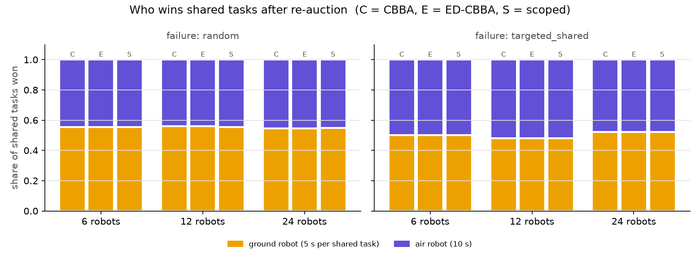

Ground robots take 5 s on a shared task and air robots 10 s, at equal speed.

| failure | robots | method | ground share | air share | unassigned | won by farther type |
| --- | ---: | --- | ---: | ---: | ---: | ---: |
| random | 6 | Standard CBBA | 0.56 | 0.44 | 0.00 | 0.23 |
| random | 6 | ED-CBBA | 0.56 | 0.44 | 0.00 | 0.23 |
| random | 6 | Scoped ED-CBBA (40 m) | 0.56 | 0.44 | 0.00 | 0.23 |
| random | 12 | Standard CBBA | 0.56 | 0.44 | 0.00 | 0.24 |
| random | 12 | ED-CBBA | 0.56 | 0.44 | 0.00 | 0.24 |
| random | 12 | Scoped ED-CBBA (40 m) | 0.56 | 0.44 | 0.00 | 0.24 |
| random | 24 | Standard CBBA | 0.55 | 0.45 | 0.00 | 0.23 |
| random | 24 | ED-CBBA | 0.55 | 0.45 | 0.00 | 0.23 |
| random | 24 | Scoped ED-CBBA (40 m) | 0.55 | 0.45 | 0.00 | 0.24 |
| targeted_shared | 6 | Standard CBBA | 0.50 | 0.50 | 0.00 | 0.24 |
| targeted_shared | 6 | ED-CBBA | 0.50 | 0.50 | 0.00 | 0.24 |
| targeted_shared | 6 | Scoped ED-CBBA (40 m) | 0.50 | 0.50 | 0.00 | 0.24 |
| targeted_shared | 12 | Standard CBBA | 0.48 | 0.52 | 0.00 | 0.22 |
| targeted_shared | 12 | ED-CBBA | 0.48 | 0.52 | 0.00 | 0.22 |
| targeted_shared | 12 | Scoped ED-CBBA (40 m) | 0.48 | 0.52 | 0.00 | 0.22 |
| targeted_shared | 24 | Standard CBBA | 0.52 | 0.48 | 0.00 | 0.25 |
| targeted_shared | 24 | ED-CBBA | 0.52 | 0.48 | 0.00 | 0.25 |
| targeted_shared | 24 | Scoped ED-CBBA (40 m) | 0.52 | 0.48 | 0.00 | 0.25 |

*won by farther type*: the winner's type has no robot closer to the task than the nearest robot of the other type.
